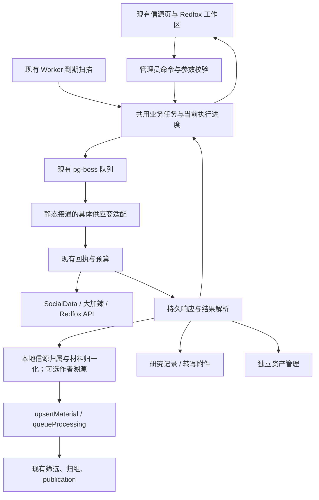

# Redfox 完整适配实施方案

> 状态：本地开发与分阶段验收完成（2026-10-21），169 项接口均已接通固定执行入口；真实供应商验证与当前兼容限制见下表。下方“既有落地与验收状态”汇总当时交付，优先于第 9 节按时间保留的阶段记录；旧记录中的“待实施/待验收”只描述当时状态。2026-10-26 新归属目标另见文首决策更新，尚未实现。代码调查基线：`main@9b877ab65336ec6316f3704c5b8ff90dadac8418`，任务分支 `codex/redfox-integration`，所有改动尚未提交。真实只读代表性联调累计授权不超过 20 元且不超过 100 次；实际仍为 3 次，估价上界 0.18 元、实扣未核对。生成、上传、生产操作及提交/推送/发布未获授权。
>
> 范围依据：[Redfox API 完整清单](redfox-api-inventory.md)（169 个接口）。项目约束：[开发原则](development-principles.md)、[工程手册](engineering-playbook.md)、[信源说明](sources.md)。本方案已获开发授权；不以此文档代替实施或验收。

> 2026-10-26 决策更新：信源归属目标以[第三阶段前统一信源归属修订](agentkey-integration-plan.md#pre-phase3-source-ownership)为准，**尚未实现**。全平台的账号、关键词和多作者订阅均继承创建时所属的本地信源，无需第二次选择或另配目标信源，远端作者 ID 只作可选溯源；缺少它不再作为入库、分析或公开门槛，也不强制隔离。参与方式、tier 与全文权限仍由管理员配置，主动配置的 `isolated` / `hot_signal` 保持其语义。下方既有验收、截图和第 9 节阶段记录保留当时事实，不能作为新规则已落地的证据；与新目标冲突的旧作者门槛不再是后续规范。
>
> 2026-10-27 复审：本轮仅同步方案，不启动 AgentKey 第三阶段、不改变 5 条暂缓路线，也不新增真实付费调用。作品身份、原文、视频事实、回执证据及供应商 API 本身要求的输入 ID 仍须满足；Redfox 与 AgentKey 各自完成采集和必要详情/原文补全，不互补作者或原文。Redfox 入口与归属优化无需 AgentKey 凭据或视频号路线，也不等待其接入；AgentKey 的作者字段优势不构成修补 Redfox 的理由。共享视频保存缺媒体地址时仍固定 Redfox 解析，该可选步骤不反向阻断已合格内容入库。

## 既有落地与验收状态（2026-10-21）

| 范围 | 当前事实与证据边界 |
| --- | --- |
| 169 项能力 | 与已存官方快照逐 ID 比较，方法和路径一致；125 个同步操作、44 个专用操作均有执行消费者和对应后台入口。48 个作品采集操作及 4 个热点研究快照进入正式采集路径，共 52 个；参数模式仍受具体契约约束。接口可达、本地通过、真实供应商通过分别记录。 |
| 最小持久化与状态归属 | 仍为约定的五张业务表，没有补建步骤、账单、附件或供应商专属订阅表。原生 X/公众号与 Redfox 共用任务、回执、恢复和结果；权限归 source，进度/占用归 subscription，业务步骤归 run，外部事实归 receipt，文件可用性归 stored_files。 |
| 主采集迁移收尾 | 旧 X/公众号 writer 和旧 job consumer 已退出；保留供应商 client、批量、缓存和独立监控的原有用途。CLI 显式迁移、通用 collect CLI、新源/seed、后台入口均调用共用领域能力。非法历史配置保持原 JSON 快照并进入不可自动恢复的 migration.review；不通过初始化隐式迁移存量数据。生产迁移尚未执行。 |
| 补全与材料 | 9 平台文档有明确定位的作品详情、X 搜索详情、6 平台账号详情均有显式本地选项与普通一次性查询；原始记录不被上下文覆盖。采集内 14 个明确作品详情目标沿原 run 执行，保留源页/项位置、库、次数和必要页码，不自动附加账号解析、转写或媒体处理。 |
| 结果、文件和费用 | 转写/字幕与媒体可人工保存附件、填补已有材料空正文或关联私有资产；图片/视频产物独立管理。已结束且无关联/依赖的结果默认 30 天原位标为 result_expired；导入与到期并发复核。结果页 JSON 下载仅导出当前 100 条分页 DTO；费用只比较可证明同口径事实，已存单页账单保留精确积分与重复行，不虚构实扣差额。 |
| UI 实际路径 | [651 张有效原始截图及逐处批注](reviews/redfox-ui-2026-10-20/README.md)覆盖各组入口、结果、人工使用、恢复和相关窄屏状态。run212–216 的 4 次查询和 2 次采集均为 localhost，原材料正文/权限保持，预算等待后同一轮详情恢复，没有重买列表；run218的一次localhost查询验证本页多选、首失败停止、同键手工重试和SPA切页清空。Redfox临时订阅停用、九类测试预算归零。 |
| 整合验证 | 此前全量后端660/660、前端305/305、全工作区类型检查、Web构建、独立空库站点smoke及最终Docker构建/启动/smoke通过。容器库18个种子/73迁移/0回执/0attempt，临时容器与新建卷已清理。本轮按变更做定向回归、类型检查和 Web 构建，未重复全量或 Docker 验证。此前权限/测试夹具/挂起、653/658及类型收窄失败日志保留；修复后通过，不改写为首次全绿。 |
| 当前兼容限制 | 旧SocialData关键词/多作者搜索默认跳过转发，而Redfox搜索/详情文档没有可确认是否为转发的字段。执行用户已批准的规则：保留原过滤要求，禁止不兼容切换。是否允许管理员明确取消该要求是可选行为调整，未获回答即不改变，不能成为本次另加的交付审批门槛。新建Redfox关键词采集已验收，不能冒充旧源的等价转换；本次不建立无合法映射的转换执行分支或绕过开关。 |

本轮使用的隔离库 `aihot_redfox_p5final_20261021_ci` 与 `aihot_redfox_ui_20261020_test` 均为 74 项已应用迁移，至 `0077`；没有修改已应用 SQL，没有生产建表或数据迁移。监督执行使用实际可调用的 Sol High 和高风险/升级包 Astra Medium；主代理运行模型/努力级别没有可用元数据，保持未核实标记。各包失败与升级记录继续保留。

最终收尾补齐了两项实际用户路径：本页多选只复用已有完整性校验与逐条本地导入命令，默认真实作者归属，首失败停止，不建设批量任务；五类尚需逐条核实的研究平台作品及视频号/快手保持原入口。非法历史JSON null的信源页、双向预检、只改元数据和显式修正配置均通过真实UI/DB验证；订阅为配置权威，不能把null回落旧source或重新序列化成SQL NULL。没有因此新增业务表、状态、能力服务或质量审批程序。

此前本地收尾已完成：专用浏览器空间及任务UI服务/操作Worker/供应商桩已结束，Docker临时容器与卷已移除；保留隔离测试数据库和验收证据，Redfox临时订阅停用、九类预算为0、无活动任务。工作树仍是本任务未提交改动，HEAD保持上述基线；没有提交、推送、生产迁移或部署。


2026-10-21 复审后的四项收尾：X 噪声过滤补写现有 filtered 结果后消费回执；X/公众号材料处理不再读取历史 source 配置中的页面提取选项，实际迁移→修复→采集→入队回归通过；三个通用热点补入原订阅和执行链；独立采集编辑器移到“信源→采集任务”，Redfox 仅跳转，旧链接保留选中订阅。没有新增业务表、状态、调度器或通用日期引擎；0077 只补三项 collect 费用估算。独立 Astra Medium 源码复审未发现新的实质问题。

本轮定向证据：运行缺陷与提取回归 33 项、热点及相关后端回归 32 项分别通过；前端相关组合 44 项通过（包括入口回归，不与此前 24 项重复相加），backend/tests/web/API/Worker 类型检查和 Web 构建通过。UI 隔离库五个合成任务 #219–223 完成，3 个 collect、2 个 query，各一次本机桩请求；历史日期保留、当天预览、零预算等待后同轮恢复、409/刷新保稿、旧链接定位及 390px 布局均已实际检查，材料/来源/绑定计数保持 53/35/34。执行代理首个演示因 1900 年夹具日期解析失败，改为现代日期后通过，未为此修改产品调度语义。两处缺陷原失败及修复通过日志均保留。全部验证属于本地桩，真实调用仍为此前 3 次。本轮另提供 16 张有效 UI 截图（03–18）及逐图批注，覆盖迁移后的入口、三个热点表单/结果、冲突保稿、旧链接、动态草稿和窄屏；原 651 张证据继续保留。

2026-10-21 再复审发现并补齐共用恢复器的 unknown 收尾遗漏：锁内先按最新订阅/信源资格收尾全部失效的旧 run，再将合法的非只读 unknown 归为 needs_review；两者均清除下一尝试时间、保留回执，不受外发开关阻挡。仍有有效成员的批量 run 沿原只读恢复规则处理，原事务结束后才取得共享回执全成员锁，不引入新表、状态或抽象。定向回归 56/56 通过，涵盖真实子进程在本机桩收到请求后 SIGKILL、pg-boss 重投遇 pending、过期转 unknown、隔离库内实际切换命令、部分批量成员有效、共享回执最多一次放行、已收响应本地恢复及重复扫描幂等；backend/Worker 类型检查通过。新测试曾遗漏批量所需水位，修正后两条目标路径均先复现原缺陷；测试类型检查随后因查询函数推断未声明动态行字段失败，执行代理按累计两处错误停交主代理，主代理增加运行时字段存在断言后，tests 类型检查及两条目标测试复验通过（这 2 条已包含在 56 条中，不重复累计）。失败和通过日志均保留于 `/private/tmp/aihot-redfox-recovery-closeout-*.log`。主代理最终复审未发现本补丁引入的新实质问题；本包合成来源停用、任务与队列收尾，临时进程和本机桩已关闭。未调整 UI，无新增截图；此前截图证据仍保留。真实调用仍为 3 次，未做生产操作、提交或部署。

2026-10-21 最终整体复审又发现两处既有适配遗漏，均不是上轮恢复器补丁引入。第一，附件记录在等待业务锁期间开始删除时，`useOperationResult` 原先只验证文件仍存在而未复检 `stored_files.status`；现沿用既有 result → file 行锁和 `AssetError(409)`，在锁内重读 `available` 状态，删除进行中或已完成都不能再关联文章或填入正文。第二，X/公众号 CLI 转交共用采集命令时漏传 `force`，使显式人工采集失去原有暂停源语义；现只在该 CLI 手工路径传 `force:true`，普通定时采集、无主订阅和 active run 占用仍按原规则拒绝，未增加绕过开关。两项均先取得失败证据再修复：新增附件直接删除中及初检后等锁期间进入删除的竞态测试，CLI 同时覆盖停用 MP/X 强采、scheduled 拒绝和 active run 拒绝。独立定向测试 27/27 通过（附件、CLI 与恢复器），backend/tests/API/Worker 类型检查通过；文档同步澄清“没有主订阅拒绝、停用源普通定时拒绝、CLI 显式手工采集保留强制意图”。本轮没有新增表、状态、调度器、抽象或 UI 行为，没有读取真实密钥或发起供应商请求，也没有提交、推送、生产迁移或部署；因此无新增截图或批注。

## 1. 要交付什么

通过 Redfox HTTP API 接入其现有公开能力，沿用 AIHOT 的后台、Worker、PostgreSQL、回执和材料处理链。管理员可以配置跨平台采集、查询账号/评论/关系/热点、提取字幕与转写、运行 AI 搜索、处理媒体及生成图片/视频，并查看执行结果、恢复失败任务和管理独立产物。

用户已经确认：

- 使用 HTTP API。采集能力接入定时任务；其他能力提供后台工具，按用途选择是否入库。
- 图片和视频生成也纳入本次范围；产物单独管理，由人工使用，不自动成为新闻。
- 成本控制沿用并细分请求次数预算，增加费用估算和 Redfox 调用账单核对（2026-10-20 确认）。本次不增加本地金额硬预算或金额预占/结算机制。
- 同步只读采集、查询及查进度的未知请求等待 30 分钟后，最多自动重试一次，可能重复计费且仍计入预算；异步任务提交、生成和上传不自动重发（2026-10-20 必要性复审确认）。
- 保留 SocialData / 大加辣，支持管理员按信源显式切换到 Redfox；保留原 source ID、权限与历史，切换后停止原供应商的后续采集，不自动切换或失败兜底（2026-10-20 确认）。
- 已有关键词／多作者 X 搜索采用转换流程，切换前展示影响；原信源及历史保留。2026-10-20 确认并实施的逐作者归属/新作者隔离属于历史行为；2026-10-26 新目标改为继承订阅所属本地信源，见上述统一修订及 4.2。复杂表达式兼容性仍须逐项检查。
- 切换规则对 Redfox、SocialData、大加辣等实际接入的供应商一致：目标不支持当前任务所需能力时禁止切换；能力未确认也不能当作支持。后台明确原因，后端强制校验，失败不停止原采集或改动原配置。
- 采用轻量预检：从当前任务提取需求，与适配代码中已确认的少量能力规则比较。未使用能力不参与阻断；预检不付费，不运行模型判断，不建设能力管理平台（2026-10-20 确认）。
- SocialData X、大加辣公众号主采集纳入本次共用订阅、任务、结果和恢复，迁移后退出旧采集生命周期；保留原供应商、批量、缓存、频率、历史和权限（2026-10-20 确认）；用户随后已另行批准完整方案和分阶段监督式开发。
- 持久化模型采用五张表：三张供应商无关的订阅/任务/结果表，以及 source_account_bindings、article_identity_aliases 两张轻量身份映射表；撤回 platform_account_key / platform_work_key 备用身份列方案（2026-10-20 确认）。sources/articles 及其历史、权限继续复用，不增加第六张业务表。
- 完整方案先审阅，再授权开发。按照监督式开发组织后续执行，对实质不确定的选择逐项确认。

上述产品方向和完整方案已获用户确认，按第 9 节分阶段实施和验收。阅读重点：第 3 节是全部能力范围，第 4.2 节是信源切换和轻量预检，第 5–7 节是执行、恢复与后台体验，第 9–11 节是施工、验收与回退，第 12 节汇总本轮逐章必要性评审。

2026-10-20 用户已确认三家主采集统一及 4.1.2 的其他依赖边界：复用已匹配的调用、预算和观测能力，RSS/网页、独立监控、模型等保留自身业务流程。本文已按这一边界整合并整体复审，用户随后已授权开始监督式开发。

其余常规实现细节由主代理负责。默认不迁移历史文章归属，不改变行业评分标准，不公开评论/关系资料，不增加面向读者的付费查询入口，不新增通用插件系统。169 个接口按本次文档快照交付；开发期间供应商新增能力需更新范围，不能运行时自动开放。

## 2. 调查结论：哪些可复用，哪些必须补齐

| 现有边界与证据 | 当前行为 | 本次适配 |
| --- | --- | --- |
| [sources/collect.ts](../packages/backend/src/sources/collect.ts)、[x.ts](../packages/backend/src/sources/x.ts)、[mp.ts](../packages/backend/src/sources/mp.ts) | 普通信源、X 搜索/分片、公众号各有调度；X 固定 SocialData，公众号固定大加辣 | 三家供应商的 X/公众号主采集共用订阅和业务任务；保留 SocialData 分片、积压分页及大加辣正文补取策略。旧 X/公众号调度和状态写入迁移后退出，不长期保留第二套生命周期。 |
| [0001_core.sql](../database/migrations/0001_core.sql)、[admin/sources.ts](../packages/backend/src/admin/sources.ts) | source 同时承载采集配置、权限、主体与信号分组；没有跨供应商账号绑定 | 将 Redfox 的“搜索/榜单采集任务”与本地信源区分；新目标按订阅所属 source 归属，平台稳定账号 ID 仅在有证据时作为可选溯源绑定，不把供应商当本地信源。 |
| [0001_core.sql](../database/migrations/0001_core.sql)、[0004_admin_ops.sql](../database/migrations/0004_admin_ops.sql)、[jobs/queue.ts](../packages/backend/src/jobs/queue.ts) | 原生周期/游标由 sources 持有；fetch_runs 是单信源抓取日志，job_runs 是一次调度函数日志，均不是长业务任务或待处理结果 | 新增的采集订阅、外部操作任务和结果属于业务模块，以 provider 及操作键选择实际适配；不建立每家供应商各自的同构业务表，也不把旧日志改造成全站任务平台。 |
| [sources/config-keys.ts](../packages/backend/src/sources/config-keys.ts) | 创建、编辑和预览严格拒绝未知配置项 | 迁移源的有效采集配置由订阅读写，source DTO/旧字段编辑转交同一命令；继续严格校验，不能通过 raw config 绕过供应商切换或另存有效参数。 |
| [admin/sources.ts](../packages/backend/src/admin/sources.ts)、[seed.ts](../scripts/seed.ts)、[ingest/items.ts](../packages/backend/src/ingest/items.ts) | 后台和 seed 可直接创建 sources；外部上报也会创建隔离 external 源 | 后台/seed 新建 X/公众号调用同一领域创建函数，事务内建立主订阅；seed 不覆盖已有管理配置。外部上报不因此自动激活供应商采集 |
| [content/materials.ts](../packages/backend/src/content/materials.ts)、[lib/url.ts](../packages/backend/src/lib/url.ts) | 去重冲突键只有 identity_key；同 URL 改用平台 ID 仍可能新建文章；同身份不同 source 只记 discovery | 在材料模块补旧记录解析及已确认别名关系，承接微博等多类型作品 ID；既有 X 身份直接复用，不把全部 URL 变成别名行。 |
| [providers/receipts.ts](../packages/backend/src/providers/receipts.ts) | 请求前占位、按 service 原子检查次数预算；先存原始响应，再完成业务写入；相同身份复用 received/completed | Redfox 全部调用接回执；每个提交、分页、轮询有稳定且不同的请求身份。保留现有供应商行为。 |
| [admin/runs.ts](../packages/backend/src/admin/runs.ts)、[schedules.ts](../apps/worker/src/schedules.ts) | unknown 回执有一次自动释放；通用释放只重建部分文章分析工作流 | Redfox 异步提交不能直接沿用自动释放重发；需回到具体 run 恢复，并明确“结果未知”与“安全重试”的区别。 |
| [admin/settings.ts](../packages/backend/src/admin/settings.ts)、[0022 migration](../database/migrations/0022_receipt_attempts_budgets.sql) | 预算按 service 计次数；缺行意味着无限；0 表示停止 | 初始化 Redfox 各用途预算为 0；Redfox 调用遇缺预算行拒绝执行。按已确认方案补费用估算和账单核对。 |
| [admin API](../apps/api/src/routes/admin.ts)、[后台布局](../apps/web/app/routes/admin/layout.tsx) | 已有 session、CSRF、审计、异步任务页面；信源预览部分为同步调用 | 新增一个 Redfox 工作区，复用后台交互；付费预览也通过 POST 建任务，返回 202；页面 GET 只读持久结果。 |
| [app.ts](../apps/api/src/app.ts)、[feedback.ts](../apps/api/src/routes/feedback.ts)、[Web server](../apps/web/server.ts) | API 全局 bodyLimit 10 MB；现有 multipart 整块缓冲，反馈路由 12 MB；Web 代理已有流式转发 | Redfox 上传用局部流式解析和提前鉴权，独立设置上限；不抬高全局限制或改动反馈上传语义。 |
| [stored_files](../database/migrations/0004_admin_ops.sql)、[backup.ts](../packages/backend/src/operations/backup.ts)、[static.ts](../apps/api/src/routes/static.ts) | 文件表只有基础元数据，未形成资产管理；备份包含 uploads；静态文件服务不提供完整私有大文件播放能力 | 补最小资产元数据、私有文件读写/Range 与清理恢复；不把新闻图片缓存或二维码上传当资产库。 |
| [publication/publish.ts](../packages/backend/src/publication/publish.ts)、[events/group.ts](../packages/backend/src/events/group.ts) | 公开资格依赖原 source；热度参与者按 signal group 或 source 区分 | 不改变发布权威。所有新材料仍遵循所属信源的参与方式、筛选、归组与 publication；供应商热度只是外部指标。 |

这是一项 B 类变更，涉及密钥、付费、迁移、并发和权限。先冻结边界和验收，再按依赖顺序开发。

## 3. Redfox 能力范围与落点

公开目录已取得 169 个唯一接口及其详情：21 个一级栏目，另有 5 个工具子栏目；162 POST、7 GET。包括抖音、小红书、公众号、视频号、快手、B 站、头条、TikTok、X、YouTube、Instagram、汽车之家、懂车帝、易车、微博、百家号、知乎及多平台热点，还包括媒体、创作、AI 搜索和账户工具。逐接口 ID、路径、输入字段、用途及文档问题见[清单](redfox-api-inventory.md)。

| 能力 | 接口数 | 用户入口与结果 |
| --- | ---: | --- |
| 账号查询/搜索/推荐 | 28 | 查询账号并人工绑定信源；不把账号统计当文章 |
| 作品列表/搜索/推荐 | 48 | 可定时采集，也可后台查询后选择入库；按订阅所属本地信源归属，作者字段可选保留 |
| 作品详情 | 23 | 手动查询或采集补全；同一作品保持稳定身份 |
| 评论/关注/话题查询 | 11 | 后台研究记录；小红书评论含异步提交与结果 |
| 转写/字幕 | 14 | 6 组异步转写接口及 2 个直接字幕接口；保存转写/字幕附件 |
| 下载解析/音频地址 | 11 | 返回链接、保存媒体或为转写提供输入 |
| 上传 | 2 | 上传参考图、视频、音频；产物与供应商引用关联 |
| 文本检查 | 1 | 违禁词查询工具；不替代 AIHOT 既有筛选规则 |
| 图片/视频生成 | 12 | 5 组图片任务、1 组视频任务；独立资产，不自动写 articles |
| AI 搜索 | 13 | 7 种提交入口、6 个结果接口；研究回答与引用原文分开 |
| 热点研究 | 4 | 可定时保存榜单快照；热词与搜索页不是原始作品 |
| 余额/调用记录 | 2 | 显式刷新或启用低频同步，展示最新同步时间 |
| 合计 | 169 | 每项有真实 UI 动作、结果归属及恢复路径 |

“完整接入”不是为 169 个接口各造一个页面：提交/结果合并为一次操作；同平台提供结构化参数表单和结果组件，保留优质库、广域库、实时/T+1 的区别。用户不需要输入路径、HTTP 方法或 JSON 才能使用。开发者调试响应仅作受控诊断附属视图。

## 4. 目标架构与所有权



代码按业务所有权放置：采集订阅、到期与批量计划及平台账号绑定归 `packages/backend/src/sources/`；外部数据/媒体操作的任务与结果持久化、生命周期协调归 `packages/backend/src/providers/operations/`。现有 SocialData/大加辣 client 和 X/公众号解析、批量、正文策略复用并收拢为具体执行函数；Redfox 的固定接口定义、client、解析及具体步骤归 `packages/backend/src/providers/redfox/`。旧采集函数不能只套一层 run 后仍自行调度和写另一份进度。适配通过静态代码调用组织，共用模块只实现实际路径需要的生命周期，不建设 Provider Registry、动态插件、工作流引擎或第二套队列。

职责划分：API 校验并建任务；Worker 执行外部请求；回执拥有请求是否发送和响应的事实；共用 run 拥有业务进度，供应商适配器解释其执行参数和进度细节；source 拥有来源权限；材料模块拥有文章身份/修订；资产模块拥有文件、溯源与任务输入关系。共享纯 DTO 放 `packages/contracts`，秘密与原始供应商响应不进入浏览器 bundle。

### 4.1 持久化模型与复用边界

**2026-10-20 补查全部 169 个接口文档后，本方案采用新增 5 张表，用户已确认：3 张生命周期表、2 张轻量身份映射表，撤回备用身份列方案。** 不再把两张身份表留作“开发时再确认”。这次的依据是实际一对多关系：公众号账号详情同时给出 wxId 与 bizInfo，TikTok 同时给出数字 userId 与 secUserId；微博详情同时给出数字 opusId 与短 mblogid。它们需要按各自类型匹配同一个实体，不能只按字段名字或字符串外观互换。逐平台证据见 4.1.3，缺失信息的补全与处理见 4.1.4。用户随后已批准分阶段开发；真实付费与生产操作仍单独授权。

五张是当前范围下推荐的关系模型，不声称是唯一可能或数学意义的最少表数。相比在 sources/articles 增设备用身份列、为不同平台不断补 JSON 查询/索引、把原文 URL 当作备用 ID 槽，两张小映射表统一承担已确认标识的唯一归属，代码与约束更清楚。本次撤回此前候选的 platform_account_key / platform_work_key 新列，避免实体列与映射表双写同一关系。现有 sources、articles、原主身份和 URL 仍复用。

串行任务的当前步骤放入 run，资产扩展现有 stored_files。生命周期表采用供应商无关的模型，同时接入已确认的 Redfox 和 SocialData/大加辣主采集；身份表分别归信源域、材料域。按首个实际使用阶段创建，不先回填所有历史身份或预建身份管理平台。表名为建议，字段细化在批准后的迁移任务中完成；按实际阶段在独立测试库应用迁移，生产尚未迁移。

| 拟新增表 | 必要事实与约束 | 为什么不直接使用现有表 |
| --- | --- | --- |
| `collection_subscriptions`（信源模块） | provider、用途/平台、操作键与配置/契约版本、账号或查询范围、可空且唯一的 control_source_id、周期/上限、启用、游标、水位、下次执行时间、可空 active_run_id | X/公众号主采集和新搜索/榜单共用生命周期。一个受控 source 只有一个主采集订阅，供应商切换更新同一订阅；独立平台订阅可无 control_source_id；新目标拟使用现有 config.sourceId 持久保存创建时所属信源，不能占用唯一的主订阅控制关系，权限仍归所属 source；主订阅不重复存储 |
| `operation_runs`（外部数据与媒体操作） | 操作者或 subscription、命令幂等键、冻结的 provider/操作键/契约版本与输入/hash、业务状态；当前步骤键/版本、适配器校验的进度、当前 receipt、等待原因/next_attempt_at、关联 job ID、执行代次/CAS、有限重试及累计上限 | job_runs/fetch_runs 是一次函数或抓取的运行日志；receipts 是一次外部请求。它们不能原样表示跨多个队列任务的业务进度。只持久业务生命周期，排队/执行、远端响应和保存阶段按 5.3 从各自权威派生；无额外租约时钟 |
| `operation_results`（外部数据与媒体操作） | run/步骤/项目稳定键、结果类型、归一化结果或页/控制结果摘要、receipt 及提交/轮询关联、已提交的材料/信源/文件关联和过期时间 | 自动采集优先保存页摘要与文章关联，不重复整份正文；待选结果保留可导入数据。结果结构按所属 run 的操作契约解释，默认不再维护独立版本；导入状态从目标关联派生；空页/全部过滤及控制响应也有消费摘要，原始响应仍留 receipts |
| `source_account_bindings`（信源模块） | platform、id_kind、id_value、source_id、确认依据；平台+类型+值唯一，source_id 外键 | 一 source 可有多个已确认标识。公众号 wxId 与 bizInfo、TikTok userId 与 secUserId 是具体实例；sources 的单个规范键不能直接提供两种标识的唯一查询。权限仍只在 sources，不复制到映射表 |
| `article_identity_aliases`（材料模块） | alias_key 唯一、article_id 外键、确认依据；键含平台与标识类型 | 微博详情同时返回数字 opusId 和短 mblogid，搜索示例 URL 使用数字 ID；旧 RSS/外部链接可能使用短 ID。既有 identity_key 及单个 url 不能在保留原值时独立约束两种不透明 ID；发现途径仍归 article_discoveries |

**归一化与映射各有边界。** 可确定转换的 URL/ID 先归一化，同一个 X tweetId 的不同地址不各建一行。只有需要跨类型复用的已确认稳定标识才登记映射；昵称、可变展示号/handle、无证明的供应商内部编号和临时媒体链接不成为永久身份。公众号 workUuid 等供应商查询参数保存在任务/结果溯源中，不能据同名字段或相同示例值自动提升为跨供应商作品主键。

文档确定字段类型和应采用的模型；真实关系由运行时同一账号/作品记录中的标识、明确作用域的请求/响应或人工核实后写入。这里是正常数据校验，不再把是否建表留待开发决定。每条已登记映射仍只指向一个 source 或 article；作者映射冲突仅阻断显式绑定或确实依赖该映射的定位操作，不影响已配置本地信源的合法内容发现，也不强迫改投原映射信源。作品主身份冲突仍须处理，不能归到错误文章；未知作者关系可留空，不新增待确认作者步骤或草稿映射状态。映射不复制权限、采集配置、正文、回执或文件状态，也不暗中增加付费解析。确认依据只存必要的依据类型及已有回执/结果或人工审计引用，不复制整份响应。平台和标识类型由各领域的固定解析代码定义，不受供应商命名或前端任意字符串支配；值保持大小写和原串，大整数在原始响应解码时保真，禁止先转不安全 Number 再转回字符串。具体缺字段的接口按 4.1.3–4.1.4 处理。

三张核心表也比较过复用与合并：订阅并入 sources 会把查询调度当作发布者及权限主体；业务 run 并入 job_runs/fetch_runs 会混合函数日志、单源抓取日志和跨任务进度；结果并入 run/receipt JSON 会使逐项导入、分页消费关联和独立保留依赖整块状态改写。现有 job_runs 还按日志保留期清理，fetch_runs 强制单一 source 且随 source 级联删除，不能直接承接无信源创作或多源批量任务。通过修改这些表当然也能少建表，但需要记录类型分流、约束、清理和既有读取兼容，总复杂度更高，因此本次保留三张核心表。

**共用的范围与供应商细节：** 订阅的周期/启停/规模限制，任务的身份/状态/并发保护，以及结果的保存/导入/过期属于业务层。端点、鉴权、请求参数、分页 cursor、远端 taskId、响应状态及特有字段由对应适配器解释，存于带版本的参数/进度结构或原始回执；共用表不增加 Redfox 专属枚举或 `redfox_task_id` 等列。provider 是必要的显式字段，但只接受实际接通的静态适配代码；不会因填入一个供应商名称就取得执行能力，也不为其他供应商预建空实现。

版本只区分三种实际职责：来源/订阅执行版本判断旧任务是否仍有资格提交，操作契约版本解释冻结输入/进度/结果，步骤版本与执行代次防止迟到执行者覆盖。单个操作共用一个契约版本，不给每个参数、结果项或预检规则另设版本。归一化结果优先增量兼容，确有不兼容变化时做对应迁移，保留既有结果可读性。升级时兼容仍在运行的实际记录，无法安全解释则暂停并明确原因；不预建历史解析器仓库、任意版本迁移器或永久运行所有旧契约。

run 创建后冻结供应商和操作契约；恢复使用原供应商、原请求身份及原 taskId，不能跟随订阅的新配置改投另一家。订阅切换只影响之后的 run，旧 run 的写入资格仍受 source/订阅版本约束。不同供应商的 cursor、taskId 不互用；切换时的水位/回填规则仍由 4.2 预检和影响预览决定。

**本轮接入范围：**

| 现有或新增路径 | 状态的唯一存放位置与本轮处理 |
| --- | --- |
| 现有 SocialData X 与大加辣公众号主采集 | 将当前参数、周期、cursor/积压及下次检查位置迁入同一套 collection_subscriptions；provider 保持原供应商，定时、手工抓取和付费试抓都创建 operation_run，不自动切到 Redfox |
| Redfox 定时采集及三家之间的切换 | 使用同一订阅模型；切换更新原主订阅的 provider/参数/版本及经确认的水位，不停一套调度再启动另一套调度 |
| RSS/网页/JSON 与外部脚本上报 | 保留现有来源读取、HTTP 缓存/选择器及推送流程；不因使用队列或偶尔调用 Jina 就迁入另一种业务模型 |
| 本轮 Redfox 后台查询、转写和创作 | 直接创建 operation_runs，subscription 可空；按需要写 operation_results，并关联既有文章/文件 |
| SocialData 的独立监控、既有文章提取，以及筛选/翻译/归组/报告/运维 | 各有自己的业务状态和恢复者，保留现有领域流程；共用底层 client、回执、预算不要求归入相同顶层任务。正文状态和后续处理仍以材料域为权威 |
| 以后接入同类能力的其他供应商 | 补实际适配后复用相同业务表和生命周期；不再新建供应商专属订阅/任务/结果表，也不为本次不存在的调用方预建实现 |

#### 4.1.1 统一改造与保留现状的取舍

| 选择 | 当前收益与长期代价 | 结论 |
| --- | --- | --- |
| 只让 Redfox 用共用表，旧 X/公众号一直走旧生命周期 | 初期迁移少，但切换、在途保护、恢复、状态展示和测试长期跨两套状态；每次修规则都须判断两边是否一致 | 不作为长期目标 |
| 三家同类主采集统一，协议与批量策略保留 | 一次承担现有 X/公众号状态迁移及回归，换取一处调度、进度、恢复和切换权威；三家本身就是实际复用对象 | 用户已确认纳入本次范围，并已批准开始开发 |
| 把 RSS、监控、模型、报告等全站任务一起迁移 | 扩大为全站工作流重构；既有 HTTP 缓存、领域状态与投递语义并不相同，超出本次替换需求 | 本次不做 |

统一后只有共用业务模块推进订阅和 run。SocialData 的搜索语法、分片合并、since_id/积压窗口及限额，大加辣的列表/正文、首次导入和有限正文补取仍是具体策略。大加辣现有 15 分钟检查粒度及 interval 判定须保留，共用扫描不能意外提高付费频率。现有自动周期调整只迁移其实际适用路径的读写，不扩成跨平台自适应调度；新平台、跨作者查询及榜单先使用显式配置的固定周期。健康统计和手工入口读取有效订阅，不再回写旧 sources 游标作为第二份状态。

SocialData 一次合并请求可覆盖多个订阅，不能为统一而拆成每账号付费请求。共用计划器锁定相关订阅，由它们的 active_run_id 指向同一个批量 run；run 冻结有界成员清单、版本及各自水位，仍串行执行页。每个成员的业务提交按当前资格独立核验；切换只解除对应成员的旧 run 占用并记为过期，不取消其他成员，在途响应仍留回执。分片变化后积压仍可续读。不增加长期分片实体、通用任务图或第二套计费。

结果管理共用保存、展示、导入和保留规则，但自动采集已写入 articles 的正文不再复制。统一技术流程不改变既有 source ID、内容归属、权限、筛选和手工强制抓取语义；多作者查询按 4.2 继承创建时所属本地信源，不能借迁移自动授予新权限。迁移按第 11 节完成，如实际需要短暂兼容入口，也只能转交共用任务或拒绝过期 job；迁移结束以旧 X/公众号调度与进度写入退出为准。

#### 4.1.2 其他现有依赖是否纳入

按业务及已有状态权威判断，不按“是否为供应商、是否付费、是否用了队列”统一迁表。本次代码调查除三家主采集外，没有发现另一个必须整体迁入的同类供应商；现有付费封装还包括 Jina、LLM 和 Embedding，但分别服务于下列流程。

| 现有依赖或路径 | 本次边界及依据 |
| --- | --- |
| [Jina Reader](../packages/backend/src/providers/jina.ts) | 当前用于网页列表渲染、详情和正文提取，是读取步骤。保留其列表 perRead、详情/正文按日缓存和预算规则；本次若实际在共用 run 中明确使用它，则继承当前步骤的回执/消费关联，不另建顶层 run 或订阅。当前未使用的地方不补空适配，也不把 Jina 增为 Redfox 失败兜底 |
| [RSS](../packages/backend/src/sources/rss.ts)、[网页](../packages/backend/src/sources/web-list.ts)、[JSON](../packages/backend/src/sources/json-list.ts) 与外部上报 | 前三者是已有来源读取模式，并非新增三家供应商；已共用 collectSource 及材料入口，HTTP 验证器、选择器、字段映射仍有明确职责。外部上报是入站写入。当前没有它们与 Redfox 互换的已确认需求，不增加订阅镜像或统一迁移其游标 |
| [LLM](../packages/backend/src/providers/llm.ts)、[Embedding](../packages/backend/src/providers/embeddings.ts) | 服务筛选、写作、翻译和事件召回，已有模型选择、文章/修订状态及向量缓存；继续共用 paidRequest、预算、价格和审计，不在 operation_results 再存一份业务权威。Redfox 的创作/AI 搜索作为人工工具管理，不因此取代既有模型流程 |
| [独立监控](../packages/backend/src/monitor/scan.ts)、[模型榜采集](../packages/backend/src/leaderboard/fetch/refresh.ts) | 已有 monitor_state/events、lb_snapshots/runs 等业务状态和发布语义。保留各自恢复与结果管理；SocialData 同时被监控调用，不意味着监控也成为信源采集订阅 |
| [推送](../packages/backend/src/notify/deliver.ts)、[IndexNow](../packages/backend/src/operations/indexnow.ts) 与备份运维 | 属于投递或运维，有投递去重、sending/unknown、快照等不同语义，继续按原领域执行；不套用只读查询的任务或重试规则 |

新增同类供应商时，复用它实际需要的业务能力：定时采集使用订阅，一次性查询/创作只需 run 和结果；已有业务任务内的辅助请求只复用该任务的执行上下文与回执。已有独立领域状态能表达进度和结果时不再复制。接入额外顶层流程须有真实用户入口和需求，本次不为将来预建适配器、供应商表或全站任务平台；后台可链接既有记录，无需先迁移其数据。

| 复用的现有表 | 本次如何使用 |
| --- | --- |
| sources、articles、article_revisions、article_discoveries | 保留信源/权限、健康摘要、材料及修订/发现；已迁移主采集的 provider/周期/游标以订阅为权威，不在 sources 重复保存有效状态 |
| receipts、receipt_attempts、budgets、service_prices | 保留原生缓存键和请求占位/尝试。run 当前引用与结果消费记录允许多 run 复用同一 receipt，不加唯一所属 run 外键；预算按实际供应商/用途及真实外发计数，关联细节见 5.2 |
| stored_files | 继续使用 key、MIME、bytes、purpose，只补文件可用/删除事实及必要元数据；上传/生成/保存进度归 run，输入引用放在 run，生成/获取溯源通过 result→file 关联，不新建 redfox_assets |
| job_runs、fetch_runs、pg-boss 队列表 | 保留运行日志与调度职责；后台可关联 operation_run，不把日志和队列表改造成业务进度权威 |
| audit_log、settings | 复用审计与小型设置；不把任务、分页结果或身份关系塞进通用键值设置 |

source 的执行配置版本用于主启停和影响入库的来源规则；订阅的执行配置版本用于 provider、操作、输入和启停等资格变更。周期/下次执行时间只控制之后的调度，手工调周期或自动频率调整不使当前 run 失效，也不重建请求身份或释放 unknown 占用。普通编辑仍按行的乐观版本检查并发；不能把健康更新或调度时间戳当作执行资格版本。三家 run 冻结相关 source/订阅执行版本，权限仍读当前 source，供应商从主订阅派生，不另存 source.collectionProvider=native|redfox。

本轮一个 run 按页／结果项串行执行，同一时刻只有一个活动步骤；不同 run 可按既有队列并发限制执行。当前步骤保存在 operation_runs 中，只有业务提交成功才替换为下一步骤并递增步骤版本；重试保持原输入、身份和位置，累计上限不归零。异步 taskId 与 poll 序号放在适配器校验的当前进度中，next_attempt_at 由 run 唯一保存。下一步骤覆盖当前进度前，已完成请求留在 receipts/attempts，结果和提交/轮询关联留在 operation_results，人工操作留在审计。历史溯源不依赖保存每次本地解析/保存的独立步骤行；不引入通用工作流图或任务编排框架。

同一文件可以被多个结果引用，不能在 stored_files 上用一个 run_id 覆盖不同任务的来源。文件本身的状态只有一份，任务来源通过结果关联保留；本模块活动任务的输入文件引用由 run 保存。两处关系已满足本轮预览、下载、人工复用与删除保护，不预建通用资产引用图。

复用 `receipts`、`receipt_attempts`、`budgets`、`stored_files`、审计表和队列表，不另建消费流水或文件目录系统。只有管理员显式选择“保存资产”或生成产物时持久保存文件；查询结果先保存必要文本/结构，避免自动下载所有媒体。

已落实的默认保留规则：终态 completed/failed 中未导入、未关联信源/文件且无实际消费依赖的普通结果保留 30 天，随后原位改为 result_expired，保留结果 ID、原类型、过期时间、回执与溯源；不是留着原类型配一个空对象。活动、等待、待核实和仍可恢复的停止任务不按该期限清理；已导入关联、人工保存资产、账号绑定依据、未过期附件/详情/同页作者证明等真实依赖也受保护。到期按 200 条事务批次迭代收敛，并在导入、详情命令冻结与附件发布时通过现有锁再次核对，避免边清理边提交。

回执 raw 与归一化结果的期限分开：本次结果到期不新增 receipts.response 的全量删除策略，不把原生正文等长期缓存套用临时结果的 30 天期限。既有 receipt_attempts 原始响应清理继续保护活动任务的当前回执和 retainedReceiptIds；历史关联不自动成为永久恢复 pin。保留调用次数、费用与身份 hash 等审计事实；过期界面不隐式重查或重新付费。资产保留到人工删除，不建设配额账本。

#### 4.1.3 已完成的官方文档身份核对（2026-10-20）

本轮读取文档网站自身公开使用的 GET 文档目录与详情说明（`/story/web/api/doc/platforms`、`/story/web/api/doc/detail/no/:interfaceNo`），未携带密钥、未请求 `/story/api/...` 业务端点。清单内 169 项详情全部取得，26 个栏目、162 POST/7 GET 与原清单一致，方法/路径无差异；仍有 21 项成功示例不是合法 JSON。核对使用请求参数、响应字段及示例三者，不仅查看目录标题，也不执行文档中的示例命令。

下表记录已核实的远端标识合同及原实现映射。新目标中，本地信源统一继承创建上下文；表中 mid/userId/channelId 等“对应来源”只解释可选作者溯源，不构成必须绑定作者才能入库的要求。作品标识与 API 必需输入仍严格按具体操作解析；同名不自动等价，示例占位值也不证明两个字段是同一身份。

| 平台 | 文档事实与证据 | 本方案确定的处理 |
| --- | --- | --- |
| 抖音 | [账号搜索](https://redfox.hk/apis/douyin/P5CHB3BZ)区分 accountId（抖音号）与 uid；[广域账号](https://redfox.hk/apis/douyin/L6OUNUN1)返回 userId、shortId、secureId；[广域作品](https://redfox.hk/apis/douyin/QSL2ZSXM)返回 authorUid、authorSecUid、videoId | UID 与安全 ID 按类型登记已确认关系，展示号仅作查询/显示。workId/videoId/aweme_id 依各操作文档及原文链接归一化；不把任意 accountId 当 UID |
| 小红书 | [账号详情](https://redfox.hk/apis/xiaohongshu/4IVIDHEN)区分展示 accountId 与主键 userId；[账号作品](https://redfox.hk/apis/xiaohongshu/XN3ULENA)与[作品搜索](https://redfox.hk/apis/xiaohongshu/384C6W6B)返回 accountUserid、workId、workUrl | 用户主页 ID 对应 source，笔记 ID 对应 article；redId/accountId 是输入定位信息，不能直接代替 userId。账号搜索若只返回展示号，先走明确的账号详情解析，再绑定 |
| 公众号 | [广域账号详情](https://redfox.hk/apis/gongzhonghao/KUQYSQNX)同一记录包含 wxId（gh_ 原始 ID）、bizInfo 和展示 account；[广域作品](https://redfox.hk/apis/gongzhonghao/8IQD0BJC)只带 bizInfo；[实时详情](https://redfox.hk/apis/gongzhonghao/I3CIBRI2)带 wechatId、bizKey、messageId、articleUrl | wxId/bizInfo 映射至原 source，承接大加辣 ghid，保留原权限；wechatId/bizKey 仅在该操作对应记录验证后加入。作品优先保留现有 URL 身份；workUuid/uniqueId 不凭名称或示例相同就跨接口合并 |
| 视频号 | [账号搜索](https://redfox.hk/apis/shipinhao/NL4I3533)只有昵称等信息；[按账号作品](https://redfox.hk/apis/shipinhao/OVUTOTCV)按 nickname 查询，结果主要是 videoId、昵称和媒体地址；[短链详情](https://redfox.hk/apis/shipinhao/MH5YA9DL)返回 exportId，未声明其与 videoId 的转换 | 接口查询和定时保存结果可接通；这些字段不能自动证明唯一作者或原文地址。不得按同名昵称自动建/合并作者绑定；材料继承创建时所属本地信源，缺作者 ID 不阻断。原文缺失仍单独待处理；不猜测 videoId 与 exportId 等价 |
| 快手 | [账号搜索](https://redfox.hk/apis/kuaishou/GU17EVLV)给出展示 kwaiId；[账号作品](https://redfox.hk/apis/kuaishou/27DQ6SF9)接受 kwaiId 或主页 threeXId，作品仅含昵称等作者信息；[详情](https://redfox.hk/apis/kuaishou/UOM99OQI)要求从列表取 photoId | 账号和跨作者采集均使用订阅所属本地信源及其权限，不靠昵称推断作者绑定。photoId 原串透传，不因示例有数字/不透明串就强制转整数；没有已确认原文链接的项不把 CDN 播放地址当原文 |
| B 站 | [账号详情](https://redfox.hk/apis/bilibili/EH53TOT7)以 mid 唯一标识账号；[作品详情](https://redfox.hk/apis/bilibili/TIN1NMTZ)以 bvId 或作品 URL 查询，[账号作品](https://redfox.hk/apis/bilibili/VPA67I98)返回 mid 和 bvId | mid 对应来源，BV 对应作品；短链解析到已确认身份再关联。不为本批文档没有要求的 AV/BV 转换预建算法 |
| 今日头条 | [账号搜索](https://redfox.hk/apis/jinritoutiao/4QS1F8DE)给出数字 uid/主页链接；[账号作品](https://redfox.hk/apis/jinritoutiao/R1IGR09H)却要求 token 形式的主页标识并返回 secUid；[作品搜索](https://redfox.hk/apis/jinritoutiao/28CFGF5I)返回 uid、opusId | 数字 UID 与 token/secUid 分类型记录，只有已证实关系才绑定同 source。不能将搜索返回 uid 填进 token 参数；配置该采集时必须提供文档要求的 token，缺少则预检阻断。作品 ID 按具体内容类型和原文归一化 |
| TikTok | [用户搜索](https://redfox.hk/apis/tool-tiktok/VBBTYLMV)同一记录含 userId、secUserId；[主页作品](https://redfox.hk/apis/tool-tiktok/R473NUE9)使用 secUserId，并在作品作者中返回两者 | 两种账号 ID 都能查同一来源，无需为已确认关系反复查用户；workId/awemeId 作为该平台作品身份，UID 与 secUID 不按格式互转 |
| X | [用户详情](https://redfox.hk/apis/X%28Twitter%29/AKFHJMXQ)接受 restId/screenName 并返回 userId；[推文搜索](https://redfox.hk/apis/X%28Twitter%29/5K5EG87P)返回逐条 tweetId 与 user.userId | 与 SocialData 的用户数字 ID 对齐，handle 只作可变定位信息；推文继续使用现有 x:tweetId，不为已统一的 X URL 另写别名或锁 |
| YouTube | [视频搜索](https://redfox.hk/apis/Youtube/GC5SC5HS)含 channelId、videoId；[视频详情](https://redfox.hk/apis/Youtube/609DF2IR)是 channelUrl/channelHandle、videoId，未单列 channelId | 作品使用 videoId，来源优先 channelId；频道 URL 可明确提取 ID 时复用。只有 handle/名称时不猜测频道绑定，但不阻止按已配置本地信源归属；作品关联仍须有证据 |
| Instagram | [综合搜索](https://redfox.hk/apis/Instagram/GM0TISWI)返回 code、mediaId、user.id；[帖子详情](https://redfox.hk/apis/Instagram/Z9M88QI8)接受 shortcode/URL，返回 code、postId、user.id | 用户数字 ID 对应来源；帖子 code 与数字 ID 在同记录确认后指向同作品。轮播子项 id 不当成整篇帖子的主身份；不预建数字 ID/shortcode 互转算法。原生 /p/ 路径已从 [Instagram 官方嵌入脚本](https://www.instagram.com/embed.js)核实，/reel/ 由 Redfox 详情示例明确给出；收到 code 后可生成原生帖子链接，媒体 CDN 地址仍不是原文 |
| 汽车之家 | [搜索](https://redfox.hk/apis/qichezhijia/CI7VW144)分 club/article/video；[视频详情](https://redfox.hk/apis/qichezhijia/TE6AGWAF)另要求 videoType=0 原创账号或 4 车家号 | ID 加内容/账号命名空间，不能因为都叫 workId/authorId 就跨栏目合并；缺少必要 videoType 时不猜测详情请求 |
| 懂车帝 | [账号与作品](https://redfox.hk/apis/dongchedi/API_1791793668086)含 account.userId、workId、videoId；[作品详情](https://redfox.hk/apis/dongchedi/QQ5E3EZ9)另区分 article/video | 作者 userId 对应来源；作品用已确认的 workId 与内容类型；视频播放/内嵌 videoId 不替代整篇文章身份 |
| 易车 | [关键词搜索](https://redfox.hk/apis/yiche/YIGCY5US)分 club/shipin/xinwen；[视频详情](https://redfox.hk/apis/yiche/3BXWEB6Y)与[文章详情](https://redfox.hk/apis/yiche/VYSP68M2)入口不同 | 用户 ID 对应来源；作品按内容命名空间+作品 ID/原文 URL 归一化，不能把不同类型相同数字直接视作同作品 |
| 微博 | [搜索](https://redfox.hk/apis/weibo/TXQPVGJG)返回 opusId、uid，示例 URL 使用数字 opusId；[详情](https://redfox.hk/apis/weibo/API_1789098514899)同时返回 opusId、mblogid 与 uid | 数字/短 ID 是已明确的两类作品标识，映射至同 article，兼容既有短 ID 链接；不为省表假设文档未给出的编码转换。用户 UID 对应来源 |
| 百家号 | [账号搜索](https://redfox.hk/apis/baijiahao/API_1789097000885)给出 uk；[账号详情](https://redfox.hk/apis/baijiahao/API_1789097000814)接受 uk、返回 uid/secUid；[视频详情](https://redfox.hk/apis/baijiahao/API_1789097000761)的作者使用 uk | uk/uid/secUid 各自分类型，只按明确的查询响应关系绑定，不能把 uk 与 secUid 当同一字段。图文 articleId/opusId 与视频 svId 分类型；作者不足可保留未知；只有 API 必需输入、作品身份或原文仍缺失时才需要对应上下文或详情补全 |
| 知乎 | [搜索](https://redfox.hk/apis/zhihu/API_1789095347662)用 vertical 区分 answer/article/zvide，并给 opusId、uid | 作者 UID 对应来源；作品键包含内容类型，避免回答/文章/视频 ID 碰撞。没有原文地址时保留结果，不能用搜索页冒充作品页 |

多平台热词/榜单按实际返回的平台解释身份；媒体、评论、AI 搜索、生成、上传和账户接口的 taskId/fileId/commentId 不变成新闻作品或发布者身份。它们继续使用任务、结果和文件的既有归属。

**文档现在已能确定的限制：** 视频号无稳定作者字段、部分平台详情/搜索缺原文或作者、头条 UID 与 token 不能直接互填。缺作者字段是溯源限制，不再单独阻断订阅所属信源的入库；缺原文、作品身份或 API 必需 token 仍是独立缺口，尚未补齐。抖音 QEQLCKD6 的 secUid 示例与输入 secUserId 的外观不一致，以及三条 AI 垂类接口 I8P3HTVH / 047JJ3UA / IE0887SO 的泛化 photoId/authorId 示例，不能证明跨接口等价。这里只限制未经证明的归并；字段原串透传，已明确的同名输入输出关系不因示例值不同而人为阻断。

文档足以确认上述模型和正常映射规则；真实联调仅用于检查实际响应是否遵守文档、修正文档矛盾及验证账户权限，不再承担“到开发时才调查要不要身份表”的工作。查询能接通不等于每条返回值都已满足文章入库的来源、身份与原文条件，缺失项有明确待处理原因。

#### 4.1.4 缺失信息的补全路径与运行边界

仅对 API 必需输入、作品身份、原文或管理员启用的必要补全处理缺字段；缺远端作者 ID 不强制补查。先复用已保存且仍适用的账号绑定、同一作品关联及已收响应；仍缺少时，才使用下列已在 169 项范围内的接口，或由管理员提供可核实信息。补全是具体操作的有界步骤，不建设通用身份解析服务，也不自动改投其他库或供应商。单纯查看查询结果不强制补全到可入库。

| 已查明的缺口 | 可采用的具体补全 | 仍缺失时的处理 |
| --- | --- | --- |
| 抖音搜索/优质作品中的展示号不能直接作为 UID；部分 secUid 示例含义不明 | 已有 userId/authorUid 及安全 ID 的同账号记录可直接建立已确认绑定；只有展示号时，显式调用 [XUT4CECZ](https://redfox.hk/apis/douyin/XUT4CECZ)，用文档接受的 unique_id/short_id/uid 之一传 accountId，取响应 uid。需要安全 ID 时只使用明确返回该类型的记录 | 不把 QEQLCKD6 的 secUid 自动填入 secUserId，也不按昵称补齐。目标确实要求且尚无对应安全 ID 时阻断该配置；不需要该字段的 UID 查询不受影响 |
| 小红书账号搜索只有展示 accountId | 用 [4IVIDHEN](https://redfox.hk/apis/xiaohongshu/4IVIDHEN) 的 accountId 查询，取 userId；作品列表/搜索已带 accountUserid 时直接复用。该详情把 accountId 标必填，因此本方案不承诺仅传 userId 的调用方式 | 查询结果仍可查看；拿不到稳定 userId 时不能建立永久账号绑定。已有 userId 的作品采集可使用 XN3ULENA 明确支持的 userid 参数，不必反查展示号 |
| 公众号优质库缺 gh_ 原始 ID/稳定作者字段；短链缺长链接身份 | 账号有 account、wxId 或 bizInfo 时，可显式选择 [KUQYSQNX](https://redfox.hk/apis/gongzhonghao/KUQYSQNX) 确认同一账号的 wxId/bizInfo。作品有原文链接时可解析明确的 __biz；需要实时详情则显式调用 [I3CIBRI2](https://redfox.hk/apis/gongzhonghao/I3CIBRI2)，从同一文章取得 wechatId/bizKey 及文章 URL。该步属于配置好的补全，不是优质库失败后自动转广域/实时 | 广域/实时接口未接通、无权限或未获准用于当前流程时，不隐式调用。缺作者 ID 可按订阅所属本地信源归属，缺原文的项仍保留待处理；workUuid/uniqueId 仅作原操作定位参数，不凭示例相同合并文章 |
| 视频号只有昵称；快手跨作者结果缺稳定作者，列表媒体链接也不是原文页 | 视频号原始分享链接可作为 [MH5YA9DL](https://redfox.hk/apis/shipinhao/MH5YA9DL) 的明确输入并保留输入链接溯源，但它没有补出稳定作者或 videoId↔exportId 关系。快手定向采集可保留管理员明确配置的账号请求范围；photoId 按 [UOM99OQI](https://redfox.hk/apis/kuaishou/UOM99OQI) 原串传入详情。上述接口并不能凭空补齐其余缺字段 | 视频号 nickname 即使标“精准匹配”也不是唯一账号证明，不能据此建立永久作者绑定。新目标按订阅所属本地信源归属，不因缺稳定作者 ID 强制人工核验或隔离；缺原始作品页、作品对应关系等必要证据仍须补齐。当前逐项人工入口保留为实现现状，统一修订尚未落地 |
| 头条账号搜索的数字 uid 不是账号作品所需 token | 管理员提供文档要求的 `/c/user/token/<token>/` 主页链接或 token，配置 [R1IGR09H](https://redfox.hk/apis/jinritoutiao/R1IGR09H)；响应 secUid 按该记录保存。169 项文档未提供数字 uid→token 的转换接口 | 只有数字 uid 时账号作品采集不能启用/切换，页面明确要求补主页 token。不能把 uid 冒充 token；两类账号 ID 的关联仍需明确证据 |
| YouTube 详情未单列 channelId；百家号作品搜索只带昵称 | YouTube 的同作品搜索记录若已有 channelId 则复用；详情 channelUrl 明确为 `/channel/<id>` 时解析，否则不以 handle/name 猜测。百家号保留搜索 titleLink；如需作者溯源且类型明确时，可分别调用图文 [API_1789097000710](https://redfox.hk/apis/baijiahao/API_1789097000710) 取 uid，或视频 [API_1789097000761](https://redfox.hk/apis/baijiahao/API_1789097000761) 取 uk；有 uk 时可经 [API_1789097000814](https://redfox.hk/apis/baijiahao/API_1789097000814) 取得同账号 uid/secUid | 不能搜索一个同名频道来替代作者证明。百家号无明确内容类型时不同时尝试两个付费详情；视频 playUrl、作者主页 url 均不能冒充作品原文页，仍缺信息则保留待处理 |
| 微博只有一种作品 ID；汽车类/知乎缺内容类型或原文地址 | 已有数字 opusId 时可显式调用 [API_1789098514899](https://redfox.hk/apis/weibo/API_1789098514899)，从同条详情学习 opusId/mblogid，关联已存短 ID 旧记录。汽车类选择文档明确的内容命名空间/详情参数；知乎采集可显式限定 vertical，混合查询仍可保存研究结果 | 仅短 ID 且没有已确认关系时，不自建编码转换或按标题合并。汽车 videoType、知乎内容类型/作品原文缺失时，需要可验证原文或人工补充；知乎当前没有通用详情接口，不能拼出缺少 questionId 的回答链接 |
| 抖音/小红书/公众号 AI 垂类接口的 photoId/authorId 是泛化示例 | 只从实际返回的原文地址及明确字段解析已支持的原生标识；若需详情，必须先有该详情所要求的已确认输入，并显式选择该步骤 | 泛化 ID、example.com 或搜索页地址不能成为作品/作者身份；无法补齐的项保留查询结果，不虚构原文、来源或通用 ID 转换 |

**预算与恢复。** 上表的远端补全在提交/采集配置中列为实际步骤，显示接口、触发条件和次数上限；切换预检检查所必需的补全接口及输入是否具备，预检本身不调用它们。采集子步骤计 redfox.collect，人工账号/详情查询计 redfox.query，同一外发只记一次本地预算和费用；仍遵守用途预算和 run 的补全数量/总次数上限。按稳定账号/作品输入复用适用绑定和回执，同一 run 分页命中同一账号时复用已收解析结果，不逐条重复请求；展示号解析不因此成为永久账号绑定。预算不足走既有 waiting；有已收响应时只恢复本地消费，不能为补字段重新购买同一步。unknown 仍按 5.3 处理，不能保证供应商只扣费一次。

**采集中途补全。** 按原 run 的当前步骤串行执行，适配进度保留尚未消费完的源页 receipt ID、当前项位置及本页返回的下一游标；补全请求占用 current_receipt_id 时不能覆盖这段页上下文。剩余候选从已存源页响应读取，不在 run 再复制整页正文或增加子任务/步骤表。源页回执在整页消费前保留恢复依赖，即使当前外部请求已经换成补全接口也不能清理；每个补全响应按既有事务规则保存结果、完成其回执并推进项位置。页内所有项已入库或明确留待处理后，才在同一事务写页消费摘要、完成源页回执、推进正式游标和下一步骤。共享回执可能因其他消费者早已 completed，本 run 是否消费完仍由自己的页进度/结果判定。中途崩溃从原页/原项恢复，不重买列表，也不重新处理已提交项。

**结果与进度。** 单项信息不足且属于该接口已知返回限制时，将可用内容、缺失原因及已有依据存入 operation_results；待处理提示由这些字段和目标关联推导，不新增结果状态表。整页已成功解析并逐项提交/留待处理后，可以推进页游标并结束本轮，显示已入库/待处理数量；个别待补项不永久占用正式订阅。配置中的有界补全已执行仍缺字段，或确定不能补齐的单项，可明确留待处理；正在执行的必需补全遇到预算等待、unknown 或需要恢复的错误时，保留原步骤和订阅占用，不能自动改成待处理来跳过。响应结构违反当前必要契约、整页无法可靠解析时，仍按 5.3–5.4 暂停相应步骤且不推进位置，不能用“待处理结果”掩盖解析失败。

**人工下一步。** 复用结果导入/账号绑定表单，展示缺少的字段；有来源上下文时沿用所属 source，不再选择；无来源上下文时才补一次已有或新建信源。管理员提供仍缺失的原始作品 URL/已确认 ID 和核实依据，再重新校验并幂等导入。账号绑定和作品导入使用 7.3 拟定的 results/:id/import 命令，按结果类型做本地校验并提交对应目标关联；该命令不隐式请求供应商。修正作为结果补充信息及既有审计保存，不改写原始回执。没有证据则继续保留或按保留策略到期，不造临时账号身份；已有两个实体占用同一身份时只报告冲突，本次不增加历史合并工具。补充信息不得覆盖已导入作品的 source、历史权限或主身份。

**任务结束后再补全。** 结果页的显式“查询补全”复用创建一次性 run 的入口，冻结原结果 ID、所需输入和原发现时间/回填信息；按具体接口及预算执行，生成带原结果引用的新结果，供管理员查看或导入。原结果可链接这次查询，不回写原 run 为 active、不恢复其订阅占用或游标，也不自动覆盖原结果的人工补充。新结果导入仍走同一材料/绑定入口，重查当前来源权限、身份和修订，补全时间不冒充首次发现时间。所需输入已过期且不能从现存信息恢复时明确提示补充输入，不能暗中重跑原搜索。该关系只作任务输入和结果溯源，不引入父子任务状态、依赖调度或专用补全恢复器。

**启用边界。** 定时保存结果与自动材料入库在配置中明确展示。当前接口若从整体上不能满足自动材料入库所必需的身份/原文要求，就不能把现有材料采集切换为“仅存结果”来绕过预检；可单独建立结果采集订阅，或待配置中的补全路径可承接后再启用。上述限制不阻止独立查询、转写、生成等已具备输入的能力，全量 169 项范围不变。

### 4.2 信源身份、采集任务与旧采集器

2026-10-20 用户已确认公众号切换的时效取舍：允许管理员显式选择 Redfox 优质库或广域库，默认广域库；预览必须展示文章列表 T+1 延迟，原周期保留、不自动跨库。实时原文接口仅能补已知链接，不作为实时发现新文章的替代。已初始化信源的双库切换与执行已完成本地阶段验收，证据见第9节。2026-10-20 用户进一步确认：未完成首次采集的公众号也可在明确展示影响后切换，首次最多8条，新增材料全部标记 `first-import` 历史回填；不以未注明时区的日期精确模拟大加辣最近7天筛选。已初始化账号保持现有行为，沿用统一材料时间与新鲜度规则，不为Redfox另设事件时间规则。该首次分支已在P3m完成本地后端与界面阶段验收，见第9节。

#### 4.2.1 来源与状态所有权

Redfox 是采集供应商，本地归属继承创建时所属的 source。产生材料的账号、关键词、多作者和作品榜单订阅采用同一规则；纯研究快照不强制关联信源。远端作者 ID 可选保留为溯源，不决定入库、分析、公开资格或来源等级。缺少作者 ID 不自动创建隔离作者源，也不阻止材料链；作品 ID、原文、视频事实与确切回执证据仍分别校验，不能用作者 ID 冒充作品身份。

完整的配置、锁与恢复设计以[第三阶段前统一信源归属修订](agentkey-integration-plan.md#pre-phase3-source-ownership)为权威，本节只列本方案连接点，**均是尚未实现的新目标**：

| 事实 | 所有权与目标连接方式 |
| --- | --- |
| 来源权限、参与方式、tier、全文与主启停 | 管理员配置的本地 source；主动 `isolated` / `hot_signal` 不变，不由供应商字段授予或解除 |
| 主采集供应商、查询条件、周期、游标、水位、订阅启停 | collection_subscriptions；已有主订阅继续用其控制信源，provider 仍是实际采集所有者 |
| 创建上下文与内部归属关联 | 从信源详情新建时自动继承所属 sourceId；全局采集/数据工具草稿没有来源上下文时才选一次已有或新建信源。独立订阅拟用现有 JSON 的 `config.sourceId` 持久关联，由已鉴权创建命令核对，不能由供应商响应决定；主订阅继续 `control_source_id`，不重复存储 |
| 执行资格与在途保护 | 创建 run 冻结所属 source ID 与 `execution_version`，复用现有锁、资格、停止/恢复和提交检查；所属信源不作为日常可改参数，不增加更换归属流程，历史材料不重归属 |
| 远端作者标识与账号绑定 | 有证据时保存平台和标识类型，不依赖昵称猜测；它们只记录可选溯源，不改变创建时所属信源 |

无所属关系的旧独立订阅须先补一次归属，再按新规则入库；不从作者结果或昵称猜历史归属，不自动解除旧隔离。新规则不会迁移历史文章或自动合并旧作者源。停用所属信源、订阅停用及执行版本失效仍按现有保护停止后续外发和业务提交；已收响应照常保留。原生手工强制抓取只保留原有明确命令语义，不扩大为普通定时绕过停采。
#### 4.2.2 轻量能力预检

是否可切换按“当前任务需要什么、目标能否完整承接”判断，适用于共用主订阅在 Redfox、SocialData、大加辣等已接通目标之间的切换。接入同一平台不代表可以承接其全部采集模式。原生链迁入同供应商订阅只改变执行机制，不按 Redfox 语法重新解释已有查询。

预检从当前配置及实际执行链提取必需能力：采集模式（账号、关键词、多作者等）、输入标识、查询语法/过滤/排序、时间范围与分页、材料身份/原文字段、API 必需账号输入，以及已启用的必需详情或正文补全步骤；远端作者 ID 缺失不单独成为预检门槛。目标必须有已接通的操作及已确认的参数/结果映射；一个必要步骤缺失就不能切。当前未启用的可选能力不阻断，但不能为使预检通过而把已有能力默认为可选或静默删除。

| 预检结果 | 后台体现 | 提交行为 |
| --- | --- | --- |
| 可直接切换 | 目标可选，展示参数对应及影响 | 复核通过后提交 |
| 需要转换 | 目标可选，说明已支持的转换方式、归属和配置差异 | 先展示具体转换结果，经管理员确认后提交 |
| 不支持／配置不兼容 | 目标置灰，旁边明确写缺失能力，如“不支持关键词搜索”“不支持当前过滤条件” | 禁止提交，不提供强制绕过 |
| 能力待核实／适配未完成／已知不可用 | 目标置灰，区分“表达式兼容性待验证”“系统尚未接通”“未配置凭证／账号无此权限”等原因 | 补齐对应条件后重新预检；不能把文档列出接口视为当前可用 |

实现限定为三个部分：现有适配代码中的少量能力规则、信源模块内的一个后端判定函数、信源页的预检明细。复用参数 schema、结果解析与配置版本；不新增能力数据库、在线文档扫描、通用规则引擎或任意查询翻译器。规则及证据随代码/测试维护，预检结果即时生成，执行审计复用现有审计记录。账户权限状态只展示本地配置和已有真实调用证据，不为预检增加后台探测、权限缓存表或定期认证任务。

预检按以下顺序执行：

1. **从实际配置提取需求。** 复用采集器的参数解析和执行策略，得到本次需要的模式、账号/查询条件、排序、增量/分页、结果字段和条件性补全。当前 X 的入口是 [fetchXSearch/readXSearch](../packages/backend/src/sources/x.ts)：读取 config.query、config.searchType（缺省 Latest），并使用水位、游标与 backlog；正文规则来自 [jobs/content.ts](../packages/backend/src/jobs/content.ts)。需求推导与执行共用相关纯函数并用测试约束，不能维护两套会漂移的条件。页面显示每项需求的配置来源和触发条件；不要求管理员再手填一份能力清单，也不把所有任务都加上正文要求。
2. **读取目标适配器的已确认能力。** 开发时为实际参与切换的操作维护少量约束，复用已有参数 schema 和结果解析定义；每项保留支持范围和证据来源，共用所属操作的契约版本。明确区分“上游文档声明”“本系统适配已实现/测试”“账户运行状态”，不能把其中一项等同于其余两项。未声明或未确认的语义标待核实；只有有依据的缺失才标不支持。169 项目录不是 169 个可切换任务模板。
3. **逐项匹配并生成目标配置。** 对每项必需能力返回通过／不支持／待核实及原因，全部通过才产生可提交的映射。参数名称、分页实现方式不必相同，但转换必须已经实现并验证；只认明确支持的转换规则。查询识别必须覆盖完整表达式，不能提取出一个 from: 就忽略其余 OR、排除条件或时间条件；不开发任意搜索语法翻译器。无法解析的部分保留并阻断，不能把整串未知表达式当普通关键词发送。
4. **分清证据能证明什么。** 明确文档配合合成样本可验证请求编码、字段解析和本地转换；本地桩不能证明供应商确实执行了某个过滤条件。文档有歧义时，需经授权的样本验证或供应商明确说明再更新契约。语义验证至少覆盖对应的正反例和所需分页/排序；HTTP 成功或空结果不能单独证明兼容。已配置凭证也不能证明账号有接口权限；页面标明权限是否已验证，已知无权限时阻断。账户尚无成功记录不等于能力语义未知：语义已确认、凭证已配置且无已知拒绝时，不强制新增付费探测，首次有界执行可因权限暂停；页面不得据此承诺实时可用。
5. **呈现检查明细并在提交时复核。** 预检响应增加逐项 checks（需求及来源、目标操作/参数映射、判定、原因、证据状态），与总体结论一起返回；未知项不能靠前端勾选“忽略”变通过。提交沿用下文的版本/事务校验；配置或能力规则改变后，旧预检不能继续生效。

例如某任务需要“关键词、Latest、分页、排除回复”，预检明细应分别列出这四项；若前三项已验证、排除回复的目标语义仍未知，则总体为“待核实，不能切换”，而不是给出一个无解释的“不支持”。当前任务未使用排除回复时，就不生成这一项检查。后台无需展示代码字段名，使用“按最新排序”“继续翻页”等业务描述。

预检不发送供应商请求、不停旧源、不推进游标；需要真实付费样本时通过单独获准的验证任务执行。次数预算、总开关单独显示并继续控制外发，预检不会提高预算或打开开关；目标尚不能运行时不能“立即接管采集”，保留输入待条件补齐。

提交时在同一短事务中重读并锁定相关 source/订阅，重新执行能力判定、检查版本及目标配置。前端传入的 allowed 不能作为依据；不兼容返回明确的 422 阻断原因，预检后配置/映射版本变化返回 409 要求重新预览。**全部检查成功后**才修改 owner、启停和版本；失败保留原 owner、启停、参数、游标及调度状态。

能力判定用于供应商切换，以及改变目标接口或必需能力的采集配置修改；通用 PATCH 触及这些内容时也须交给同一订阅命令。名称、标签和权限编辑仍走现有校验，停用及权限收紧不被供应商能力阻挡。SocialData/大加辣迁移后保留自身原有参数规则，不能因接入 Redfox 限制其既有功能。新增执行步骤按实际所需操作检查并明确缺口，不能暗中调用其他供应商。

规则变化时更新契约版本；运行中的响应仍按契约检查。端点下线、明确无权限或必要字段结构不符时暂停受影响步骤，显示原因；不能当作空结果成功或推进游标，也不自动切换供应商。超时、429 或暂时服务故障按第 5 节恢复，不因一次网络错误永久判为不支持。已有在途请求按下文收尾。

#### 4.2.3 切换与转换流程

**单账号切换。** 沿用已有 X 单账号／公众号的 source，只核对目标接口实际要求的账号定位参数及当前账号范围；缺失才补配置，已有适用映射可复用。账号绑定不是切换前必须再做一次的手续，不因可选作者映射缺失或指向别源而改变本地归属。通过预检后，事务更新原主订阅的 provider/操作/参数/版本及确认后的水位，保持 subscription 和 source ID；不把原生 cursor 当未经验证的 Redfox cursor。手工抓取、配置和自动周期调整都操作同一主订阅，切回也不重启旧调度器。

**关键词／多作者 X 搜索转换。** 2026-10-20 复核的 [官方搜索文档](https://redfox.hk/apis/X%28Twitter%29/5K5EG87P)提供 `POST /story/api/x/search`：输入 keyword、searchType、cursor，返回推文列表及逐条 `tweetId`、`user.userId`。这支持关键词检索并保留可选作者溯源；新目标统一按订阅所属本地信源归属；没有明确证明 SocialData 的 `from:`、`OR`、排除回复等表达式全部兼容。

按最新统一归属目标修订以下转换要求（尚未实现）；原有过滤兼容限制仍然有效：

1. 切换前展示原查询→Redfox 参数的对照、排序/过滤差异、目标订阅与周期、页数/费用估算、订阅所属本地信源及其参与方式/权限、历史权限不迁移，以及在途请求可能继续计费的影响。预览以已有数据和静态参数检查为基础；需要新付费样本时走明确的预览任务。
2. 关键词采集显式指定 Top 或 Latest，不让文档默认 Top 悄悄替代原有 Latest。未知操作符或无法等价表达的条件阻止切换，等待样本验证或管理员改写后重新预览；不得静默丢弃过滤条件。People、Lists 不作为文章采集模式，Media 仅在作品结构验证后开放相应用途。
3. 确认转换后，事务内更新原主订阅的 provider、参数、归属规则和版本，control_source_id 继续指向原查询信源。保留原 source、旧配置快照、历史文章和权限；不把多作者旧源绑定成一个账号，也不再建一份平行定时任务。
4. 新结果按订阅所属本地信源归属并遵循其参与方式、tier 与全文权限；返回的作者 ID 可选保存溯源，不因未知作者另建隔离源。已有主订阅用其控制信源，独立平台订阅按 4.2.1 继承创建上下文并保存内部关联。
5. 再次命中历史作品时复用原 article ID、原 source 和发现记录，不自动迁移或升级历史权限；未证实同一归属时不跨 source 补正文。切回 SocialData 同样显式预览并更新同一主订阅；已经建立的作者信源、材料和历史不反向合并。

#### 4.2.4 在途请求与提交保护

原生 `collect.ts` 当前会冻结 X 分片成员后请求，再按旧快照写材料、健康状态和游标；只在排队时检查 owner 不够。迁移后的三家主采集使用同一 source/订阅版本规则，X 分片保留批量执行但不保留另一套状态推进。RSS/网页调度不随之改造：

- 每次外发前，以短事务核对 owner、enabled、source/订阅版本，并登记该请求的执行资格和冻结范围；复用回执 attempt／run step，不新增独立调度系统。与切换事务锁定相同 source，先完成的事务决定该请求是否已进入在途范围，不能只在内存里检查一次。
- 切换后尚未取得执行资格的旧 job 不得外发；此前已取得资格的请求仍可能发送、完成和计费，界面明确展示这一点。收到的响应照常存回执，但在业务写入事务中再次锁定并检查版本：失效部分不写材料、游标、水位、健康状态、周期或下一页，只记录已过期及原因。
- X 合并分片逐 source 核验；只跳过已切换/停采成员，其余成员可正常提交。旧流程不能根据冻结快照覆盖新配置，也不能因共享请求完成替已切换成员补发详情。
- Redfox 也遵循同样规则。执行配置版本失效后旧 run 不派生新外发步骤；调周期按 4.1 保留当前轮次。已存响应可完成审计和结果展示，材料写入仍须通过当前版本及来源检查；权限不因旧快照恢复。

这保证新任务只有一个采集所有者、过期结果不能覆盖新状态；不承诺撤销供应商已受理的请求或绝对零重复扣费。

#### 4.2.5 现有入口的衔接

三家到期采集、SocialData 分片和手工正式抓取都通过主订阅/共用 run。已保存来源的付费试抓读取有效订阅配置，创建只存结果、不推进正式游标的一次性 run。现有 [previewSource](../packages/backend/src/admin/sources.ts) 还支持独立 X 草稿：保留该入口，使用 subscription_id=null 的一次性 run 冻结经校验的原生供应商及草稿参数，不为试抓创建 source/订阅或占正式轮次；草稿即使带有已存在的 source ID，也不据此读取或修改其正式订阅。保存信源时才走领域创建入口，原生回执身份不因草稿 run 改变。当前详情页仍试抓已保存配置，RSS/网页等试抓保持既有流程。旧 MP reconcile 和 X 专用到期写入在迁移结束后退出；分片计划和正文策略仍由具体执行函数提供。新旧 API 的版本及异步反馈需同步到信源页。

后台创建与 scripts/seed.ts 复用同一个领域创建入口：X/公众号的 source 与唯一主订阅在同一事务建立，默认仍使用原供应商和原配置格式；重复检测读取有效采集配置。seed 重跑只添加新增来源，不覆盖已编辑的来源/订阅；已有来源缺失订阅交显式迁移处理，不在每次 seed 时猜测修复。外部上报仍只建立隔离 external 信源，不从推送数据自动生成供应商订阅。信源列表/详情、运行页滞后统计、健康周报和热榜覆盖统计都读取有效采集状态，不把旧 sources 调度快照当当前事实。

既有文章提取仍归材料处理流程，但必须选择该材料/来源实际允许的供应商，不能凭 kind/x_post 暗调 SocialData。Redfox 未列独立 X Article 接口；当前任务若需要长文正文，必须先确认详情可承接，否则禁止切换。未要求该能力时不阻断；个别正文缺失显示“正文未确认”，按对应补全策略处理，不假装完整成功。其他平台不能因 external 类型暗转 Jina。SocialData 独立监控和其他材料处理不迁入采集订阅，仅保留必要的适配选择与原回执/预算。

现有信源页据有效采集所有者显示配置和状态，不把 Redfox external 账号误标成待外部脚本上报。`events/hot.ts` 的采集覆盖统计增加订阅最近完成状态，并与真实 source 的热度参与者分开；不能把多个订阅计成多个作者。

### 4.3 材料归一化与修订

- 输出适配既有 `MaterialInput` / `Candidate`。X 保持 `x:<tweetId>` 和现有 `xPost`；非 X 内容不得写入 xPost。公众号优先沿用规范化原文 URL 身份，避免把 Redfox 内部 uuid 当作跨供应商主键。
- 其他平台按 4.1.3–4.1.4 采用明确的平台作品 ID/类型及补全路径；只有 URL 时使用现有 canonical URL 规则。大整数和不透明 ID 均按字符串保真，不凭外观转整数；超出安全整数范围的 JSON 数字须从原始数字文本保真读取，不能对已经舍入的 Number 调 String() 假装恢复原值。身份归一化与 article_identity_aliases 归材料模块，只对本次接入且规则明确的平台生效，因此 RSS/外部上报同一平台作品也能复用。普通 RSS/网页材料保留原有身份逻辑，不为所有地址生成别名。
- 同一 source 的列表摘要只能补空缺，不能覆盖已有完整正文；详情、字幕和转写携带明确来源/完整度。不能仅用字符串更长判断更正确，也不能把空响应解释为删正文。
- 已有 `upsertMaterial` 对不同 source 只记 discovery、对部分 metadata-only 更新不生效：本次应在材料模块增加范围明确的补全入口，要求相同作品身份与已验证归属，保留修订检查。未证实同一归属时只记录发现，不跨 source 改正文。
- 内容修订仍由现有机制触发分析；只有媒体、作者或时间补全的更新按其实际影响更新元数据/投影，不能为了让更新生效伪造正文修订。迟到旧步骤不得覆盖更新版本。
- `publishedAt` 使用作品发布时间；采集时间和供应商数据更新时间另存。时间缺失、未来或过旧均遵循现有隔离/回填规则，不用 now() 伪造新闻新鲜度。时区不明确时保留未知，直到端点契约确认。
- 每次本地消费的材料写入、结果关联、相应回执完成与 run 步骤推进使用同一事务及既有材料/入队函数。无远端补全的页可一次提交；需逐项补全时按 4.1.4 保留源页上下文，逐项提交，整页消费完成后才提交正式下一页游标。事务不跨供应商请求；某页失败保留前页及本页已提交项，恢复复用已保存响应，不从第一页重新付费。

**身份解析的最小算法：**

1. 共享材料入口先判断是否属于本次已支持的平台作品，只有命中明确规则才把作品 ID、规范 URL 与已解析分享链接转换成该平台已验证的规范身份；不依据标题、昵称或相似正文猜同一作品。X 等已经统一到现有 identity_key 的路径直接复用 upsertMaterial 的唯一冲突处理，不再叠加一套身份锁。其他材料沿用原 identityKeyFor/identityKeyForUrl，保留显式 identityKey、preserveUrlFragment 等现有语义，不把同页面不同片段误合成一篇。
2. 需要建立旧身份或不同已确认标识的关联时，在短事务中按固定顺序锁定相关键，查询 article_identity_aliases，并兼容查询旧 articles.identity_key 和规范 URL；复用现有 articles.url 索引，不给 articles 增设备用平台键。已有主键与别名若分别命中不同 article，即视为冲突，不能只取先命中的一条。
3. 无命中才新建 article 并保存规范主身份及必要的已确认别名；唯一命中则补别名，保留原 article ID、identity_key、source、url 和历史，再按现有修订/补全规则处理。确定可归一化为同一键的地址不重复登记，不能只靠 run/回执临时数据记住不同 ID 的归属。并发唯一冲突须重新解析，不能 catch 后另插一篇。
4. 如果多个历史 article 分别占有这些身份，记录身份冲突并暂停该项入库；不自动合并来源、权限、修订或造第三篇。其他无冲突项目可提交，冲突项从已收结果人工处理，无需重新请求。

验收覆盖已支持平台的旧 RSS/外部 URL→Redfox 平台 ID、相反顺序、同一规范身份与已确认不同 ID 的并发写入及历史双记录冲突；包含公众号 wxId/bizInfo 来源复用、TikTok 两种用户 ID 和微博数字/短 ID 的具体样例。保留普通 RSS 片段身份的定向回归。不认识的短链保留待解析，不能宣称未获证实的两个地址已完成去重。历史身份关联按需补齐，不做全库来源迁移。

## 5. 调用、预算与异步任务

### 5.1 传输与固定接口定义

固定接口定义覆盖 169 个接口，但每项只登记实际执行和表单需要的 ID/名称、平台、方法/路径、输入校验、结果解析、用途和操作性质；分页、异步配对及特有约束只在该操作实际使用时提供。接口清单中的说明和证据留在文档/对应测试，不再完整复制成运行时元数据平台。共享相同协议的操作复用请求编码和解析函数，有差异的响应保持具体适配。未知请求自动重试只开放给明确的同步只读查询/采集/轮询操作；不能仅凭 GET/POST、用途名称或结果字段推断，未明确分类的操作保持人工处理。按平台组织，通过简单静态导出汇总；界面复用必要的无秘密 DTO，不引入动态加载、表单设计器或通用协议编排。也不接受管理员任意路径、主机、请求头或脚本作为供应商代理。

原生适配只补本轮实际使用的 SocialData 搜索和大加辣列表/正文等操作的固定定义、只读性质与现有窗口规则，不扩展盘点其全部供应商 API。分页和正文补取规则仍由各自执行函数给出。

进入本次共用采集/工具路径的调用须提供 run/步骤/执行代次上下文，在回执占位或复用的同一事务把 run 当前步骤关联到 receipt；不能先外发再补引用。对现有 paidRequest 只补需要的事务内关联入口，由任务模块写 run 引用并校验版本，回执模块不反向依赖订阅/任务表；未使用此入口的原调用方行为保持。SocialData 独立监控等其他领域调用保留其现有入口，不强制变成采集任务。公共业务模块不解释接口协议，client 不另存业务任务状态。

凭证沿现有配置系统读取 `REDFOX_API_KEY`，仅后端使用；生产主机固定为经核实的 Redfox API 主机，本地测试允许受控桩地址。普通 JSON 请求复用 guardedFetch；带密钥的 Redfox API 请求禁止自动跟随重定向，避免现有跳转行为携带请求头到其他主机。外部媒体下载不携带 API Key。余额/账单含 apiKey 的请求还须在客户端边界转换为脱敏错误，不能把包含完整 URL 的底层异常直接写入日志或回执。

现有 guardedFetch 的请求体是字符串、响应整块缓冲，不能直接承担大文件上传/下载。本次只在该 HTTP 模块内复用连接、超时和逐跳安全检查，补有界流式传输入口供文件路径使用；保留原缓冲接口，不另建一套 URL/DNS 安全策略或通用传输框架。50 MB 视频不进入 JSON 或整块内存响应。

普通接口使用文档要求的鉴权头；余额/账单例外要求查询参数 `apiKey`，由客户端最后注入，任何日志、异常、回执、身份 hash 与审计均不得含其值。文档里的 header 密钥字段不成为用户表单字段。

Redfox 的 HTTP 响应先以受限大小的状态码、必要响应头和原始 body 持久到回执，再在业务阶段做 JSON/字段解析。响应已收到但 JSON 损坏应显示“响应不可解析”，不能直接重新扣费提交。HTTP 成功、业务成功、任务完成三种状态分别判断；没有文档证据不能把所有非 2000 都归为“不计费拒绝”。明确未接收的请求才使用现有 `ProviderRejectedError` 语义。

现有 SocialData/大加辣 client 在 paidRequest 回调内先做 JSON.parse。对本次实际复用的搜索、列表/正文操作，只补异常原文也能持久并在回调外报解析失败的局部路径；正常 JSON 和旧缓存格式继续兼容，不能把异常包装当空列表。不重编码历史回执，也不扩成其他供应商或独立领域的传输重构。

### 5.2 回执身份与费用

请求身份仍由会改变结果的供应商/操作、输入、分页/窗口及异步阶段决定；run 关联与请求身份分开。SocialData/大加辣沿用其已有 logical key 和窗口，不能为了关联 run 把 run ID 一律加入原生请求身份，取消已有缓存。Redfox 的生成/上传/异步提交使用业务命令及具体子步骤区分真实的新提交；只读查询按具体操作明确的新鲜度/窗口策略复用，同一步重试始终保持原身份，不机械把所有 run ID 或仅用于执行资格的配置版本加入 hash。poll 由原 taskId/子项和单调 poll 序号区分。复用现有 paidRequest，不新增查询缓存系统；未确定新鲜度的接口不擅自套统一跨任务 TTL。`subject` 不参与现有 logical key，不能依赖它区分或独占请求。

SocialData 同查询/排序/cursor/半小时窗口的预览、采集甚至不同 source 可命中同一 receipt；水位或参数变化则不命中。大加辣列表区分 s/m 两种十分钟窗口，同类重复执行可复用，正文按既有文章身份复用。因而 receipt 不是唯一属于某个 run：当前消费由 run.current_receipt_id 表达，完成消费由结果的 receipt 引用表达；空页/全部过滤和控制响应保存小型页/控制结果，不复制原始正文，也不保存另一套步骤执行状态。不新增唯一所属 run 外键或第二套请求流水。

current_receipt_id 指向当前外部步骤的回执；消费成功后，在结果提交事务中清空或切换，completed 不保留当前消费引用。它不是 run 全部恢复依赖的清单：4.1.4 的源页先完成结构校验并事务保存页上下文，才能把当前外部步骤切到补全请求；此时源页尚未消费完，回执由适配进度继续引用，整页完成后才标记消费完成、移交页结果并释放该引用。停止但可恢复的步骤保留其真实依赖；明确放弃尚未解决的 unknown 时仍保留该步骤的回执关联，防止通用恢复器误将其当作无所属请求再次放行，这不表示允许恢复已放弃的 run。原始响应是否可清理还须检查 run 的可恢复性及实际缓存依赖，不能只因指针或历史关联存在就永久保留 raw body；不新增 pin 表或消费状态流水。

同一 receipt 可以供多个 run 消费，completeReceipt 不能被当成其他 run 已完成业务的证据。放行/尝试次数属于 receipt/attempt，全体消费者合计最多一次自动未知重试；各 run 只恢复自己的解析/写入。真实外发只扣一次预算和记录一次费用，复用消费者展示共享来源，不在汇总里重复收费；原始响应清理检查所有消费依赖。显式新建业务 run 本身不授权绕开适用缓存策略强制重买，另行强制外发须明确说明费用影响。

按用户 2026-10-20 确认的“细分次数预算＋费用估算＋账单核对”落实以下设计：

- 复用现有 service 预算机制，划分 `redfox.collect`、`redfox.query`、`redfox.transcript`、`redfox.ai_search`、`redfox.image`、`redfox.video`、`redfox.media`、`redfox.poll`、`redfox.account`。每次外发归入一个明确类别，轮询独立计数；文档免费接口也记录尝试和限额，复用响应不再次计数。
- 新增预算行初值 0。Redfox 在预算缺行时拒绝调用；不改变其他供应商现有“缺行无限”的语义。管理员配置分钟/小时/日上限，并明确启用后才发送请求。
- SocialData/大加辣继续使用原有 service、预算及与其他调用方共享额度的方式；不因迁入共用任务而重置预算、另开额度或提高频率。三家共用生命周期不等于合并计费口径。
- 每个 run 还约束页数、结果数、详情补全数、轮询次数/总时长；有限预算不能被无限子任务放大。队列并发与供应商限流分别处理，收到 429 优先遵循 Retry-After，使用有上限退避。
- 展示端点/参数对应的文档估价及采集日期；先复用 service_prices 能表达的单价和已有 cost_basis 区分。积分或尺寸/数量/时长定价由对应操作局部计算，保留报价来源和当次估算，不扩建通用计费规则引擎。调用次数不是金额，估价不标为实扣；未知费用明确标未知。
- Redfox 账单包含积分与时间等字段，公开示例未给本地回执可直接关联的唯一 ID。展示账单和时段汇总差异，无证据的逐笔关联标“未匹配”，不自动给回执填入伪造的 actual cost。人民币与积分仅按可验证换算规则显示。

2026-10-20 联调前补证：[官方价格页](https://redfox.hk/pricing)展示人民币单价、100 元对应 1,000 积分，并说明标准实时数据基础价为 0.06 元/次；三个首批 X 操作的公开详情数值均为 price=0.06、minPrice=0.03，单项页面也使用人民币符号。这支持 0041 中的 CNY 文档估价，不证明本账户实扣。页面对累计/每日阶梯口径存在表述差异，首批限额联调按未折扣基价保守估算，不据此实现自动折扣规则。账号页“即将上线”标签与一次实际成功响应不一致，标签不代替接口运行证据。

请求次数上限负责阻止超限外发；费用估算、余额和账单用于成本展示与核对。费用未知时明确展示未知，仍按已配置的次数及任务规模上限执行。本次数据模型和回执事务不增加金额预占、占额释放或金额结算账本。

### 5.3 Run 状态与恢复动作

用户已确认按操作性质恢复未知请求：同步只读采集、查询和 poll 等待 30 分钟后最多自动重试一次；异步任务提交、生成和上传不自动重发。自动重试可能重复计费，受同一预算及 run 累计上限控制，后台展示等待原因、已使用次数及下一动作。

run 只持久业务状态：`active`、`waiting`、`needs_review`、`stopped`、`completed`、`failed`。waiting 保存业务等待原因及 next_attempt_at；当前步骤说明本轮在采集、提交、轮询还是保存。排队/执行中从关联 job 读取，生成/上传/unknown 等请求事实从 receipt/响应读取，不再增加 queued、running、saving_result、unknown 等平行 run 状态。页面可显示这些细分信息，但它们不成为另一份执行权威。

```text
active ↔ waiting → active → completed
   ↘ needs_review → 经明确恢复回到原步骤
   ↘ failed
非终态可显式 stopped；恢复仍校验原步骤、版本、占用与回执
```

| 场景 | 必须持久的事实 | 恢复与界面行为 |
| --- | --- | --- |
| 重复点击或网络超时后再次提交 | 管理员+幂等键唯一，保存输入 hash | 相同输入返回同一 run；同 key 不同输入 409。按钮显示已创建任务及状态链接 |
| 响应已存、业务未提交 | receipt=received，步骤未解析提交 | 重新消费响应，在同一事务落结果并完成回执，不重新请求 |
| 异步提交/生成/上传响应丢失 | 固定请求 identity、receipt=unknown，run=needs_review | 不自动再次提交；优先已有 taskId/结果核实；无法核实时等待管理员明确处理，提示可能重复收费 |
| 同步只读查询/采集分页响应未知 | 原步骤 identity、已完成页、unknown 时间、是否已自动放行 | 原 run 等待满 30 分钟后最多自动重试一次，原 identity 下新增 attempt 并计预算。第二次仍未知则转人工；等待期间对应订阅不另开窗口绕过未知请求 |
| 只读轮询响应未知 | 当前步骤冻结的子项/taskId/poll identity、unknown 时间、是否已自动放行 | 满 30 分钟后最多重试原 poll 一次；不重交生成任务，不提前推进 poll 序号。第二次仍未知转人工，“继续查询原任务”沿原 taskId/步骤恢复 |
| 异步任务 pending/processing | 下一步骤的子项/taskId、next_attempt_at、单调递增 poll 序号 | 每轮不同身份；上一轮已存结果先复用，再推进序号，避免永久命中第一次 processing 缓存 |
| 小红书评论尚未可见 | 已存提交回执 received_at、原始 visibleAfterTime、当前步骤 next_attempt_at | 首自动查询按本地收到提交后24小时安排；无时区 visibleAfterTime 只展示原串。停止/恢复时从原提交回执重建首查约束；之后按小时有界轮询，不密集空查 |
| 预算用尽/供应商限流 | 停止原因、下一次尝试时间、已完成页 | 延迟恢复当前步骤，不重建新 run 绕过预算或未知状态 |
| 供应商明确失败 | 明确错误及原始响应引用 | 显示可修正输入/需运营处理；可安全重试的范围按端点契约判断 |
| 产物生成成功、本地保存失败 | 已完成结果 URL 和文件保存步骤 | 只重试下载/保存，不重新生成；临时链接失效则明确缺口 |
| 管理员本地停止 | 停止原因、已有提交结果和最后持久步骤 | 停止后续外发；在途请求尽量落回执。不宣称取消供应商任务或退款；人工恢复沿原任务继续 |
| Worker shutdown | 当前步骤、关联 job、执行代次及对应回执 | 中断进程不等于管理员停止；重启后按 5.4 判断本地重放、安全续行或 unknown 待核实，不自行标已完成或新建任务 |
| 新旧 Worker 或重复队列投递 | run 当前步骤版本、执行代次/CAS、稳定回执 identity | 队列携带 run ID＋步骤版本；同一步骤的新执行代次也会使迟到旧执行者失效，不依赖单进程内存锁 |

**订阅占用与停止/恢复：** active_run_id 表示订阅当前轮次的占用，不是到期租约。正式采集的 active、waiting、needs_review，以及仍允许恢复的 stopped 都保留占用；receipt 未知不会解除占用，扫描不得因 handler 已退出或状态为 stopped 就另开一轮。只读试抓不占正式调度位置、不推进游标，结果仍有自己的 run 和回执关联。

完成、不可恢复的终止失败或管理员明确“放弃本轮并允许下一轮”时，在业务事务中以 `WHERE active_run_id = 当前 run` 条件释放；放弃为 failed 加终止原因，不新增状态表。可恢复失败使用 waiting/needs_review，不能先释放再恢复旧轮次。正式采集恢复重查 source/订阅执行版本与占用；已失效、放弃或被其他 run 接管时拒绝原采集写入，已有响应仍可查阅。一次性工具/只读试抓按自身 run 恢复，不因此取得正式游标写权限。

停止整个批量 run 会阻止全部成员继续外发；停用/切换一个 source 或订阅只使对应成员退出，按同一条件解除该成员占用，其余成员继续。全部成员退出后不再派生外发步骤；迟到旧 run 完成时不能清掉已指向新 run 的占用。后台明确区分“恢复本轮”“放弃本轮并继续调度”和“停用订阅”，不让停止按钮被下一次扫描抵消。

现有 `ops.recover` 的通用释放逻辑跳过存在 run 当前引用或结果消费记录的回执，改由共用业务恢复者处理；不依据 service 名称前缀或唯一消费者假设。手工释放入口列出受影响 run，事务中只放行原 receipt 一次并补排仍有效的消费步骤，不能只改回执状态。未接入该业务路径的其他领域保持原有恢复。自动恢复沿用 30 分钟/最多一次，放行标记属于 receipt_attempts 并由审计记录，消费者增多或重启不能重置；分类及所有预算/累计上限继续生效。

自动或人工恢复均在事务中校验 run/步骤版本、原回执及 attempt 状态，写放行依据并入队；迟到旧 attempt 不能覆盖新尝试。unknown 尚未取得明确结果前不推进业务位置；放行只允许重试原步骤，不能跳到下一页或下一轮 poll。核实失败或放弃时记录终止原因，订阅由管理员决定是否继续下一窗口。旧通用恢复器不区分只读与提交操作，也不恢复 operation_run，因此不能直接复用其无差别放行；程序降级按第 11 节处理。

异步等待使用延迟 job，唤醒时间只保存为 run 当前步骤的 next_attempt_at，不重复设置 next_poll_at，也不在一个 Worker handler 中长时间 sleep。单次请求期限应小于现有回执 stale 窗口；停止行为遵守当前 Worker 约 195 秒优雅退出约束。供应商没有取消 API 的事实必须在停止操作文案中体现。

### 5.4 正常任务的恢复者与队列事务

恢复由共用业务模块的 `recoverOperationRuns` 负责，只接入现有 `ops.recover` 周期入口；本轮不另增 Worker 启动扫描或常驻恢复循环。它读取 run 当前执行进度、关联 job 的持久状态与对应回执，依冻结的 provider/操作键交给已接通的具体执行函数。共用部分负责状态与补排协调，Redfox 仍负责解释分页、异步响应与下一步骤；不要求所有供应商共用协议状态或取消语义。队列仍负责任务领取、超时和队列内重试；恢复器只处理业务结果未提交、后续步骤缺失等队列不知道的事实，不建立步骤表或另一套租约计时。

| 扫描发现 | 恢复动作与停止条件 |
| --- | --- |
| received 已持久，业务事务未完成 | 领取原步骤，重放本地解析/写入；不申请新的外发 attempt。解析错误保留响应，有限重试后 needs_review |
| waiting 的远端等待已到 next_attempt_at，但延迟 job 缺失/过期 | 使用该步骤已冻结的子项/taskId、poll 序号及原身份重建 job；先复用已有响应，再判断是否允许外发 |
| active 的当前步骤缺少可运行 job | 先查关联 job；已有有效等待、执行或队列重试时不重复补排，否则根据当前步骤与结果补排；保存步骤失败只恢复文件保存 |
| 已领取步骤对应 job 终止、过期或缺失 | 核对 receipt：received 走本地恢复；pending 等待回执 stale 判定，unknown 按 5.3 的操作性质恢复；确认从未外发的步骤可安全重试，队列过期本身不能证明未计费 |
| waiting 的预算等待／明确限流 | 到下次允许时间且开关/版本有效才补排原步骤；仍无预算则延后，任务总时长/次数上限耗尽后转需处理状态 |
| 队列重试耗尽 | 按步骤持久的失败类型和重试次数处理；只对已证实安全的本地或未发出步骤有限补排，超限转 needs_review，不每轮扫描重置次数 |
| 当前 receipt=unknown | 只对 waiting 中满 30 分钟、尚未自动放行的明确只读操作按 5.3 恢复原步骤；提交/上传等或已经用过一次自动重试的操作归 needs_review 等待人工 |
| needs_review、stopped 或执行配置已失效 | 不自动外发或推进业务/游标；保留回执落盘和临时资源清理等本地收尾，显示允许的恢复/放弃动作。此限制先于上面的 received 重放规则 |

业务结果、相应 completeReceipt、run 当前步骤替换为下一步骤（含单调步骤版本、poll 序号、冻结输入、next_attempt_at）与延迟 enqueue 使用同一个数据库事务，复用现有队列的事务参数。页内补全的源页/项位置保留至该页消费完成，当前步骤切换不等于正式游标推进；规则见 4.1.4。每页/项目成功后才推进，unknown 不推进；队列补排或步骤切换不能重置 run 累计调用、轮询和总时长限制。新步骤去重键使用 run ID＋步骤版本，不能只用 run ID，避免仍在执行的上一轮挡住下一轮。enqueue 返回 null 不等于任务已经排好：能确认同一步已有有效 job 才复用；否则保留待唤醒事实，由有界扫描补排，不能据此标业务完成。

每次领取用 CAS 更新 run 执行代次并关联 job，外发和提交都核对步骤版本/执行代次。前者防旧步骤，后者防同一步骤重试时的旧 handler 迟到，不另设租约。迟到响应可按原 attempt 保存，但不覆盖新进度或尝试。原生回执保留既有 subject/请求摘要语义，最多附首次发起上下文，不反复覆盖为最新消费者；所有消费关系由 run 当前引用及结果记录表达。关外发后仍可重放 received 的本地结果，不发送下一次 poll。

在任务注册处明确网络超时、队列 expiry/retry 与退出期限的关系：网络及本地收尾须在约 195 秒退出窗口内结束或中断；回执 stale 判定晚于正常请求期限，不因队列过期判定未计费。next_attempt_at 只表示业务继续时间，不兼任租约。长等待拆延迟步骤，流式下载也有期限/清理。现有 ensureQueue 只创建缺失队列；共用任务和供应商限流只新增必要队列选项，旧 X/MP 专属注册按第 11 节退出，不借此改造队列管理系统。

最小故障验收：在 received 落库后杀进程、延迟 job 丢失/过期、等待轮询期间重启、队列重试耗尽、停用后恢复本地结果。这些场景由同一恢复者接管，不能依靠管理员记住任务 ID 或手工改数据库。

### 5.5 配置与启用

新增 `REDFOX_CALLS_ENABLED=false` 作为 Redfox 外部调用总开关，因为现有 `COLLECT_ENABLED` 不覆盖人工工具请求。定时采集还受 COLLECT_ENABLED 控制；AI 搜索/图片/视频生成还受 MODEL_CALLS_ENABLED 控制。停止开关不阻止读取已存结果或从已收回执完成本地解析、登记和入库；仍需下载远端文件的保存步骤继续遵守外发及网络安全策略，不能当作纯本地重放。禁用外发后不新建外部轮询。

开发、测试默认无真实凭证，所有外部副作用关闭。需要桩调用时仅在隔离进程设置假凭证和桩地址、针对性启用，不修改日常配置。正式启用由管理员设置预算并明确开启各项订阅；不是部署后自动开始采集/生成。

## 6. 调度、工具与入库工作流

### 6.1 采集

从信源详情新建订阅并自动继承所属信源 → 选择平台与明确接口模式、账号/搜索条件/榜单 → 配置周期和页数上限 → 保存（默认停用）→ 按现有校验启用订阅。试查/预览结果是可选的显式收费动作，不要求先取得成功回执才能保存或启用；本地参数校验和切换预检不外发。现有全局采集/数据工具草稿没有来源上下文时，才在创建时选一次已有或新建信源；不增加第二个信源选择或日常归属编辑项。作品导入复用该来源，不因账号绑定动作的 external-only 条件再创建一份平行信源。

共用到期扫描锁定订阅，按“订阅/批量计划+执行配置版本+固定窗口”创建 run、登记 active_run_id 并入队；已有占用时按 5.3 处理可自动恢复、等待人工或停止，不另开一轮。SocialData 合并计划锁定有界成员，保留一份付费查询。三家冻结 source/订阅版本和查询范围，游标只随业务提交推进；调周期不失效既有任务。所属本地信源停用时按现有资格规则阻止材料写入；明确手工命令保留既有授权语义，旧响应不得重新启用来源。

T+1 接口按供应商数据更新时间设置重叠采集窗口，并依靠作品身份去重；实时与 T+1 不自动互相兜底。无可靠增量游标的榜单按日期/小时保存快照，不承诺完整历史回补。初次运行明确回填标记，不能让旧内容冲入今日热点。

作品榜单可以产生候选材料；多平台热词榜、微博热搜及搜索页链接只生成趋势记录。用户选定热词后，可另建有限额的作品检索任务，结果仍需要原文 URL、作品身份和订阅所属本地信源，远端作者信息可选保留。

2026-10-21 用户确认三个通用热点接口采用动态当天窗口：新轮次按系统 `Asia/Shanghai` 计算当日到次日，TOP10 使用零点日期时间，其余两个使用日期；在创建 run 时固定参数，重试或跨天恢复沿用原窗口。订阅只保存平台、关键词等静态条件，默认停用、周期 60 分钟；手工查询仍允许自选日期。官方文档标注小时级更新、最新可查前一小时，三个接口未明确声明时区；这里的上海时区是本系统的窗口约定。常规界面显示实际查询窗口与数据时效，文档缺项不另设警告或启用门禁。

### 6.2 后台查询与人工入库

账号、评论、关注、话题结果展示分页/数量/采集时间。账号可绑定信源，作品可多选导入，研究结果按保留策略持久并可下载。账号、作品、研究文本、趋势、文件和页/控制摘要使用少量业务结果类型；相同结构复用展示组件，特殊字段由具体操作补充，不为每个平台各建一套结果管理。转写/字幕附件也是关联原文章的结果文本/文件，不增加附件表或研究库。评论、关注关系不直接写 articles；AI 搜索的生成回答保留为研究记录，引用原文才可进入材料采集。

导入重新校验材料身份和 source 权限，按“结果项+目标材料”幂等执行；重复导入展示已有目标关联。材料写入、结果关联及后续入队在同一事务完成，失败回滚；界面的“已导入/已绑定”从关联派生，不另存一份可漂移的成功标志。新目标不因发现未知作者而自动创建隔离信源；材料使用订阅所属本地信源及其权限。管理员主动选择的隔离与关闭全文仍生效；历史归属和权限不自动改写。

身份/原文缺失的补全按 4.1.4 进行，结果页显示具体缺项和可执行动作；只需查看时不强制付费解析。个别待处理项与整个 run 的失败分开显示，任务完成不表示全部结果已经导入。

### 6.3 转写、字幕、下载与创作

输入可以是经验证的平台原文地址、已保存素材或明确上传文件。视频转写、平台字幕和下载解析分别展示来源、语言/格式、时长或可用性；字幕下载链接不是字幕正文，需安全拉取并解析支持格式后才可用于正文补全。转写保留原作品关联和获取方式，不伪装成原作者文字稿。

生成流程为：选择 Redfox 模型标签与参数 → 上传/选择参考资产 → 展示估算和请求次数 → 提交任务 → 轮询 → 保存产物 → 预览/下载/人工使用。用户点击提交即授权该次已展示操作，不加重复确认弹窗；真实付费测试另行授权。

图片/视频产物保持独立，首版提供预览、下载、选择为另一次 Redfox 任务的参考素材、删除，以及来源/生成参数追溯。已有供应商文件引用在对应接口确认有效时直接使用，不为同一操作重复上传已可用素材；不预建全局媒体去重服务。只保存本模块真实用到的输入资产关系；不承诺追踪下载后的外部使用，不预建文章封面、编辑器或跨系统引用关系。产物不会自动成为新闻正文/封面或进入既有写作模型。

## 7. 文件、权限与后台界面

### 7.1 最小资产管理

- 直接复用并扩展 stored_files，保留 bytes/MIME/存储键/purpose，只补可用、删除中、已删除等文件本地事实及必要元数据；不复制上传、生成、轮询或保存失败状态，它们归 run。已保存资产使用该表的文件键作为身份。任务输入引用保存在 operation_run，生成/获取结果通过 operation_results 关联文件，同一文件的多次来源不互相覆盖。二进制放 `uploads/redfox/` 下私有区域，使现有 uploads 备份覆盖；保持现有静态路由只能访问原有允许范围，不为此建立全站静态权限系统。此目录是本轮文件的存储分区，不决定业务表所有权。
- 仅管理员鉴权路由读取资产，支持流式下载与必要的 Range 视频播放。不要生成无需鉴权的永久文件地址；导出给供应商的参考文件使用正式上传接口和其文件引用。
- 校验实际文件类型、扩展名与字节长度；遵从供应商上传上限（当前文档视频 50 MB、音频 20 MB、图片 10 MB），本地限制可以更严但必须可见。尺寸/时长只在实际接口有约束或使用时解析：图片可复用已有 sharp，音视频只引入对应操作必需的有界检测，不为展示元数据预装转码或完整媒体分析流水线。大文件不进入回执正文或审计。
- 外部媒体下载逐跳校验 URL、DNS/IP 和协议，限制重定向、大小、时间，拒绝本地/内网目标；只向固定供应商主机发送 API Key。HTML 清洗继续走现有内容机制。
- 保存过程先写入 uploads 备份范围之外、同一文件系统的私有暂存目录，验证后原子移动到正式目录，确认完整文件存在才登记；正式文件不原地改写。文件系统与数据库不能原子提交，故 run 的保存阶段记录预期存储键/hash，重启时可补登记或清理孤儿。Redfox 资产的 `stored_files.expires_at` 保持 null，由本模块清理函数负责，避免通用过期 DELETE 绕过任务检查。删除采用标记→检查活动任务→删文件→完成，失败可重试并保留来源元数据。
- 只有仍在执行或允许恢复的任务会占用其输入资产。已完成历史任务的输入关系只是溯源，不永久禁止删除；停止但仍可恢复的任务须先明确放弃相关恢复，才能释放占用。领取输入与标记删除在事务中互斥，防止检查后又被新任务使用。下载不产生永久占用。查询到期与资产生命周期分开。
- 现有备份先 pg_dump 再打包 uploads；两者之间删除文件会使数据库备份引用缺失文件。沿现有备份函数增加一个跨 API/Worker 可见的数据库协调锁，范围从 pg_dump 开始前到 uploads 打包完成；只约束 Redfox 正式目录的实体文件删除，包括已移动但尚未登记的孤儿。备份外暂存文件的取消清理不取此锁，避免备份阻塞上传断线清理，也避免打包半文件。期间可新增不可变正式文件，备份多出的无关联文件按孤儿处理；锁不覆盖远程备份上传或供应商请求，失败须释放，文件包不完整时标记备份失败。P5 验证并发删除、备份与还原后的文件及任务关联，不另建备份系统。

### 7.2 大文件上传如何经过现有系统

当前 API 全局限制 10 MB，feedback 注册的 multipart 解析会整块缓冲；普通 adminHandler 的鉴权发生在 body 解析之后，不能直接承接 50 MB 上传。本次建立局部封装的 Redfox 上传路由，路径遵循现有 `/api/admin/...` 挂载，专用流式 multipart 解析不继承整块 Buffer 行为；只调整该路由上限，保留全局 10 MB 和反馈 12 MB 行为。

处理链为：浏览器上传 → 现有 Web 流式代理 → API 提前鉴权 → 私有临时文件 → 校验并登记本地资产 → Worker 按明确命令上传至 Redfox。文件先本地验收，供应商调用才进入回执/预算；客户端断线或本地校验失败不会提前产生付费上传。

- 在 onRequest 等 body 读取前阶段复用 session、管理员权限和 header CSRF 校验；提取现有鉴权逻辑的共用入口，避免另写一套鉴权。未授权请求直接返回 401/403。
- 每次一个文件，限制字段数量/长度、multipart 额外字节、总读取时间及并发占用。逐字节累计限制，缺失/伪造 Content-Length 或 chunked 上传也不能绕过；文件上限分别按图片 10 MB、音频 20 MB、视频 50 MB 校验，总请求只额外允许有界的 multipart 开销。不得全局放开请求体。
- 文件名由服务端生成；核验类型、实际 MIME、路径边界及 7.1 中该操作确需的尺寸/时长。超限返回 413，不支持的类型 415，内容无效 422；二进制不进入 JSON、回执或审计。解析器选用支持 backpressure、截断检测和 abort 的小型实现，不扩成通用上传平台。
- 本地上传用稳定操作 ID 及内容 hash 防止网络重试重复落文件；后续任务只引用已验证的 asset ID。需要向供应商上传时创建可恢复 run、返回 202；Worker 从持久文件读取，不依赖浏览器连接继续存在。
- 检查 `apps/web/server.ts` 的代理背压、Content-Type 和断线取消传递，确保不将文件再次缓冲。现有 Caddy 转发链未配置专属上传上限；部署验证实际反向代理的体积/超时限制，而非仅验证直连 API 成功。
- 连接取消、超限和校验失败立即关闭流并删除暂存文件；进程中断残留由现有清理入口的有界扫描回收。依据上传/下载的固定期限及暂存使用状态避开进行中的文件，不为上传另建持久任务或租约表；已移动到正式目录但未登记的文件按保存阶段恢复。写入前检查部署数据目录可用空间，并限制单文件与并发占用；空间不足清理未完成文件，已生成产物按保存失败恢复，不实现独立磁盘配额账本。

验收沿浏览器／Web 代理／API 实际路径测试各类型边界内外、无长度上传、断线取消、未授权大文件与反馈上传回归；验证失败前没有供应商调用、残留文件可清理，以及 Worker 重启后能从已保存输入继续。

### 7.3 页面与 HTTP 边界

现有信源页作为采集的唯一配置入口：原 source 详情管理三家主订阅，新增同页“采集任务”视图承接跨作者/榜单等无控制 source 的订阅；Redfox 工作区只提供跳转，不再复制一套采集表单和启停状态。信源页显示有效主订阅、供应商、进度和最近错误。SocialData 付费试抓由原同步请求改为 POST 建 run→查询结果，保留 4.2.5 的创建前草稿试抓；抓取一次返回业务 run 链接，不再只返回难以追踪的队列 ID。

新增“Redfox”工作区按平台/研究与媒体工具、创作、结果与素材、账户账单组织现有范围，不按 169 个接口建页面。任务列表/详情和结果组件由三家共用，工作区仅按 provider/用途筛选并链接同一详情；素材是结果中的文件视图，不另建媒体库后台。现有“运行”页增加业务任务摘要/链接，原预算、回执、队列与审计继续使用原页面。默认显示状态、原因和下一动作，参数映射/证据等诊断信息按需展开，不把所有内部版本字段放进常规操作表单。

现有 [未知回执告警](../packages/backend/src/operations/alerts.ts) 将全部 unknown 描述为“自动重试过一次”，接入后须改为“结果未知”；如显示重试次数或允许动作，则从 receipt_attempts 和所属 run 的实际策略派生，并链接同一任务详情。生成/上传尚未重试时不得误报为已重试，也不能引导走旧通用放行入口；复用现有告警规则，不另建告警状态或通知渠道。

信源的“切换采集器”面板按 4.2 展示各目标的可切换性；不可选目标保留名称和可见原因，不能只藏掉选项或仅给无说明的灰色按钮。需要转换的目标先展示具体差异，再出现确认动作。提交失败保持原采集器并展示后端原因；从预检到提交期间变化的配置须重新预览。

| 建议后台 API | 行为 |
| --- | --- |
| `POST /api/admin/sources/:id/collection-provider/preview` | 返回总体结论及逐项 checks、参数映射、证据状态、版本和切换影响；不调用供应商、不停旧源 |
| `POST /api/admin/sources/:id/collection-provider/switch` | 带预期版本及目标配置；服务端复核，全部通过后事务切换；各供应商共用此入口 |
| `GET /api/admin/redfox/capabilities` | 无秘密的已审核能力/参数、是否可用和原因；不调用供应商 |
| `GET /api/admin/operations/runs` | 分页列出三家本次业务任务，按 provider/用途/状态筛选；现有运行页和工作区共用，不另建任务索引 |
| `POST /api/admin/operations/runs` | 校验 provider/操作键、输入与幂等键，持久建任务，202 返回 run ID；草稿试抓和结果页显式查询补全同样创建一次性 run。只开放三家本次实际接通的采集/工具操作，不自动开放其余 API |
| `GET /api/admin/operations/runs/:id`、`GET .../results` | 共用持久状态和分页结果；保留供应商溯源，读取不计费 |
| `POST .../runs/:id/resume`、`.../stop`、`.../abandon` | 按 5.3 恢复、停止或明确放弃；占用、条件释放和费用影响一致，不把放弃等同于未知请求免费失败 |
| `POST .../results/:id/import` | 按账号/作品结果类型做本地校验，受控且幂等地提交 source 绑定或材料/身份关联；状态从目标关联派生，不改写原始响应、不隐式调用供应商 |
| `/api/admin/collection-subscriptions` 下的查询、新建、编辑 / 启停 | 信源页使用的共用入口；供应商适配器校验参数，业务模块负责审计和调度版本。首版用停用结束调度，不新增物理删除、归档生命周期或第二套信源编辑器 |
| 资产上传/保存/删除、鉴权下载 | 本地文件与任务关联，文件读不调用供应商 |
| 账户刷新命令 | 创建账户查询 run；GET 只展示最近快照 |

路径以现有 admin 挂载约定细化；订阅及任务/结果使用上述共用业务入口，Redfox 专属能力说明、参数表单和账户账单仍可放在 Redfox 工作区，不复制另一套任务写入或恢复路径。无需为此新建全站通用任务工作台。新增职责明确的路由模块，避免把全部行为塞进现有大路由文件。写操作沿用 session、CSRF 和审计。明确幂等键用于创建付费 run、上传重试及结果导入；普通配置编辑沿用版本冲突校验，停止/删除按资源当前状态处理，不给所有 CRUD 增加统一命令表。401/403/400/409/5xx 有区分，界面保留输入并给出实际允许的下一步。

用户于实施期间补充要求：最终交付为每处 UI 设计或调整保留截图并附批注。主代理按实际变更的页面与组件位置建立对应记录，包含相关弹窗、结果和错误/恢复反馈，标明具体变化、操作效果及验证结果；P1 已完成界面同样补齐。截图使用任务测试库和合成数据，不含真实凭证或原始敏感响应，最终整理为可逐项查看的界面验收材料。

公开网站、RSS、API 和 AIHOT 自身 MCP 继续只消费现有 publication/read model，不添加 Redfox 代理工具。后台任务与原始数据不会从公开 GET 泄漏，也不会因访客浏览而付费。

## 8. 文档与真实行为的不确定性

已经确认 21 个接口的至少一个响应示例不是合法 JSON；另有参数位置、必填标记、结果层级不一致。它们是契约待验证项，不是可以忽略的错误。详细名单随[接口清单](redfox-api-inventory.md)逐行标注。

开发处理方式：先按字段表和明确文档实现最小严格解析与合成样本；记录冲突。获准真实联调后以脱敏样本校正。未获证实的能力不能标“真实可用”；需展示具体限制，保留其在本轮范围内。不得把无法解析当成空结果成功，也不能承诺优质库覆盖所有账号、限时接口永久可用或所有调用可精确逐笔对账。

身份字段是否存在及本轮采用五张表，已在方案阶段完成调查和确认；已知缺字段的补全接口、输入条件、预算归属、人工动作及进度处理见 4.1.4。该节中没有文档依据的转换明确不实现，不能再写成“开发时确认后自动补齐”。运行时实际值、账户权限和供应商矛盾仍需对应证据，不伪造为已经取得。

真实联调所需：有相应接口权限的 Redfox 配置、用户批准的总额度/各用途上限、合适的测试素材。用户已提供凭证，并明确授权只读代表性接口累计不超过 20 元、最多 100 次调用；当前累计 3 次（账号、时间线、详情各 1），估算上界 0.18 元，实扣未核对，证据见第 9 节。Key 不写入仓库、日志或夹具，只有独立联调进程读取。生成/上传等非只读调用仍另行确认；预算和调用记录累计核对，费用无法可靠估计的接口先不发送。最终交付区分“代码完成”“桩验证通过”“真实联调通过”。

## 9. 分阶段实施与监督分工

主代理已核实远端 origin/main 与方案基线一致，建立 `codex/redfox-integration` 分支。任务使用独立 PostgreSQL 17 实例（仅监听 127.0.0.1:55437，数据目录 `/private/tmp/aihot-redfox-pg-20261020`），测试库 `aihot_redfox_20261020_test`；已通过 SQL 核实主机、端口、库名和目录，现有 35 项基础迁移已应用。Node 使用隔离的 24.19.0 运行时，依赖按现有 lockfile 安装。所有任务迁移/测试/API/Worker 显式绑定此库及 `/private/tmp/aihot-redfox-task-data`，凭证目录指向不存在的测试路径，外部副作用默认关闭；不加载仓库真实 `.env`。原日常 checkout 为当前目录的 main，未提交改动只有本任务文档；未创建第二 worktree。

默认每次一个执行代理，按依赖顺序交付。主代理负责方案、边界决策、集成审阅与最终验收。以下模型是本次工具当前可调用的分工建议；开工时重新确认可用性。主代理实际模型/推理档位如运行时未提供则记“未核实”，不凭 skill 名称假定已切换。

| 阶段 / 包 | 可审阅的完整路径与文件责任 | 执行模型 / 主代理检查点 |
| --- | --- | --- |
| P0：确认与首条路径契约 | 已补查 169 项文档，用户已确认五张表并撤回备用身份列；逐平台规则与缺字段处理按 4.1.3–4.1.4 确定，其他依赖按 4.1.2 保留业务边界；细化首条闭环的运行解析与错误处理。其余平台在对应阶段实现，不把全部真实联调或五张表同时创建当作开工前提。用户已批准开始实施 | 主代理负责；已完成方案确认 |
| P1：统一三家主采集并跑通首条替换路径 | 先以现有 SocialData 单源/分片、大加辣列表/正文建立共用订阅→run→结果→材料及恢复，再接 Redfox X 账号查询/推文列表/推文详情（AKFHJMXQ、API_1790148502632、QCP75W33）→绑定→切换预览→定时执行。此阶段建立账号映射，按实际已验证 ID 绑定；旧多作者查询控制 source 不冒充一个账号，不为迁移付费回填。同步交付后台/seed、信源页/手工试抓、原生缓存消费关联和最小 Redfox 页面，按第 11 节退出旧 X/公众号生命周期 | Astra `gpt-6-astra / medium` 负责迁移、批量并发、权限、付费与恢复；契约稳定的表单交最新 Sol High 顺序完成。主代理先验收原生行为/费用复用、三家共用生命周期及真实切换/恢复，再扩其他平台 |
| P2：一条异步创作路径 | 参考图本地上传→FXDGJO1V→ATY07YGY 提交→849ONCDF 轮询→保存私有资产→预览/下载/删除。同步交付上传鉴权、文件清理、输入占用、poll 恢复及对应创作/资产页面；模型名称仅按 Redfox 标签展示 | Astra `gpt-6-astra / medium` 负责付费提交、任务恢复、私有文件；稳定展示交 Sol High。主代理验证提交未知、漏排轮询、保存失败与重启，合成样本先跑通完整路径 |
| P3：扩展采集与查询 | 完成所有账号/作品/热点与同步研究接口，关键词多作者 X 转换、公众号切换、优质/广域及 T+1 差异；按 4.1.3–4.1.4 实现账号多 ID 绑定、显式有界补全及待处理结果，建立作品别名表并以微博数字/短 ID 跑通旧记录复用。不按昵称猜测入库；账户余额/账单视图一并接通。每个平台同步交付表单、结果、导入和错误处理 | 纯适配/展示包用最新 Sol High；复杂但边界已定的解析可 XHigh。来源转换/身份/权限/并发包由 Astra Medium 执行，不让纯适配包重定身份规则；主代理按完整用户路径验收 |
| P4：扩展其余工具与创作 | 补齐评论异步流程、全部转写/字幕、下载/媒体上传、文本检查、AI 搜索和其余图片/视频任务；每组连同 UI、输入约束、结果保存和恢复一起交付 | Astra Medium 负责新增高风险边界；稳定契约的解析/表单用 Sol High，复杂已定包可 XHigh；主代理检查每组差异，避免把一个端点的状态枚举套给所有端点 |
| P5：整体联调与收尾 | 汇总 169 项覆盖证据，验证迁移、停用 Redfox 后的恢复、跨出口隔离、恢复/清理、任务库/临时目录中的文件备份还原和真实代理上传；说明实际采用的回退路径，不另测未采用的旧版本组合；获授权后限额真实联调；补 sources/deploy 文档与启用说明 | 主代理最终验收；风险问题交 Astra Medium。不是到这一阶段才补页面或首次检查 UI；真实未测项逐项保留 |

当前执行记录：P0 方案已批准。P1 基座包由 `gpt-6-astra / medium` 实现，主代理完成代码审阅：0039/0040 已在任务库迁移，10 项 operation 测试、23 项既有 receipt/recovery 回归和 typecheck 通过；初次回归有 5 项被关闭的本地桩模型阀阻断，仅对应进程启用假凭证/localhost 桩后通过。回执通过 beforeClaim/onReceipt 局部事务钩子关联，统一业务锁序；迟到响应仅补存原 attempt 的 response，不覆盖当前回执。

P1 原生后端接管包已完成集成审阅：旧 X/MP 执行循环及专属队列注册退出，后台/seed 建主订阅，迁移仅在任务库验证。原生行为 15 项、HTTP/生命周期 16 项、既有 receipt/recovery 23 项及工作区 typecheck 通过；影响域合并曾为 61/62，剩余占用冲突误映射 500 修为 409 后对应 16 项复测通过，其余通过项未重复。主代理另以真实任务库验证命令幂等，并修正迁移重跑摘要仍报告已有阻断，相关迁移用例复测通过。缺凭证误记尝试、动态冻结值误入命令身份两处边界缺漏经监督修正；达到同包第二处时由主代理重新诊断，继续使用 Astra Medium，未变更模型重置计数。迁移按停写排空前提收拢，删除对已接管任务追补旧证据的分支；不改冻结输入，模糊旧分片阻断所有可能受影响成员。该原生后端包不单独构成整个 P1 验收；后续结果见下。

P1 Redfox 后端检查点已审：账号查询、绑定/纯预检、同订阅往返切换及分页补全接通。0041 初始化九类关闭预算及首批文档估价。执行者先将无币种数值推为 CNY 的证据缺漏计 1，主代理补查官方页面证实，不改已应用迁移。主代理随后用本地 429 桩复现共享回执提前重试，计同包第 2 个实质错误；完成根因诊断后，修正为复用已有 attempt 的响应与完成时间约束共同退避，并按确切 attempt 隔离迟到消费者，不新增表或状态。独立复现已由两次外发降为一次，两个 run 等待同一绝对期限；既有回执/恢复 23 项复测通过。常驻 Worker 注册遗漏计第 3 项，主代理确定将共用 operations 队列从采集注册分离，原 fetch/extraction 保持采集开关边界；错误历史持续保留。

后台包顺序交 `gpt-6.1-sol / high`。主代理另建空库 `aihot_redfox_ui_20261020_test`，同一任务实例 127.0.0.1:55437，数据目录 `/private/tmp/aihot-redfox-ui-data`；已核实身份并应用 38 项迁移。常驻 API 4401、Web 4400、Worker 与本地供应商桩 4402 全部绑定此库。实际浏览器完成三家共同任务、账号绑定、同 ID 往返切换、409 后原因保留、草稿新标签试抓，以及预算等待→停止→原任务恢复。草稿未建 source 或占用正式订阅。桌面实测视口 1745×769、窄屏 390×844 暗色检查有代表性截图，无相关控制台错误或框架覆盖层。前端预检展示及草稿错误来源链接两项验收缺漏累计 2；达到阈值转交 Astra Medium，按冻结命令意图区分草稿与正式信源，浏览器复核无错误链接。只读任务 DTO 从现有文章派生标题，并区分当前请求与终态最近回执，不增加状态所有者。

真实只读联调另用干净的 `aihot_redfox_live_20261020_test`：AKFHJMXQ、API_1790148502632、QCP75W33 各 1 次，均 HTTP 200 / code 2000、run/receipt 完成。时间线作者用户名实际为空，原任务先保留页并暂停；主代理诊断并补齐既有同稳定 ID 账号结果复用及 retained 页离线恢复，两处计入 P1c 历史，当时累计 5 项。聚焦 nullable/异作者与关阀恢复测试通过，真实原 run 随后经浏览器在关双阀、无 key 的 Worker 中完成，无新外发，冻结输入与原页不改写。详情另由最多一次外发的短时正常 Worker 执行。总计 3 次，基价保守估计上界 0.18 元，实扣未核对；真实预算与持钥进程均关闭，凭证未写入文件、日志或仓库。早先汇总脚本字段名错误只通过本地读回执修正，没有重发。此证据不证明其余 166 项或关键词/多作者语义。

P2 异步扩展前的整合审查又发现 P1 首次断线分类缺漏，计 P1c 第 6 项：主代理以假凭证、localhost socket reset 及任务库独立复现 receipt=unknown、run=needs_review；原执行器只按二次读取才会出现的 ReceiptUnknownError 判定等待，首次错误则进人工态，既有自动恢复扫描无法接管。已交 Astra Medium 按当前关联回执的实际状态修正，并明确仅同步只读步骤可进入 30 分钟后一次重试；异步提交/生成/上传保持人工处理。复现任务已通过业务放弃入口收尾，预算恢复，无真实外发。该缺漏已修正：两执行器在原有锁内按当前回执事实分类，原生信源健康收尾保留；两项真实 localhost 断线测试通过，含共享消费者、未满 30 分钟不放行、满期沿原回执第二次尝试、再次未知转人工。原通过证据继续有效，累计错误历史保留。

P1 阶段验收通过；P2a 后端本地资产包、P2b 异步图片链后端已通过整合审阅，P2 页面验收中。主代理核实并精确新增 Fastify 官方 `@fastify/multipart@10.1.4`，其四项新增锁记录之外保持原依赖版本及平台元数据；复用现有 sharp。0042 只扩展 stored_files；0043 为文档免费上传/轮询补零元估价，未给生成提交编造精确金额，任务与 UI 测试库现各 40 项迁移。提前鉴权、单图片格式/大小校验、幂等发布、私有读取/Range、删除与输入引用的行锁互斥、失败删除重试、审计、可推进清理和备份删除协调已接通；12 项不同用例分组验证、既有反馈上传 3 项及 typecheck 通过。清理复用 settings 存小型名称游标，目录名称枚举按现有 readdir 方式，昂贵检查/删除每批有上限；没有文件索引或额外表。备份专用连接的协调锁只覆盖 pg_dump 至文件打包，远端上传在锁外，失败释放已验证。

P2a 累计 3 处验收缺漏：总请求超限先断连接导致收不到 413；测试硬编码本次临时路径导致 CI 无法运行；Web 代理等到首段 body 才发上游头部，不能及时返回提前鉴权拒绝。前两处由 Astra Medium 修正并经主代理重诊断，上传用真实 HTTP 验证完整 413/408 及断线暂存清理，测试改用 mkdtemp；第三处由主代理以直连/代理有界对照定位，在 dev/prod 代理各补 upstream.flushHeaders() 这一低风险微改。主代理已独立通过 Web 4400→API 4401 验证合成上传 201、Range 206、静态私有路径 404、无 body 的 CSRF 403、半途断线暂存清理和删除，供应商桩请求增量为 0。构建后的本地 Web 4410 同样通过上传 201、Range 206、私有静态路径 404、无 body CSRF 403、删除 200，桩请求增量 0。另在两个新建空测试库实际完成 pg_dump/tar 与 pg_restore/解包，核对可恢复 stopped 任务的输入、结果与文件哈希；已完成历史结果保留删除元数据但不永久占用文件，已删除字节没有进入恢复目录。对象存储凭证明确关闭，未上传备份。

P2b 复用共用 run、结果、回执和现有 Worker，接通 FXDGJO1V→ATY07YGY→849ONCDF→有界流式下载和私有文件发布；已有 taskId 查询不提交新生成。未知上传/提交留人工核对，只读 poll 按既定一次自动重试；保存失败从原 save 继续。输入仍限 10 MiB/16 MP，生成输出单文件限 64 MiB/64 MP，支持实际 4096×4096 合成样本。poll/步骤/外发/保存次数及期限冻结进原 run，2 小时到期只阻止新的供应商请求，已收响应及完整孤儿文件仍可本地恢复。关键图片流程 9 项分组、X 断线/恢复 8 项和原生 4 项聚焦回归通过；冻结小上限及 4K/孤儿恢复有对应复测。未新增业务表、租约、步骤表或自动转码。

P2 前端由 `gpt-6.1-sol / high` 顺序接通表单、可取消私有上传、参考选择、既有 taskId 查询、中文进度和私有图片操作；类型检查、局部 5 项及构建通过。主代理浏览器验证本地上传、取消保留文件/输入、零预算等待、停止/恢复同一 run、两张合成图片完成、参考复用、已有任务只查询及删除。前端累计 2 处验收缺漏：完成后 taskId 因 progress 清空未显示；无正文 DELETE 错带 JSON Content-Type 被 Fastify 提前拒绝。第一处改从已存控制结果派生显示；第二处按监督规则升 Astra Medium 修正共用请求准备，保留 null/对象 JSON 与 FormData 语义，聚焦测试与类型检查通过。主代理随后实际核对 UI DELETE=409、保留对话框、正常放弃占用任务后成功删除，历史结果与另一文件不受影响；已有任务查询未增加生成提交。390 px 实测无横向溢出。[12 处截图与批注](reviews/redfox-ui-2026-10-20/README.md)已保存，其他阶段界面继续补充。P2 本地阶段验收通过；供应商上传/生成无真实授权，未宣称真实协议或扣费已验证，真实累计仍 3 次。音视频在 P4 按实际约束扩展，不新增业务表、持久上传任务或独立素材库。

P3a 轻量作品身份包由 Astra Medium 实施并经主代理审阅：0044 建立第五张业务表 article_identity_aliases，0045 收紧已应用表的证据约束，不增其他实体。材料根入口识别受支持微博 permalink、按已确认 opusId/mblogid 关联旧短 ID URL，保留原 article/source/URL/权限；数字外观仅形成候选，不推断编码关系。一般 URL/X 不写别名或额外取锁，公开 ingest 不接收确认身份对象。合成并发/冲突 8 项和既有材料 10 项通过。没有迁移历史归属或批量回填。

P3b 微博五项查询、本地导入和有界搜索/热搜订阅后端已完成并冻结。主代理读取官方页面确认人民币标记；0046 仅补文档基价估算，0047 为订阅创建增加命令身份与输入摘要，未新增表。主任务库和 UI 库均已应用至 0047，共 44 项迁移。首检查点发现空结果未留消费摘要、文档带时区时间未解析、媒体未映射材料三处缺漏，另查出 run 复制整页正文、订阅创建未使用幂等键两处，均经主代理诊断后修正，错误历史累计 5 保留。源页恢复只保存回执引用和标量位置；同源同正文只填补缺失媒体，不改历史时间、原身份或已有媒体。微博 13 项、材料/身份 19 项、既有 X 8 项及 typecheck 通过。

P3c 由 Sol High 顺序交付平台参数表单、微博结构化结果/本地导入、订阅列表与创建/编辑、任务回链，17 项前端局部回归、typecheck 和构建通过。主代理通过实际浏览器验证合成账号默认隔离、作品入库的作者/日期/媒体/双 ID、空页正常结束；订阅默认停用，旧版本保存实际返回 409 且保留草稿，核对同步后可保存。只改周期保留原等待 run 和执行版本，改查询停止旧轮次并禁用旧任务恢复。实际两页/三次详情补全得到三条材料关联，已有作品复用原 article ID，新作者仍隔离；到期扫描另完成单次热搜研究快照，无文章关联。390 px 无页面横向溢出。P1/P2/微博相关界面累计 [40 处截图与批注](reviews/redfox-ui-2026-10-20/README.md) 已保存，其他平台和工具继续补充；不代表整个 P3 或 169 项交付。

P3d 公众号 17 项同步查询与本地导入后端由 Astra Medium 实施、主代理审阅，已完成本地阶段检查：两项 GET 按 query 传参，只有实时原文接口采用其文档成功码 200，其他接口保持 2000；账号/作品/榜单与真实代表作品分别保存，不把供应商 workUuid 等当跨接口身份。0048 只补已实现查询的文档估价，主任务库和 UI 库均 45 项迁移。该包两处实质缺漏已修正：相同形态短链接的不同文章未拒绝；无可信发布时间的新增导入未标回填。主代理核对已有时间消费者后，仅缺失/无可信时区/无效或被既有超前规则拒绝的导入标记 `redfox-import-unknown-time`；可信旧日期沿原 stale 规则，可信新鲜材料保留原资格，全站 RSS 与已有文章时序不变。公众号/微博 26 项、相关同源复用 2 项及 typecheck 通过，既有 X/图片证据保留。实际 localhost API/Worker 联调另证明双 ID 绑定原 MP source、旧 canonical URL 复用原 article 且原时序不变、未知时间新增材料回填；三次桩请求，本地导入零外发。P3e 正扩展公众号界面；真实 Redfox 仍累计 3 次，未新增付费、生产或 Git 交付操作。

每包限定文件/行为所有权，执行者不得覆盖其他人的改动、另行委派或操作 Git 交付。对同包第二次实质错误按监督式 skill 升级到 Astra Medium；Astra 仍无法完成则由主代理重新诊断。多执行者并行仅在用户确认具体独立拆分后启用。

每阶段只增加该路径确实用到的字段和局部能力，不先铺全套骨架。P1 已包括两家现有主采集的迁移和回归，是本次范围调整的主要新增工作；不把它隐含为一次表名修改。原生同供应商迁移保留既有复杂查询，不预设其都能切换到 Redfox，排除回复或 X Article 仍须按 4.2 核实。P1/P2 只验证首批边界，169 项范围不缩减；工期取决于迁移、真实响应和文档差异，暂不编造数字。


P3e 公众号界面本地阶段验收已完成：17 项操作沿平台查询入口，账号/作品/研究榜单分类型，三选一标识、offset 步长、布尔 false、分操作草稿与库差异说明均保留；API→Worker→浏览器完成原文查询和复用旧文章、人工证据补录新隔离作者、账号缺稳定身份阻断。两处实质缺漏已修正：候选搜索为空仍提交旧 sourceId；长对话框溢出视口。前者用当前候选页/类型校验、清除旧选择，后者按监督规则由 Astra Medium 仅加高度与滚动；主代理实际复验无误提交、重选成功、390px 窄屏与确认/取消可用。相关前端 8 项及 typecheck 通过，截图累计 [55 张及逐项批注](reviews/redfox-ui-2026-10-20/README.md)。临时合成订阅停用、任务终结、九类预算关闭，真实调用未增加。

P3f 抖音 14 项同步查询与本地导入后端已冻结，经主代理实读官方快照、参数和身份算法检查点，正在接通 P3g 界面验收。0049 只加该 14 项 query 文档基价估算，主任务测试库 46 项迁移、UI 库仍 45 项，生产未变。双 ID 账号绑定按同记录证据及类型处理；已证 douyin.com/video 与 iesdouyin.com/share/video 使用同 typed 作品身份，有界匹配旧 generic identity，保留原文章归属/时间，不写冗余 URL alias，不吸收自定义/片段身份；短链、note、不明作者不自动推断。可信毫秒时间戳保留，未知时间沿既有回填。定向 20 项和其他受影响 45 项通过，typecheck 通过；首次 53 项中一个 X 失败已查明为测试 tag 丢熵导致回执碰撞，修正测试数字 ID 后 X 8 项通过，不改业务恢复规则。以上均为 localhost 桩，尚不代表抖音调度或全部 P3 完成。


P3g 抖音查询/导入界面已完成本地阶段验收，复用平台表单与共同任务页；14项固定操作、双ID账号、作品/研究榜单及缺项分型、人工补证和不能导入的原文提示已接通。主代理实际从后台发起5次桩查询并完成默认隔离绑定、作品导入与跨douyin/iesdouyin原文地址复用同article，账号榜单无文章操作，AI泛化字段/占位URL阻断。前端22项、typecheck/build通过，390px结果与表单无溢出；截图累计[65张及批注](reviews/redfox-ui-2026-10-20/README.md)。主任务库和UI库均46迁移至0049，测试预算已关闭，真实仍3次。P3h正在扩小红书11项同步查询；其他平台、定时采集扩展、关键词X转换和P4/P5仍未完成，不以本地已验收子集代替169项交付。


P3h 查询首检查点已完成：小红书11项（其中2项GET）按各自契约接通，3X8FGEEM仅此操作允许其文档HTTP200根研究对象；关键词命中与上游推荐分角色，话题/相关搜索不冒充文章。0050仅应用主任务测试库（47项），UI库仍0049（46项）；新5项与共享35项通过。主代理另独立复现并修正抖音及小红书详情使用原生URL输入时未核对返回作品ID的同类遗漏，已收原文不丢失、错误转needs_review，两个文件17项通过且主代理纯解析重验拒绝不一致；P3f/P3h各累计1处实质缺漏保留。小红书导入后端已按原生笔记ID完成，主代理已实读身份与权限检查点；0051只加旧generic笔记身份的局部LIKE索引，以兼容变化分享参数、不做历史回填或增加业务表。主任务库与UI库均48项迁移至0051。37项定向回归及typecheck通过，主代理另确认变化参数分支可使用该局部索引；这是索引可用性证据，不是生产数据性能基准。0051已应用后保持原SQL不变，本次没有预建同名CONCURRENTLY的流程；未来生产操作另行确认并按实际体量安排窗口。P3i小红书界面已完成本地阶段验收：主代理实际发起7次桩查询（run #41–47），核验账号显式绑定旧隔离信源、变化签名参数复用原article/source/URL和历史时间、洞察主结果/推荐候选/研究分型、人工采用推荐、原文ID不符阻断及纠正后补录、身份不足和AI非原生地址阻断、账号研究无文章操作。前端21项、typecheck/build通过；390px表单与结果无横向溢出，截图累计[80张及逐项批注](reviews/redfox-ui-2026-10-20/README.md)。九类测试预算再次关闭，真实仍累计3次。

P3j正在扩公众号主采集切换与执行：已确认显式选库、默认广域/T+1及原周期；已初始化信源先完成阶段验收；用户现已确认首次可采用最多8条、全部标记历史回填，补包P3m已完成本地阶段验收。沿原source/subscription及五张表推进，账号绑定持有稳定归属，优质库请求所需的展示account复用已导入账号结果的必要归一化证据；该关联按既定规则保留，原回执raw不因此永久保留，不重复复制账号记录或新增表、付费预检。主任务库和UI库均已应用0052四项collect文档价格，各49项迁移。双库列表→详情→材料、往返同ID/权限/周期、八条正文上限、已收响应关阀/无key恢复、过期轮次阻断均已通过后端定向验收；MP9项、共享X分片5项和此前受影响组合49项通过，最终typecheck通过。主代理另经常驻API独立核验默认广域及双向预检，桩调用增量为0。P3k显式选库与影响预览已完成本地界面阶段验收：主代理实际从信源页完成广域→优质→大加辣同ID往返，run #48/#49共4次桩请求，零预算外发前等待、停止/恢复原轮、改库使预检失效、同Redfox换库和缺身份阻断均已验证；390px页面/对话框及原X入口复验通过。前端9项及typecheck/build通过，累计1处窄屏grid撑宽缺漏已局部修正并重拍；截图累计[92张与逐项批注](reviews/redfox-ui-2026-10-20/README.md)。原周期/权限保持，九类测试预算再次关闭，真实仍累计3次。P3j累计两处实质缺漏：仅绑定wxId时把新出现bizInfo误判冲突；单源本地预检受阻会中断整个MP调度。达到Astra阈值后主代理重诊断，限定修正为校验实际已确认身份/他主冲突，以及扫描返回逐源blocked并继续其他来源，不加状态表或告警系统。P3j/k已完成已初始化信源的后端及界面阶段验收；已获确认的首次分支已由P3m补齐并验收，不代表全部P3完成。 迁移收尾仍须核对：信源页最近运行目前仍仅读fetch_runs；Redfox正式采集失败/等待目前只更新run，不能把旧source健康字段继续作为完整的当前采集事实。后续统一后台读取/健康汇总时补齐这两处实际消费者，不另建历史或健康状态表。

## 10. 验收与验证计划

| 验收项 | 必须看到的证据 | 实施责任 / 验收责任 |
| --- | --- | --- |
| A1 全范围覆盖 | 169 个唯一 ID 与清单一致；方法、参数位置、解析、分页/异步与 UI/结果用途逐项有证据；快照差异可解释 | P1–P4，P5 汇总 / 主代理 |
| A2 定时采集闭环 | 三家共用订阅→run→结果/材料；主供应商/周期/cursor 只由订阅持有。旧数据及后台/seed 新建均可运行，seed 重跑不覆盖管理修改。迁移保留身份、权限、SocialData 单源语法/批量/积压及大加辣首次导入/补取/检查节奏；重跑迁移不回退新游标，旧未知请求有持久阻断，旧调度/进度写入退出。RSS/独立监控不被迁移 | P1/P3 / 主代理 |
| A3 材料身份兼容 | P1 验证现有 X 身份；P3 验证受支持平台旧 URL→平台 ID、反向及已确认不同 ID 的并发写入复用 article ID，含微博 opusId/mblogid；配合 A4 验证公众号 wxId/bizInfo、TikTok userId/secUserId 来源复用。历史多记录冲突停止该项；普通 RSS 片段/自定义身份不变，不迁移 source/权限或重复热度 | P1/P3 / 主代理 |
| A4 来源切换 | 必需能力缺失/待核实或参数不兼容均阻断；三家更新同一主订阅，source/subscription ID 保持，PATCH 不绕过，陈旧编辑/预检拒绝，失败原状态不变。调周期不失效当前 run 或解除未知占用；停用/权限收紧不受能力阻挡。批量只退出受影响成员，旧完成不清新占用；多作者转换明确预览订阅所属信源及其权限；新归属规则尚未验收 | P1/P3 / 主代理 |
| A5 付费、幂等与恢复 | 三家并发预算不超限，原生 service/窗口/缓存键不因 run 改变；X 预览/采集同参数复用，大加辣 s/m 窗口分开且正文可复用。多 run 消费同 receipt，空页/控制结果仍留消费证据，任一有效消费者阻止过早清理；费用只算真实外发一次。received 崩溃/漏排/重启可恢复；只读 unknown 满 30 分钟原身份全局最多自动重试一次且计预算，生成/上传未知不自动重发。订阅变更不换在途 run 供应商；迟到 attempt 不覆盖新值；关外发后只做本地恢复。并入既有定向恢复测试 | P1/P2，P3/P4 扩展，P5 汇总 / 主代理 |
| A6 全部异步能力与占用 | 提交→taskId→等待→结果→保存；一个活动步骤、旧执行者不可覆盖、有效 job 不重复补排，多子项身份不串用。排队/执行和请求未知从 job/receipt 派生，不复制 run 状态；非终态及可恢复 stopped 保留正式轮次占用。恢复核对版本和占用，完成/明确放弃条件释放，停止整个批量与退出单成员行为区分。可见时间、预算等待、保存失败和重启都有正确下一动作 | P1/P2/P4 / 主代理 |
| A7 入库与隔离 | 非文章结果不混入 articles；导入幂等，状态由事务提交的目标关联派生，失败不留成功标志。新归属目标按订阅所属本地信源及其参与方式执行，不因缺作者 ID 隔离；所属信源停用或执行版本失效不写材料，保留已有明确手工强制命令语义；公开出口遵循所属信源权限和撤回边界。该归属修订尚未实施/验收 | P1/P3/P4 / 主代理 |
| A8 上传链路 | 经 Web 代理成功上传允许范围内文件；各类型超限、chunked、伪造类型、未鉴权、断线均有对应结果；失败无供应商调用；临时文件可回收、反馈上传不回归、全局上限不放宽 | P2/P4，P5 部署链核验 / 主代理 |
| A9 资产与结果保留 | 鉴权预览/Range/下载；保存失败不重新生成；同一文件的多任务来源不互相覆盖；活动任务输入不可删，历史溯源不永久占用；删除与任务领取互斥、unlink 失败可重试；过期结果不外发重取；并发正式文件删除/孤儿清理下备份仍可还原文件与关联，备份失败释放锁；暂存清理不受备份阻塞且半文件不入包 | P2/P4/P5 / 主代理 |
| A10 后台可用 | 三家及独立采集订阅统一在现有信源入口管理，工作区不重复维护表单/启停；抓取/付费试抓可追踪 run，三家任务列表/详情共用。自动结果链接文章、查询结果可导入。占用阻断原因及恢复/放弃本轮/停用订阅动作清楚，刷新可续看；滞后/健康/覆盖统计使用当前权威 | P1–P4 / 主代理逐阶段检查 |
| A11 安全边界 | Key 不在前端、日志、回执身份或错误 URL；GET 不付费；伪造字段/URL/文件被拒绝；session、CSRF 和私有文件权限生效 | P1–P4 / 主代理 |
| A12 上游可用性 | 使用获准额度及脱敏输入，代表性 API→Worker→结果/UI 链成功；逐接口实测/未实测状态明确，不把关键词能力推定成全部表达式兼容 | P5 / 主代理与用户授权的验证范围 |

A3/A4 还覆盖 4.1.3–4.1.4 中已经查明的文档边界：头条数字 uid 不能填 token，视频号昵称不能授予来源归属，快手 photoId 作为不透明串透传，超出安全范围的数字 ID 解码不丢精度，汽车/知乎等类型命名空间不互相覆盖；同名字段或相同占位示例不自动合并。以抖音/小红书详情或公众号明确补全路径验证输入条件和结果绑定；不存在的转换不触发猜测性请求。这里只验证文档中实际存在的风险，不增加任意平台 ID 转换器。

A5/A7/A9/A10 使用同一组补全样例验证：同一 run 的重复账号复用已收结果；切到补全后源页仍受保留保护，中途重启从原页/原项恢复，received 不再外发；预算/补全上限生效，必需补全等待或 unknown 时不能先推进页。已知单项缺失可留待处理，整页契约错误不推进。任务结束后显式查询补全创建一次性 run，保留原时间/回填语义，不重开旧 run 或回写游标；导入命令不隐式付费，人工补充保留原响应/审计，导入幂等且不改变旧归属。已知缺字段的模式不能通过降为“仅存结果”绕过现有材料采集的切换预检。这些并入既有验收，不新增验收阶段或门禁。

A2/A10 的迁移回归包含创建前 X 草稿试抓：无 source/订阅也可得到一次性 run 和结果，重复提交幂等且沿用原生回执规则，不产生持久采集配置或正式轮次占用。A5/A10 同时核对运行页及既有告警按真实 unknown/重试事实展示，不把生成/上传误报为已自动重试，不导向绕过共用恢复的旧入口。

169 项能力范围不缩减，但验证按契约差异组织：逐项核对接口定义、参数位置和独有响应结构；相同传输、鉴权、预算及通用错误只在共用层验证，不给每个端点重复一套完整失败矩阵。不同分页、异步状态或结果解包必须有对应样本。浏览器沿采集、查询导入、上传创作与恢复的代表性路径验证，复用组件只补有差异的交互；不做 169 次完整浏览器演练，也不把每个阶段都变成全量 CI 重跑。

只验证本次改变的边界。文件备份/还原在任务库和临时目录验证新增文件关系，不扩为生产灾备演练；历史回执、普通 RSS 和既有媒体的回归覆盖与本次共享的接口。上述验收用于证明真实行为，不新增审批、评分或独立质量门禁程序。

为原始时间、身份、大整数、分页、优质/广域差异、结果层级和不合法响应使用合成样本；不要把公开文档里的真实用户内容或完整示例复制进仓库。

A4 的定向样例还须证明：需求来自实际执行规则；未使用能力不参与阻断；完整查询中的未知条件不会被丢弃；已验证转换可以通过；文档、桩与真实语义证据不混淆；同配置/契约版本得到一致判定，版本变更会拒绝旧预检。预检自身的测试应证明没有供应商调用和采集状态写入。

沿现有工程命令运行：纯解析定向测试；真实隔离库运行回执/恢复、材料、调度及迁移集成测试；跨模块类型检查 `npm run typecheck`。后台变更执行相关 web 测试和 `npm run build -w @aihot/web`，再检查真实用户路径。最终执行适用 CI（当前根测试 `npm test` 串行共享测试库），不为同一已验证结论反复重跑全套。

现有回归重点为 `tests/receipts.test.ts`、`tests/recovery-receipts.test.ts`、`tests/collection.test.ts`、`tests/x-shards.test.ts`、`tests/x-article.test.ts`、`tests/materials.test.ts` 及公众号/来源权限相关用例；围绕实际迁移和缓存风险调整，不加源码匹配式门禁。运行前按[工程手册](engineering-playbook.md#2-开发环境与命令)验证环境，直接调用 `node scripts/migrate.ts`，避免带真实 `.env` 的快捷命令。

此前方案审阅仅核验接口计数/唯一性、代码引用、方案一致性和文本差异；该证据不算功能验收。用户已批准实施后，按上述阶段在任务专用环境运行对应迁移与业务验证。新文档尚未跟踪，需用 `git diff --no-index --check /dev/null <文档>` 检查，不能只看普通 git diff 的空输出。

## 11. 迁移、启用与回退

1. 在批准的任务库做增量迁移，开发时核对当前 0038 之后的编号。先以合成旧数据验证三家共用表、X 分片和大加辣行为；已有 fetch_runs/job_runs/receipts 作为历史保留，不伪造历史业务 run，不重置原预算或 paidRequest 身份。
2. 迁移期间暂停旧 X/MP 新调度及旧 API 的手工采集/配置写入，让已取得资格的请求落回执并收尾；确认旧 API/Worker 的相关写者已停止，再复制最终配置/周期/游标/积压/下次检查。已收响应优先本地处理，迁移本身不调用供应商。未决回执按已确认的归属关联当前 needs_review run 并占用主订阅，不能复原原输入时只提供核实/放弃动作，不伪造旧执行历史或另开窗口重发；无法确认归属的项及可能受影响的采集范围保持待处理，不猜测激活。
3. 按 source 唯一创建主订阅：x_search 保持 provider=socialdata，mp_account 保持 provider=dajiala，包括停用源。只迁采集参数、周期和水位；来源规则/权限仍留 source，已有正文补取状态归材料域。迁移可失败重跑：已由新流程接管的记录仅核对，不用旧快照覆盖已推进的新游标；未决/非法配置保持可见待处理。保留源和文章身份、归属、原检查节奏，不为迁移补做付费账号探测。
4. API、Worker、信源页、恢复及后台/seed 新建入口切到共用领域逻辑；已迁移源的供应商/周期/游标只从订阅读写，旧字段只作快照，RSS/网页继续原职责。草稿付费试抓按 4.2.5 迁为无订阅的一次性 run，移除其直接调用供应商的旧分支，不为迁移补建虚假 source/订阅。手工/编辑、频率调整、滞后/健康/覆盖统计都用有效状态，既有 unknown 告警按 7.3 改读真实重试事实；保留现有开关及 COLLECT_KINDS 的作用，不扩大外发范围。seed 重跑不成为旧状态的再次写入者。
5. 默认采用上述停写、排空和协调切换，不为假定的滚动发布预建旧新转换层。对尚未执行的旧 X/MP job，在保留历史证据后显式取消；共享 RSS 的 source.fetch 入口须拒绝已迁移源的旧采集路径。只有实际存在无法排净的旧队列调用时才保留最短的拒绝/转交入口，且纳入 P1 收尾删除。全部 X/MP 主源已迁入、旧 job 已收尾后，删除旧 X/MP 到期调度、直接进度写入分支和专属注册；保留实际复用的 client、解析和批量/正文策略。旧 Worker 全部停止后才恢复已迁移采集，不长期维护双轨。
6. Redfox 总开关仍关闭，先确认原供应商在共用流程下按原预算/频率工作；随后才显式切换少量合格信源、启用新采集/工具。默认回退是关闭 Redfox 新外发、保留当前共用 Worker 和证据并完成本地恢复；需换回 SocialData/大加辣时通过同一主订阅预检和更新，不重启旧调度器。RSS/独立监控和公开链保持既有边界。
7. 实际需要程序降级时，按当时遗留的有效订阅/水位、共享回执及私有文件验证目标版本。原版 Worker 只认识旧 sources 状态，不能直接启动并假定能接着运行；选择保留必要局部修正的版本或向前修复。旧通用恢复器也可能错误放行需人工核实的 unknown。只验证实际采用路径，复用 A5 等用例，不提前维护旧版分支或兼容矩阵，不清空回执或回写双份状态掩盖问题。
8. 迁移以向前修复为主。用户已批准本地分阶段实施与验收；真实生产回填/迁移、付费、提交/推送/发布仍须相应授权，当前未执行这些动作。

## 12. 整体评审结论与取舍（2026-10-20）

本节及其后续阶段追加记录是当时的方案审查/实施历史；涉及逐作者归属、作者缺失补查或新作者隔离的旧结论，由文首统一修订的新目标取代，不改写当时实现与验收事实。

本轮按“最小可实现、优先复用、保留必要架构与扩展边界”再次通读全案，重点检查 4.1.4 补全流程与原采集、回执、结果及迁移边界。主代理负责全文取舍，复用一位代理只读核对旧 X/公众号入口及迁移退出；此前文件/备份核对继续作为有效证据。未进行应用开发或功能验收。以下取舍纳入既有实施和验收，不增加审批或质量门禁系统。

### 12.1 逐章评审与修改

| 章节 | 本轮取舍 | 保留的必要边界 |
| --- | --- | --- |
| 1 交付范围 | 保留已确认的三家主采集统一与 Redfox 全能力范围；不借精简改成仅抖音或仅文章的 MVP | 完整方案先审阅、再开发；不扩全站任务迁移 |
| 2 现有能力 | 复用 paidRequest、db/事务队列、材料/发布、后台鉴权/审计和 stored_files；补充 HTTP 的真实缓冲/流式差异 | 不把语义不同的日志、权限源或新闻缓存直接改成任务/素材库 |
| 3 接口范围 | 保留 169 项；提交/结果配对成一次操作，重用输入与结果组件 | 独有参数、响应、分页与优质/广域/实时差异仍按接口适配 |
| 4 架构/身份/预检 | 保留已确认五张表及逐平台规则。页内补全只在原 run 留源页引用/项位置，不复制正文或建立子任务；任务结束后的补全复用一次性 run。草稿试抓不要求主订阅 | 单一来源权限/订阅进度权威，实际所需能力不足阻止切换；旧身份、唯一约束、批量与执行代次保护保留 |
| 5 调用/状态/恢复 | run 只保存业务状态，排队/执行、请求未知、保存阶段按各自权威派生；清理检查当前补全请求及未消费源页；同一步保持请求身份，导入不隐式付费 | 原生缓存、共享回执、原始响应先落库、次数预算及只读未知最多一次自动重试；只接既有 ops.recover |
| 6 工作流/结果 | 使用少量结果类型；转写附件也是关联结果，不另建研究库/附件表。后续补全产出新结果并保留原输入溯源，不重开旧 run 或覆盖人工补充 | 入库权限、修订、逐项导入幂等，补全保留原发现/回填时间；创作仍是独立产物并人工使用 |
| 7 文件/后台 | 采集统一放信源入口，三家共用任务列表/详情；素材合并为结果文件视图。保留草稿试抓，结果页补全复用现有拟定命令，未知告警不再假定全部已重试 | 文件只存本地可用/删除事实；局部提前鉴权与流式传输、私有 Range、活动输入删除互斥及备份删除协调 |
| 8 外部不确定性 | 明确文档冲突、权限和真实语义待核实，不建设权限探测服务或在线文档平台 | 未知不伪装可用，不把空结果当成功，不借桩证明真实上游语义 |
| 9 实施顺序 | 按首条闭环逐步落实契约/字段，不先铺 169 项空骨架或要求全部真实联调后才开工 | 每阶段包含对应 UI、恢复与必要验证；全范围仍须完成 |
| 10 验证 | 共用机制只验证一次，差异按契约补测；浏览器验证代表性真实路径，不做 169 套失败矩阵/浏览器演练 | 付费/并发/权限/迁移及文件风险有对应证据，最终适用 CI 不省略 |
| 11 迁移/回退 | 默认停写、排空后协调切换；草稿试抓的旧直接调用也切到共用 run。确有遗留调用才短暂拒绝/转交并收尾删除，不预建旧新转换层或版本组合 | 未决回执阻断、seed/新建同入口、重跑不回退水位、旧进度写入退出；默认关闭新外发而保留本地恢复 |

### 12.2 精简后仍需闭合的状态与收尾

本次复审确认四处需要澄清的衔接，均已回写正文，不增加表、恢复器或独立状态：

| 发现 | 若不明确的实际风险 | 已采用的最小修订 |
| --- | --- | --- |
| 页内补全切换 current_receipt_id 后，原页及项位置的恢复依赖未写明 | 重启丢失剩余候选、清理提前移除源页，或补全未完成就推进正式游标 | 4.1.4/5.2 使用原 run 的适配进度保留源页回执、项位置和下一游标；逐项提交、整页结束再推进，复用既有恢复和清理 |
| 任务完成后再次补全，与恢复旧 run/直接导入的边界未写明 | 重开已释放的采集轮次、回写旧游标，或在导入动作中隐式计费 | 显式查询补全创建普通一次性 run，产出新结果并链接原结果；导入只做本地提交，保留时间与权限语义 |
| 现有创建前 X 草稿试抓不具备主订阅 | 强制要求主订阅会破坏现有入口，或制造不需要的 source/订阅及清理工作 | 4.2.5 保留 subscription_id=null 的一次性试抓，旧直接调用退出，共用回执身份和结果页面 |
| 既有 unknown 告警硬编码“已自动重试一次” | 首次未知的生成/上传被误报，并可能引导管理员错误放行 | 7.3 使用“结果未知”及真实 attempt/策略，链接共用任务恢复，不新增告警状态 |

保留来源/订阅执行版本、步骤版本和执行代次，它们分别阻止配置失效、旧步骤和同一步旧执行者的迟到写入；不以减少字段为由删去不同并发职责。正式订阅占用在可恢复停止/等待/人工处理期间保留，完成或明确放弃才条件释放；批量只退出受影响成员。周期调整只控制未来调度，权限始终读当前 source。

结果导入状态从已提交的目标关联派生；当前回执引用在成功消费后移交结果并清空，历史引用不自动永久保留整份原始响应。尚未解决的 unknown 即使被放弃也保留治理关联，避免通用恢复器再次放行；这与是否保留 raw body、是否允许恢复 run 分别判断，不新增 pin/消费流水表。文件同理：历史溯源不永久占用，活动或可恢复任务的输入才阻止删除。

P1 迁移收尾仍包含所有旧 X/MP 主源唯一主订阅或明确阻断、后台/seed 新建、草稿试抓、有效统计读取、原预算/缓存/批量/频率，以及旧调度和进度写者退出；P5 汇总实际证据。本次对照现有入口后，除此处草稿试抓澄清外，未发现需要扩大迁移范围的缺口。精简临时兼容并不允许旧队列落回原采集路径。

### 12.3 当前结论与待验证范围

完成上述修订后，本轮未发现补全流程需要增加业务表、第二套状态权威、专用恢复器或独立后台入口。五张表、静态适配与现有回执/队列/材料机制可承接已确认范围；没有证据支持再建设工作流平台、供应商注册平台、金额账本、资产引用图、全站任务改造或额外审批系统。补全关系只保存当前执行所需的上下文及结果溯源，不能在实施时扩为通用任务图。没有新增需要用户选择的产品分歧；用户随后已批准按本方案开始监督式开发。

身份文档调查本轮已经完成，不再把“是否采用两张映射表”推迟到开发。公众号、TikTok 和微博等已有具体多标识证据，因此本案明确采用五张表、保留原 sources/articles 身份及权限；这是维护复杂度的选择，不宣称任何其他物理模型都不可能。17 个内容平台的字段规则见 4.1.3；缺作者/原文/输入标识时的具体补全、无文档转换时的限制、人工补充和结果进度见 4.1.4。资料缺失不会增加第六张表、备用身份列、通用解析服务或新的审批系统。仍待真实验证的是实际响应是否遵守文档、高级 X 查询/X Article、21 项不合法 JSON 示例及具体字段矛盾、账户权限/限时接口和账单关联程度；未知必需能力阻止切换，真实联调须获准额度。

这份评审结论证明的是方案与现有架构的取舍一致性，不是功能验收。169 项清单范围、P0–P5 和 A1–A12 保留；此前评审仅改文档，未开发或调用付费接口。当前实施状态以第 9 节和各阶段实际验证为准。最终代码质量和稳定性由实现后的定向测试、迁移回归与获准联调证明。

P3l TikTok 7项同步查询首检查点已冻结供主代理审阅：固定参数/分型、大整数指定字段原值传输、分页摘要及同记录作者校验通过本地33项定向与公众号/微博回归，typecheck通过。原生video地址校验已接通；本地导入、材料身份兼容、价格迁移及界面尚未完成，无新增真实调用。

P3m首次采集补包已完成：不再以未初始化阻断Redfox切换，预检即时推导firstImport并展示用户已确认的最多8条/全部回填影响；执行复用冻结cursor，新增材料标记first-import，完成才lastCheckedAt推进，不改统一新鲜度规则。后端11项、UI选择5项及类型检查通过。主代理实际从UI切换/发起/停止恢复同run #50，经1列表+2正文完成，新鲜可信时间与未知时间两材料均回填，原源/订阅/权限/周期保持；完成后预检不再显示首次提示，已显式切回大加辣，九类预算全部关闭。新增截图93–97及批注，累计97张。首次测试阀初始关闭已在外发前等待，调整仅localhost进程后恢复，不计业务缺陷；P3m实质错误0，P3j历史2保留。

P3l TikTok后端检查点已完成主代理代码审阅：7同步查询、同记录双ID绑定、本地导入、秒时间及原生video身份接通；0053加入7项query基价.06CNY与有界legacy表达式索引，主任务库和UI库均50项迁移。新专项15项、受影响材料25项及类型检查通过，初轮33项证据保留，实质错误0。P3n界面正在实施，尚未浏览器验收；其余采集/平台和P4/P5仍未完成。

P3n TikTok查询/本地导入界面已完成本地阶段验收，7项固定表单、双ID绑定、真实作者作品、话题研究与可读游标接通。主代理实际从UI提交#51–60共10次桩查询并4次本地导入，旧handle/分享参数仍复用原文章，原归属/URL/时间保留、无冗余alias；缺项补证ID错误阻断，纠正后新增材料隔离/无全文/未知时间回填；短链禁入、空页及390px已验证。UI29项及typecheck/build通过。窄屏hint长URL裁切计P3n1，已局部断行并#61额外纯桩查询复验/取消，117重拍，全部预算关闭，真实仍3次。截图98–121均批注，累计121张。P3o B站5同步查询/导入后端已审：0054仅任务库应用至51项(UI当前50)，专项与材料48项通过，另增缺BV时人工nativeURL+依据用例1项及typecheck通过；泛HTTP输入未按文档限制计1，已修外发前400且不建run/不请求。补证DTO与既定共同流程对齐，未改原始record或权限。P3p界面已冻结，代码检查中已修一处缺BV提示歧义(累计1)，浏览器验收待进行。其他P3/P4/P5仍未完成。

P3o/P3p B站5项查询与本地绑定/导入完成本地阶段验收。主代理UI#62–69共8次桩查询、5次本地绑定/导入；旧材料source/URL/identity/time/backfill保持且无alias，缺BV原文/缺MID均带核实依据，3条新材料未知时间回填、新作者隔离/无全文。122–145截图及批注齐全，390px表单/结果/补证无横向溢出。P3p1处提示歧义已修；共享校验错误JSON由lead局部格式化及中文XOR，17项admin/B站测试/typecheck通过，126重拍。UI预算关闭，真实仍3次。P3q YouTube后端代码已审阅：两项固定查询、原搜索结果PK核验的显式详情补全、可选同视频频道上下文、原发现时间冻结、本地导入、局部legacy身份与并发复用均接通；14项专项/11项受影响材料回归/typecheck通过。0055已由lead同步应用UI库，主任务库/UI库均52项；P3r界面实施中。未新增关系表/父子任务状态，其他P3/P4/P5未完成。

P3q/P3r YouTube完成本地阶段验收：主代理UI#70–75六次合成查询、四次本地导入，#76另一次仅窄屏滚动/错误/取消，合计7次桩请求。SQL核实原始token首尾空格保真、同视频补全沿原结果created_at保存发现时间，原搜索run/结果不重开或自动导入；旧材料source/URL/identity/time不改，无alias。独立详情仅handle需人工稳定频道ID，新增源隔离/无全文，三条新材料未知时间回填。146–165截图批注齐全，390px确认区可滚动到达；跨调用仿真差异已在同次设置/浏览器DOM滚动复验，不计产品错误。P3q/P3r错误0，后端14项/受影响11项及前端31项/typecheck/build通过；主库/UI库均52项至0055，九类测试预算关闭，真实仍3次。P3s Instagram查询/origin/局部身份SQL首检查点已审：上游count不应作本页已返回条数，计1，按items.length与reportedCount拆开；0056允许仅任务库应用后继续导入/身份专项。其他P3/P4/P5仍未完成。

P3s Instagram后端已完成并审阅：三项固定查询、同帖子显式补全origin、账号绑定/作品本地导入及严格p/reel身份接通。摘要实际count与reportedCount已分离，累计1处实质错误已修；19项专项/受影响材料及YouTube查询11项/typecheck通过。秒时间与带时区ISO整秒冲突按未知时间回填，人工身份不提升权限，原发现时间/旧材料归属保持，无新增业务表或空设数字ID转换。0056仅任务库应用至53项，UI仍52，P3t界面实施中。

P3t Instagram完成本地阶段验收：主代理UI#77–84共8次桩查询、6次本地绑定/导入，SQL核实双输入userId优先、opaque原串、p/reel旧材料复用、原发现时间及原结果保持、时间冲突回填、图片可信时间保留和人工作者隔离/无全文。166–188逐处截图批注齐全，390px表单/结果/补证上下部可读，P3t错误0；前端36项/typecheck/build通过，P3s错误1已修历史保留。UI九类预算关闭，真实仍3次。P3u视频号5项只读查询首检查点已审：nickname/findName不造身份、响应videoId/请求ID/exportId区分、CDN不作原文、实际数量与total区分；专项5项/只读1项/共享2项/typecheck通过，错误0。0057仅主任务库应用至54，UI53；人工逐条归属方式已异步询问用户，导入后半等待，不以空设作者ID或昵称映射绕过；其他P3/P4/P5继续。

P3v快手4项同步查询后端已审：固定POST路径，分页/排序明确发送文档默认值，kwaiId与threeXId恰填一项，opaque photoId原串保留；响应作品ID与请求定位分别记录，昵称/展示号/主页定位号不自动绑定作者，视频CDN不是原文，毫秒时长与未注明时区的发布时间保留原值。专项5项、共享2项及typecheck通过，实质错误0。0058仅加入4项query文档基价，由lead核对任务库身份后应用，主任务库55项；UI已应用0057至54项。P3w由既有gpt-6.1-sol/high顺序接通两平台9项查询表单、分型只读结果及分页说明；逐条人工归属方式仍等待用户选择，未开始依赖该选择的导入实现，不把当前查询子集称为完整交付。真实调用仍3次。

P3w两平台9项只读查询界面已完成本地检查点验收：主代理UI#85–95共11次桩请求覆盖所有9项及两种空页，SQL核对参数、opaque ID、响应/请求身份、分页数量和结果无source/article关联，媒体未主动读取。189–213逐处截图批注齐全，390px结果/表单可读，前端34项/typecheck/build通过，P3u/v/w错误均0；UI库至0058共55项、九类预算关闭，真实仍3次。用户追问后澄清：缺稳定作者字段不等于所有结果都须逐条人工，已核实账号的定向列表可利用该次可信查询上下文；跨作者搜索/独立详情缺身份且无上下文时才须人工，不凭昵称永久绑定。人工导入产品选择尚未明确，不以该澄清冒充同意。P3x头条4项同步查询后端已审，6项专项/共享4项/typecheck及4份官方本地样本解析通过，错误0；0059仅4项query文档基价，lead核对主任务库后应用至56项，UI仍55，导入/origin/界面未接通。

P3y整合审阅发现共用正文提取保护只识别主订阅provider，未覆盖已导入的Redfox external材料：当已有作者进入editorial且正文为空时，现有route可进入通用网页/Jina补全。这是违反既定显式补全契约的实际入口缺漏。lead按当前材料raw.provider及当前主订阅provider限定最小修正，复用body_status与现有队列收尾，不增加表、流程或开关，不全局停用普通来源提取；已交既有AstraMedium定向复现/修复，当前尚未验收。其他P3/P4/P5继续，未新增真实调用、提交或生产操作。

P3y共用正文边界修复已审阅并通过本地检查：修前external/editorial且raw.provider=redfox的空正文材料实际触发localhost GET一次；修后按材料来源标记或正式订阅provider阻止隐式提取，并仅在同revision/pending时标记unconfirmed，既有队列转分析，普通external仍可正常GET。新增4项（含真实行锁等待保护新revision）、既有正文/X Article7项及typecheck通过，实质错误0，无新表或开关，无真实请求。

人工归属提问收尾：lead重读已批准4.1.4后确认，“管理员核实真实作者/原始作品关系，再复用已有信源与导入命令”的路径已经授权，前述重复提问撤回，不把等待时间当作同意。实现沿既有规则：有可靠账号上下文时复用；跨作者或独立详情仍缺依据时才逐项核实，保留证据，不以昵称永久绑定或自动提高公开权限。无需用户再次批准已有方案。P3z头条同作品补全/本地导入已按此边界交AstraMedium，先审静态origin与身份兼容SQL，再继续后半；主任务库56，UI55。其余P3/P4/P5仍未完成。

P3z首检查点已审：4条文档原文路径、同workId局部legacy兼容与并发锁、仅搜索/账号作品到同作品详情的origin验证接通；最小冻结已收uid/secUid与原created_at，固定详情的原文须匹配请求opusId，不把请求参数变成响应身份。头条9项/共享origin3项/typecheck通过，0060由lead仅主任务库应用至57，UI55。导入后半继续同包实施。P5读取收尾另记录一处已定位诊断缺漏：正常原始响应在receipts.response，而任务详情的has_retained_response只看attempt.response，导致当前attempt可能误显示未保留；后续只读DTO须按确切当前attempt合并主回执事实，历史迟到响应仍读各自attempt，不能混代次或新增状态。该项尚未修改。

P3z头条后端已完成并经lead代码审阅：实收uid/secUid分型、隔离目标人工关联、原生URL与请求作品核验、同作品显式补全和旧文章跨来源去重均接通。六文件组合39项首轮38通过，唯一失败是新测试误查audit_log.target（实际字段subject），修正测试后导入9项全部通过，其余30项证据保留；另1项正文保护回归/typecheck通过，产品实质错误0。主任务库与UI库均通过0060共57项迁移。P3aa前端7文件、48项定向回归/typecheck/build通过，界面尚未验收。拟使用的合成V14只监听localhost，API/operation-only Worker已重载；尝试恢复既有浏览器空间57时报不存在，未执行头条UI查询或导入，全部九类UI预算已关闭。已询问是否重建专用空间，等待答复；后端继续，不把构建或组件测试视作浏览器验收。截图仍213张，真实调用仍3次。

P3ab开始顺序接通汽车之家4、懂车帝4、易车5、百家号5及知乎1，共19项固定同步查询。沿既有paidRequest/run/result，不增加表或供应商注册机制；200业务成功码只按懂车帝两个明确操作例外，分页原值及各作品类型身份保持作用域。当前为查询后端包，导入、定时、界面及其余P4/P5仍须完成。

P5定向只读复核确认另一处收尾缺漏：六个早期同步导入器仍以点击导入时刻取discoveredAt，YouTube/Instagram无origin时也如此，延后导入可能改变既有stale-on-discovery判定。同步结果应取所消费的该条operation_results.created_at，已核验origin仍优先；不得用整个run起点或其他共享消费者时间。微博正式采集另须取当前作品所属页summary的发现时间，因为作品结果可能补详情后才建立；利用既有页回执/上下文即可，不增加字段表或统一时钟机制。这些修正尚未实施，需在P5闭合并定向验证；不把前述UI/桩证据扩大为已经覆盖延后导入。

P3aa头条完成本地阶段验收：用户允许重建后改用专用浏览器空间68，实际UI#96–104共9次合成查询、6次绑定/导入，新增4材料；SQL核实旧文章归属/URL/身份/时间保持、同作品补全与直接导入保留原发现时间、两种作者身份有证据才关联、未知时间回填及新作者隔离/无全文，未主动读取媒体。214–240截图及批注齐全，390px表单/结果/补证布局可读；仿真点击投射偏差与一次并行截图记录混淆已在证据中如实标明并纠正，未改产品代码，取消逻辑用浏览器DOM事件验证，不声称真实手机触控实测。P3aa产品错误0，前端48项/typecheck/build证据保留，九类UI预算关闭，真实仍3次。主任务库已审阅应用0061至58项，UI仍57。

P3ab后端19项查询已经lead代码及证据审阅：19份官方样本严格JSON解析通过；7项专项覆盖全部19个实际localhost POST/path/body及持久回执、两个限定code200成功例外、损坏响应关阀本地恢复/幂等与HTTP错误，YouTube/Instagram共享回归24项及typecheck通过。实质错误0；导入/定时/界面未完成。P5a时间及回执诊断修正已审：八个导入入口以对应结果created_at为准，YT/IG保留origin优先；微博把准确当前页summary PK存既有结果provenance，含终态pending手工导入，legacy无引用回退本条时间；当前attempt仅合并同回执当前主raw，历史仍读自身。42个不同定向测试/typecheck通过；首轮fixture小红书模块路径错误已纠正并保留记录，产品错误0，无新表/迁移或真实调用。运行中UI API/Worker尚未加载此P5a代码，诊断截图待下一次本地重载补齐。其他P5健康/历史读取、其余P3/P4继续。

P5a运行读取已补验：仅重载本任务localhost API/operation-only Worker，预算保持全0，实际查看已有#104当前attempt“响应已保留”已从误报否变为是，无新供应商请求。241截图及批注齐全。P3ac随后开始视频号/快手逐项人工本地导入与两个固定同作品详情origin：复用现有隔离external来源，必填原文/核实依据，不建立昵称或展示号永久绑定；定向账号作用域和正式采集另按其具体入口继续。其他P3/P4/P5尚未完成。

P5剩余读取收尾已有明确触发证据：sourceDetail.runs仍只查fetch_runs，迁移后正式operation完成会从来源历史消失；新增读取须按冻结members关联共享X批次，保留旧历史而不补写假fetch记录。来源健康摘要也需与当前任务原因分开：原生成功/异常有source摘要写入，Redfox X/MP仅成功写入，微博正式完成未写成功摘要；预算、关闭、占用等待及本地身份待处理不能一律计成来源HTTP失败。原生catch在同run恢复时可能重复递增计数，不能直接把它称作连续失败轮数。后续按真实失败/成功提交点与实际计数单位修正，当前未实施；不新增健康状态表或恢复器。静态调用复核未发现可达的旧X/MP主采集写者，无需为此再加兼容层。

P3ac人工作品后端已审阅验收：视频号/快手两个固定同作品详情origin及逐项导入接通，必选当前启用的隔离external、原文和核实依据；不自动建作者、不生成永久昵称/展示号绑定或作品别名，保留接收/请求标识区别。来源证明只读原record实际ID，已移除parser与origin循环依赖；人工原文采用既有URL身份，快手opaque photoId不和原生路径ID猜转换，视频号分享详情限制同输入作品。40项专项/共享回归及typecheck通过，早期过时测试断言与类型修正记录保留，实质错误0，无新迁移/真实调用。P3ad由既有gpt-6.1-sol/high顺序接通两平台本地导入、显式详情及复用新建隔离信源的入口，当前尚未界面验收。主任务库/UI库均58项至0061，UI九类预算全0。

P3ad两平台逐项人工导入完成本地阶段验收：UI #105–112共8次localhost合成查询、5次本地导入、2次明确创建隔离external，新材料2条；SQL核实旧文章归属/正文/URL/identity/时间保持、两个显式详情沿用准确原结果发现时间、原结果未导入、无永久账号绑定或alias，8回执各1次attempt，无媒体读取。242–265截图及批注齐全，390px对话框可滚动至确认区、新建页无横向溢出；仿真取消沿DOM验证，未声称真实手机触控。证据脚本标签/字段名与英文错误等待文字失误均已纠正，无重复供应商查询，产品错误0；九类UI预算关闭，真实仍3次。P3ae五平台19项查询界面已冻结，60项前端定向回归/typecheck/build通过，尚待lead浏览器验收。P3af开始剩余X4/多平台热点3/账户2的只读查询后端，重点GET query凭证脱敏与账单只读事实；尚未审阅应用0062，其他P3/P4/P5继续。

P3af九项固定查询后端已审阅：新6项localhost wire/GET凭证脱敏/预算/原始响应本地恢复/HTTP幂等测试通过，官方9样本严格解析、typecheck通过，产品错误0。余额/账单按原方案归redfox.account（lead早期派发误写query已纠正）；0062应用后不改历史SQL，新增0063仅移动两条文档价格、不重写历史回执，主任务库共60项，UI仍58。共享回归主任务库32项首轮30通过，两个旧X断言假设一次扫描可命中目标，但现有351个活动合成夹具超过LIMIT200；lead另建并核实aihot_redfox_p3af_20261020_ci空白专用库、迁移60后X8项全部通过，与主库其余24项组成32个不同通过证据。未改恢复实现、未清现有库，保留失败日志；P5整体回归须按有界扫描语义组织测试，不能掩盖此环境假设。P3ag九项研究/账户查询界面按gpt-6.1-sol/high顺序实施，仍未浏览器验收。

P3ae五平台19项只读查询界面完成本地阶段验收：UI #113–132共20次合成调用（19ops+1空页），全部completed、0导入；SQL核实所有wire参数、字符串/整数page区别、百家号opaque原串空白、易车空timestamp、完整大整数、类型冲突及外层账号/作品作者分离。266–309截图及逐处批注齐全，390px表单与结果无横向溢出，无媒体读取；60前端定向回归/typecheck/build证据保留，产品错误0。lead输入page0及缺url/null断言两处脚本失误已纠正，无额外查询；九类UI预算已关闭，真实仍3次。P3ag新增研究/账户9项界面首检查点已审，仍在自检；五平台导入/采集及其余P3/P4/P5继续。

P3ag研究/热点/账户9项完成本地阶段验收：UI #133–142共10次桩调用（9项+空搜索），无导入或绑定。SQL核实GET账户只传输注apiKey，持久input/request/response及前端均不含合成凭证；账户独立account预算/0估价、其余query，原始cursor/page保真，数组词不按逗号拆、根/回复/关注身份分开，重复账单逐行保留且不造实扣匹配。310–334截图及批注齐全，390px数组表单/账单/榜单无横向溢出；73前端回归/typecheck/build通过，榜单核心指标漏展示累计1处已修。九类UI预算关闭，真实仍3次；main/UI均60项迁移。时段账单汇总核对仍待，不把账户快照称完整对账。P3ah剩余6同步评论/关注后端已按有界既定同步模式交gpt-6.1-sol/high顺序实施，错误从0计，保留P3ag历史1；正式采集、剩余P4和P5继续。

2026-10-21 P3ah六项同步评论/关注后端已审阅验收：固定请求契约保留 TikTok 首次空 pageToken、数字游标和互斥用户定位；头条根响应与 YouTube 根/data 两处令牌分别处理，评论者与作品作者分开，无导入/绑定/origin。六份官方样本严格解析通过，lead独立运行专项及四平台既有回归50/50、typecheck通过；早期sandbox EPERM与两处旧目录计数断言已记录，旧成员集合保留、新六项另验，实质错误0。0064仅主任务库应用至61项，UI仍60项，未执行真实请求。P3ai界面按既有gpt-6.1-sol/high顺序接通表单、主字段与分页事实，首检查点已审，自检及浏览器验收继续；不能把当前117条执行链称完整169项或正式采集已完成。

P3ai六项评论/关注完成本地阶段验收：UI #143–149共7次桩请求，含空页；SQL核实初次pageToken必送空字符串、完整ID及超大cursor、请求/实际评论者分开、YouTube两处令牌和Instagram actual=1/reported=15，七回执各一次attempt，0导入/绑定/媒体读取。335–354截图逐处批注，390px表单和结果无横向溢出；102前端定向测试/typecheck/build通过，产品错误0，旧P3ag1保留。预算脚本引号及焦点滚动截图问题均由lead纠正，无多余请求；九类UI预算已关闭，真实仍3次。main/UI均61项迁移。P4a开始六组ASR的12接口后端，由既有gpt-6-astra/medium处理提交/轮询与unknown边界，继续复用run/result/receipt；媒体探测只读准备已完成，尚未新增运行依赖或媒体上传实现。剩余工具、完整采集、补全与P5仍待，不以117条执行链冒充整体完成。

P4a首检查点已审：六对固定路径与12条价格引用逐项对官方快照吻合，提交/轮询同既有回执与步骤事务，冻结限额，不给ASR额外增加模型阀。发现恢复器实际operation_key扫描清单遗漏两种ASR run，计P4a实质错误1，已要求补齐及缺job/等待到期的实际入口验收；不能只凭poll只读分类算恢复接通。0065已批准仅主测试库应用，UI尚未应用。P5结果收尾同时需补既有研究记录的显式下载入口（6.2已要求），可从已存结果导出，不额外持久复制文件或调用供应商；当前查询/评论的JSON诊断不冒充已提供下载。

P4a六组ASR后端本地检查点已验收：12实际localhost端点、提交与taskID/下一步同事务、processing序号、失败null/错task/坏JSON、submit unknown不自动释放与poll原回执仅一次自动放行、缺job/等待时间及关阀已存响应的恢复入口均有证据。新增8项与既有图片/run19项、独立恢复17项共44不同测试通过，typecheck通过；首次测试同步throw断言和两处TS可选值断言已纠正，未冒充首次全绿。恢复扫描遗漏累计1处已修并保留历史。主任务库核实身份后0065应用至62项，UI仍61；API/Worker未重载。当前仅独立转写研究结果，无材料/附件关联或真实接口验证。P4b按gpt-6.1-sol/high顺序接通“工具”入口、六平台新建/已有task表单、冻结计划与转写结果；其他作者保持冻结，真实仍3次。

P4媒体准备的最小化结论：对上传、六组ASR和Seedance的已保存官方参数逐项核对，当前只需要文件类型/字节及图片实际约束；Seedance duration4–15是新产物时长，公开参考参数只有图片角色，不能凭“多模态”描述预建音视频参考。此前ffprobe本地实验仅为调查，管道读取尾部元数据MP4/MOV存在尺寸缺失且退出0的反例；目前不据此新增ffmpeg/ffprobe生产依赖或转码流水线。sharp实测支持GIF，不支持BMP；后续文件扩展按真实类型校验选择最小方案。B站音频输出m4a与上传支持列表分开，保存可用不等于允许再次上传，不自动转码或伪装aac。以上仍为准备事实与设计取舍，资产扩展尚未实现。

P4b六平台ASR完成本地阶段验收：UI #150–158共9run/22次合成调用（7submit/15poll），六组完整成功、已有task只查询、失败及27段本地分页可达均有证据。初始预算0外发；run150实际停止/恢复同一任务及审计保留，仍仅一次提交；SQL核实分享文案原串/换行emoji、毫秒0及结果/回执归属、完成progress清空但ID可见，0文章/信源/文件关联。355–385截图逐处批注，390px表单/结果/分段/失败均可读；仿真投射问题按原生键盘补验，文字选择器拆分超时按DOM实际状态纠正，无重复查询。V18的21次计数及输入保留给V19，再增加1次长段poll；九类UI预算全关，真实仍3次。119前端定向测试/typecheck/build通过；P4b误把正常processing-null当警告累计1已修，分页“本页最近”和poll轮次/外发次数文案已校准。尚无材料附件关联/字幕正文拉取或真实ASR调用验证，不以此称完整P4交付。

P4c十四项同步工具后端已验收：13官方合法样本解析通过，AW原坏JSON未修复；14实际localhost POST逐项核实11media/2transcript/1query与估价，图集/null/未知类型、字幕description/多格式轨道、HTML最小span清洗、坏raw/真实已收中断关阀本地恢复、预算/HTTP/unknown与只读GET有证据。新7项+social5+ASR8共20不同测试/typecheck通过；首轮2/7是operationId联合漏接，累计实质1已修；第二轮6/7是测试错误期待新命令复用旧缓存，改用同一冻结命令，不改业务缓存语义，原日志保留。0066仅核实main库后应用至63，UI仍62；服务未加载P4c。P4d按gpt-6.1-sol/high顺序接通同一工具tab的14项表单及分型结果，其他作者冻结。现按接口ID累计143已有执行入口、余26未接；正式采集、补全、文件及P5仍待，未将覆盖计数称整体交付。

P4d十四项工具已完成本地后端/UI阶段验收：0066核实UI库后应用至63，API/operation-only Worker重载，V20新阶段计数与此前已保存计数分开留证。UI #159–173共15run/15合成调用；SQL与实际页面核实14唯一接口、12media/2transcript/1query、原始分享文案、0/null/未知类型、字幕description与多格式轨道、清洗HTML与原文分开，0文件读取/文章或信源关联。386–410逐处截图批注齐全，390px表单/草稿隔离/清空/结果无横向溢出；131前端定向测试/typecheck/build通过，P4d错误0。lead验收脚本两处命名/桩值假设已按现状纠正，未修改产品或重复调用；九类UI预算全关，真实仍3次。字幕正文/附件、其余26项及正式采集/P5仍继续，不提前称整体完成。

P4e最小文件扩展正在实施：继续同一stored_files、私有上传路由与发布/清理/备份机制，不增加表或并行资产生命周期。输入按十进制图片10,000,000、音频20,000,000、视频50,000,000字节校验，现有生成图片64MiB/64MP保持；精确file-type22.2.0仅读取有界头做实际类型识别，以单次有界Worker隔离，不能将识别提示宣称完整媒体解码。既有图片sharp验证保留，GIF按总帧像素限制；BMP使用最小结构检查并明确本地支持范围。没有实际时长需求，不引入ffmpeg/转码流水线；m4a保存输出与供应商输入支持列表分开。此段是当前包边界，尚未完成资产/UI验收；Astra Medium唯一实现作者，其他作者冻结。

P4e文件基础后端已验收：资产16项、图片链9项共25不同测试及全工作区typecheck通过；原有鉴权/CSRF前置、分段流限额/中断、Range、幂等、活动输入保护、删除/清理/备份锁证据保留，新增实际合成格式、伪装/截断、分类大小、GIF总帧、BMP结构与m4a输出边界。首box检查发现合法8字节wide/free MOV会被误拒，按实验改为最小ISO边界并实际上传201；file-type本身不能识别的size1 ftyp、MP4前置free被识别为MOV等限制如实保留，不自建另一识别器或声称所有容器均可播放。GET素材options从同一固定定义派生，未加表/迁移；实质错误0。依赖安装离线缓存缺失后使用公开npm，初次安装进程系统Node22的engine警告保留，代码/类型/测试均Node24；没有真实Redfox请求。API/operation-only Worker已重载供UI验收，九类UI预算仍0。P4f按Sol High接通私有素材tab、上传/播放/下载/删除和图片参考过滤；Astra实现作者冻结，未将后端基础验收称整体素材交付。

P4f私有素材UI已完成本地阶段验收：13次实际浏览器上传覆盖新增GIF/BMP、五类音频和六份视频（含11,000,000字节MP4）；不支持扩展名、十进制图片上限+1、输出专用m4a以及实际字节/MIME不符分别拒绝。限速取消后保留原File，重试使用同一幂等键并成功；WAV下载字节和SHA256与原文件一致，WAV/WebM实际播放，浏览器不支持的MPEG4样本提供下载提示。音视频preload=none、无自动内容读取；参考选择排除GIF/BMP/音视频，新窗口正确初始化旧参考。run174在零预算下验证409删除保护，随后正常放弃且没有新供应商回执；音频实际删除后移除播放器和下载。素材分页真实50+1无重复，33份专用分页夹具已通过正常删除清理。390px无横向溢出，新增截图及逐处批注见UI记录；两张过渡/错位截图由稳定原生截图439替代，不作为验收证据。38项前端定向测试、typecheck/build通过，P4f实质错误0；lead两次截图环境/一处临时夹具路径错误已纠正，无重复供应商请求。九类UI预算全关，真实仍3次。

P4g通用媒体上传后端已验收：固定6L178PZD、multipart file及query format，输入仅引用已有私有文件，冻结hash/bytes/MIME，复用同一run/receipt与占用规则；响应安全resourceUrl和format核实后保留为media_upload，不读取远端文件或写文章。上传未知始终人工核对；已收raw可在无文件、无key、关阀时本地恢复。5项新专项、资产16/图片9/ASR8共38不同测试及全工作区typecheck通过，实质错误0，真实multipart传输仍待授权验证。0067补文档估价0（免费也占media次数），非实际账单。

P4i七种AI搜索提交、六种结果查询后端已验收：13份官方合法样本严格解析，31不同专项/ASR/上传/图片回归及全工作区typecheck通过，实质错误0。MODEL与Redfox双阀覆盖提交和轮询；提交未知不自动重发，只读未知按原回执最多一次；原始问题/任务ID空白保真，完成答案与顺序引用分开保存，不创建材料或读取引用资源。Kimi布尔完成标志、各家实际状态、DeepSeek固定200/2000成功码差异分别处理；矛盾/错误taskId留原响应待核对。真实pg-boss与恢复入口覆盖关阀本地消费、丢job补排及预算0外发。主测试库和UI测试库现均65项迁移至0068。累计157/169唯一接口已有执行入口，剩余12为生成10及小红书异步评论2；不等于定时采集、补全、附件、账单及迁移收尾全部完成。P4h/P4j由gpt-6.1-sol/high接入稳定上传与AI搜索UI，其他实现作者冻结；真实仍累计3次。

后续材料收尾的具体耦合已通过源码确认：同源另一条作品结果中的description/caption可经upsertMaterial覆盖已有完整body_text，而独立coalesce保留旧body_html。按第334行既定防降级要求，后续仅对描述型输入采用“只补空缺”，在原文章行锁内统一决定正文对、hash和revision；实际全文替换同步处理text/html，不增加质量框架或业务表。尚未实施或宣称数据库复现通过。

P4h/P4j上传与AI搜索UI本地验收通过：49项定向测试/typecheck/build，UI #175–179五run七次localhost请求（1搜索submit/5poll/1上传），111引用、105条响应的100+6结果分页、原问题/ID空白、DeepSeek固定200、failed/null事实与安全纯文本均有实际证据。175零预算外发0、停止恢复同轮仅提交一次；上传先取消再确认，仅1次multipart，供应商地址不作预览或下载源。390px布局与最终弹窗均截图批注。lead发现上传确认显示了不会保存的备注，计P4h/j展示缺漏1；直接复用既有ReasonDialog可选展示参数隐藏上传/删除两处无用输入，保留其他审计原因和初始安全焦点，已重新typecheck/build/实际验收。全部UI预算关闭，临时m4a输出清理，真实仍3次。P4k由Astra Medium扩展四组图片8接口，复用原images四步骤；首检查点已审，0069仅main独立测试库应用至66，UI仍65，尚未整体接受。

P4k四组新增图片后端已完成监督阶段验收：九项新模型、九项旧GPT2及38项共享回归共56不同测试通过，全工作区typecheck通过；旧门控测试三处补排夹具和一个测试类型断言首轮失败保留，未改业务以迁就测试。八份官方响应中六份合法JSON按原样通过，两份Seedream坏JSON未修补、不冒充真实验证。GPT2旧无model命令/回执身份保留；新模型复用原四步骤，显式6L上传关系及hash/base核实、10图保存、冻结80步骤/整轮30下载、双阀和无网孤儿/已收恢复均有实际测试。没有将样例返回model名称固定为枚举，没有按named尺寸猜精确像素；公开基价仅估计，URL模式不假称支持未定义b64查询结构。0069主/UI独立测试库均应用至66，真实仍3次。累计165/169已有执行入口，余4为Seedance2及小红书异步评论2；P4l由Sol High扩展同一图片UI，P4m Astra Medium负责独立视频后端，所有权分开，完整业务和P5仍待。

P4m Seedance后端已完成lead阶段审阅：JE93E37A/VBALJNC7沿同一operation/receipt/stored_files接通，参考图按独立文件上传并保留有序角色；视频实际容器识别、私有视频与可选末帧保存、已有任务只查询、未知提交人工处理和关阀本地恢复保持原生命周期。66不同定向测试、全workspace typecheck、两份官方合法样本解析通过，实质错误0；容器识别不保证完整可播放或实际时长。主测试库0070至67项，UI库仍66项，真实仍3次。现167/169具有执行入口，余小红书异步评论2项；P4n视频UI与P4o评论后端按不重叠文件范围继续，尚未称整体交付。

P4l五图片模型UI完成本地阶段验收：run180–185的6任务、30次合成HTTP调用，1通用上传/5提交/10poll/14远端图片保存；显式复用不重传、四新模型参数原串、模型草稿隔离、非法尺寸本地拒绝、查询带模型和原始ID，以及Lite十张私有产物/390px有证据。59定向web检查与TS/build通过，产品错误0；仿真指针改数量和验收字段名假设均记录为测试环境/脚本问题，保留真实run184及新run185证据。九类UI预算关闭，真实仍3。P4n视频浏览器验收与P4p评论UI继续。

P4o小红书异步评论后端已阶段验收：5AM3X4HZ/LO93CE5K的POST body/query位置、原回执时间+24h首查、小时轮询、创建起算72h/查询48h本地期限与保留taskId待核实、只读unknown单次重试、关阀已收raw恢复均有证据；评论逐条结果不复制整集进progress，dataNum/received/实际数组数分别保留，不下载媒体或写文章。提交费用保持未知，poll0仍计次数；44不同定向测试、workspaceTS及2官方合法样本通过，实质错误0。0071仅主任务库至68，后按正常迁移在UI库至68。现169/169有执行入口；此计数不代表正式采集、补全、附件、账单与迁移收尾已完成，P4p UI继续，真实仍3次。

P5b正文一致性修复已阶段验收：四个描述/caption导入入口只填缺失正文，已有text或HTML均保护；正式text-only清旧HTML，HTML-only以既有stripTags派生配对text，空输入不删除正文。effective pair在现有锁内先确定，再计算hash；samehash更新配对但不制造revision，历史hash-null建立baseline仍不触发新分析。75项材料/新result导入关联/并发/回填/采集/提取定向回归、backend/API/tests TS通过，实质错误0，全workspaceTS待P4p冻结合并检查。无新表/迁移/正文质量分级框架；媒体/身份/发现归属沿原权威。

P4n视频UI完成本地阶段验收：三run/12新增合成HTTP调用，2提交/5poll/3私有WebM/2末帧；同图两角色显式复用0重传，实际播放合成文件、零预算停止恢复同run一次提交、缺请求末帧与query不猜标记均核实。72项web定向tests及TS/build通过，产品错误0，UI预算全关；479–489截图逐处批注。P5b/P4p整合全workspaceTS已通过。P4o首查等待在stop/resume丢失next_attempt_at后的约束缺漏计1，正局部修复为从原提交回执重建24h期限，不改其他任务恢复策略，未视为最终验收。

P4o首查恢复修正完成并验收：从原提交receipt.received_at重建24h notBefore，停止/恢复与缺job不能绕过；已收raw仍可关阀离线消费。27不同定向回归、全workspaceTS通过，累计缺漏1已修，首strip-only构造语法自检失败日志保留。P4p评论UI四run/6新增合成HTTP调用、107条研究评论与100+4结果分页、本地24h等待及测试时间快进、空完成/原ID/无媒体读取均验收，预算全关；两展示缺漏按Sol累计2升级Astra Medium，新错误0，最终截图与逐处批注见UI记录490–503。真实仍3次、未真实评论提交/生成/上传。P5c-1按同一订阅/页生命周期扩展抖音8项和小红书7项正在实施，48采集能力总范围不变。

P5c-1抖音8/小红书7定时采集后端已验收：同一platform-subscriptions/execution承接原微博，无第二调度或消费实现；既有/subscriptions仅微博过滤薄入口，新/collections统一模型。15端点实际collect调用、offset20/pageNum/单次及3X关键词规则、同Tx本地导入/proof/逐页发现时间、混合条目总上限与关阀原页恢复均验证；71不同定向测试/全workspaceTS通过，实质错误0。main0072至69、UI仍68。native旧单次扫描fixture在>200历史run环境失败，改为按有界cursor扫描本fixture，不改生产LIMIT/不清库，原23回归通过且失败日志保留。P5c-ui扩同一现有订阅入口；P5c-2继续20项已有平台采集及真实DTO估价，其余9项与自动详情补全后续继续，全48范围不缩。

P5c-2及统一订阅UI完成本地阶段验收：20项沿同一页/项执行链，collect估价从本地service_prices读取，不新增付费预检；YT/IG/TikTok原始令牌、公众号HTML、混合条目上限和逐页发现时间有实际DB/localhost证据。增长榜同rank两个作品的父结果定位已修；已完成原页可关阀本地导入。扩producer后既有四类origin和SPH/KS人工导入漏接collection结果，累计第二处后由lead诊断，复用同页proof修正，48项回归/类型检查通过；不另加结果管理或补全状态表。

同一订阅编辑器承接多平台，保留原微博入口、分操作草稿、CAS、显式启用和配置失效规则；可选预览为普通独立query，只查一次，不写订阅或正式游标。UI六run/六合成调用验证两页、关键词单页、零预算、保留周期轮次、限额改动停止旧轮、后续详情与逐条人工入库。三个临时订阅停用、九类预算全关，真实仍3次；新增23张有效截图及逐处批注见[504–528验收记录](reviews/redfox-ui-2026-10-20/README.md#p5c-共用采集订阅与结果消费)。单次摘要误用和处理量标签两处展示缺漏按Sol累计2升级Astra Medium，聚焦回归/TS/build及浏览器复验通过；初次集成全workspaceTS已过，后续消费者修正的backend/API/tests与web分别通过。

P5d五平台导入及其余八项采集正在实施。官方样例已证实易车workId与新闻URL数字、百家号opusId与原文URL数字并不相同；本包复用generic原文身份，供应商ID及内容/作者namespace留作定位和溯源，不预建跨URL转换/别名。DCD同响应账号可证明本页作者上下文；Autohome原创/车家号/club作者分类型；知乎缺原文只能人工补证。无效原文占位和协议相对地址与已确认原文分开，人工证据不能替换真正已确认的原文或身份。主测试库已应用0074至71，UI库仍0073至70，均为独立任务库，生产未变。X关键词转换、配置内自动补全、附件/正文使用、研究下载、账单核对和迁移消费者收尾仍待，不以169个执行入口或已验收子集称全部交付。

P5e源历史与健康摘要后端完成定向验收：同一源详情联合旧 fetch 与正式 collection operation，冻结成员匹配使共享 X 批次每个信源只出现一行，排除预览/查询且释放占用后仍保留历史。operation 的创建时间、实际关联材料数分别标明，不冒充抓取开始/耗时或新增数；当前业务等待直接读取 activeOperation。明确 HTTP/业务拒绝才更新仍具执行资格的主采集信源健康，同 run 的同 receipt/attempt 只计一次并使用实际失败时间；新 attempt 可计新失败。预算、unknown、坏 JSON、身份待核、预览及失效成员不改健康摘要，成功轮次沿原资格规则重置。57 不同定向测试及 backend/API/tests 类型检查通过；旧 X 测试因历史夹具超过扫描窗口，按既有有界 cursor 扫描修正两处测试假设，不改生产恢复上限。前端 4 项定向测试、类型检查与构建通过，实际源页及 390px 截图尚待主代理验收。

P5f先闭合固定 5K5EG87P 搜索作品的显式本地入库与共用采集订阅：按实收 user.userId 复用作者绑定/当前权限，新作者隔离；保持 x:<tweetId> 材料身份与旧文章归属。共用订阅只开放 Top/Latest、有界原始 cursor 分页，不将这条新订阅能力称为旧 SocialData 查询转换或增量语义等价。旧源切换仍须另行通过实际所需语义预检，高级 from:/OR/日期过滤及必需 X Article 未获证实不得静默删除。本包正在实施，尚未完成数据库或 UI 验收。

P5d五平台本地UI验收完成：run199–206的8次localhost查询与逐项账号绑定/作品导入，产生6篇材料、6个隔离且关闭全文的作者、9条分类型绑定，0媒体自动读取。汽车之家同数字不同范围保持两份归属；懂车帝同页账号证明、协议人工补证及短描述保护已有全文；百家号uk请求→uid/secUid明确关系与不同原文数字；易车/知乎人工补原文均经实际后台及SQL核实。28项前端定向测试/TS/build，已关联旧pendingReason显示缺漏计1修正后真实组件状态测试/TS通过。529–548共20张截图逐处批注，390px无页面溢出；九类预算全关，真实仍3次。main/UI均72项迁移至0075，未动生产。

P5f后端40项不同专项/受影响回归及backend/API/tests类型检查通过；X Article必需项阻断、Top遇旧ID仍续页、原始空白cursor、已收页无key离线消费、并发作者唯一绑定与旧文章归属/全文均有证据。UI36项定向测试/最终新功能7项复验、类型检查和构建通过，实际浏览器尚待。P5g附件与显式正文补全沿原结果/私有资产实施，不新增run、表或下载恢复器；JSON字幕目前只保存原始附件，不推断未知cue结构或时间单位。

P5e源页实际验收完成：run207在SocialData零预算前等待，无新供应商请求，源仍health=ok/连续失败0；正常放弃后占用释放、历史保留。历史同时显示当时的Redfox/SocialData任务和实际关联材料数，390px仅表格容器内部横滚、页面宽度390。549–553五张截图逐处批注，SQL证据保留；未新增closed/abandoned状态，沿用既有放弃终态。后台新附件链的首TXT保存/下载/填空正文与CAS已取得检查点证据，完整附件/字幕/媒体尚待。

P5f实际UI验收完成：run208搜索作品按实收userId导入隔离作者，run209共用订阅读两页，重复作品复用同一x:tweetId文章/作者，原始含空白cursor保持；People查询可用但不能带入作品订阅。3次localhost请求/3个completed单attempt回执、1篇新文章/1个隔离作者、0媒体读取，临时订阅10停用且预算全关；554–560七张截图逐处批注，390px无页面溢出。该验收不表示旧SocialData关键词/多作者切换已完成。P5g后台59不同专项/回归及backend/API/tests类型检查通过，跨平台明确身份冲突可被evidence绕过的首缺漏计1已修；完整附件UI与实际保存/正文使用仍待。无新增业务表或迁移。

P5g本地UI阶段验收完成：复用已有结果和私有文件，新增一次localhost字幕查询、7次资源下载及8份附件（1份json3经正常UI删除），没有新增文章/作者。转写TXT与SRT分别补入已有空正文材料，TXT/json3显式关联；CAS过期拒绝、原因/依据保留及新版本重试、正文不覆盖、媒体实际播放/容器识别、删除保留历史、390px布局均有实际证据。561–592共32张截图逐处批注，累计586张有效原图；九类UI预算全关，真实仍3次。新远程附件下载漏查总开关计后端第2个缺漏，交新Astra窄修；关外发15项聚焦验证0 GET/0文件且离线TXT/完整孤儿可恢复。前端44项/TS/build通过，另两处过时限制说明交Astra修正，18项相关/TS通过。未新增run类型、表或附件下载恢复器。

P5h-a/b/c后端显式补全已接通：9平台的文档明确作品→详情关系和X专用搜索→详情，复用sourceResultId冻结来源、按原页发现时间导入，保留实际provider原记录与typed作者命名空间；库/作品/作者矛盾拒绝，Autohome必填page不设默认，易车URL定位不制造供应商ID。X详情与搜索共用具体逐作者材料事务，历史专用详情article结果仍可本地导入，未知结果不再落入账号import。分别77/54/21项定向证据及相关TS通过（有重叠回归，不累计为独立总数）；X分派遗漏计1已修。轻量detail-options仅本地读取已存结果并复验现有proof，9平台结果按钮及界面测试完成，实际浏览器仍待。

费用汇总与结果页JSON下载已完成后端/前端定向验证，正在本地浏览器验收。费用按receipt_attempts分币种、依据、来源和base汇总；只选单份已存账单响应，保留同秒重复行、原始时间和积分符号，面值折算不写作实扣，不计算未证同口径差额。结果下载复用现行100条分页DTO，不新增导出任务。旧X关键词转换新增的默认跳过转发语义缺口已逐项询问，未在未确认时修改过滤要求；其余实施继续。
