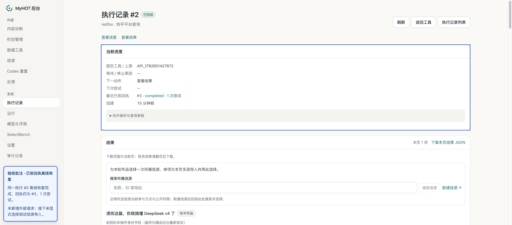
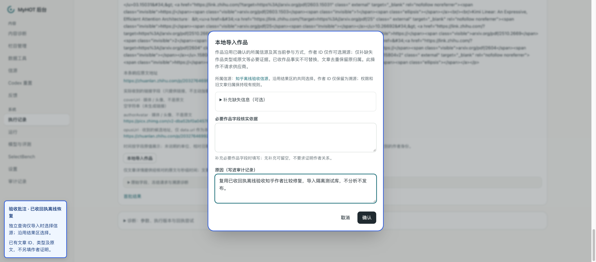
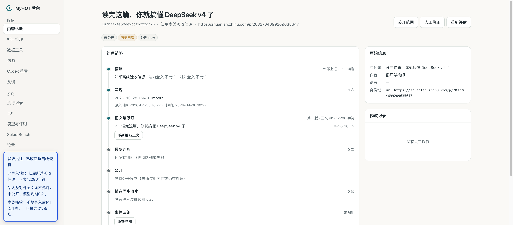

# 知乎作者比较 P2 修复与离线验收 · 2026-10-28

结论：本次最小修复及隔离库离线验收通过，整体复审未发现新增 P1/P2/P3。本记录随修复提交；未合并或部署。修复后没有追加真实调用。

## 修复边界

搜索响应的 uid 是主页标识，详情中的 authorUid 是数字作者 ID；二者不是同一种标识。复用现有 applyWorkDetailOrigin，只将搜索 uid 与详情明确返回的 authorsecid 比较。两者明确冲突仍拒绝；没有可比较字段时，以既有作品 ID、文章类型、原文校验及所选信源完成导入，不把主页标识伪装成数字 ID。

仅在现有校验处增加知乎分支；不新增表、列、状态、队列或抽象。其他平台规则保持现有行为。本次同时交付前一轮 keyword 传输映射修复：仅知乎搜索对外发送时将旧 keword 映射为官方 keyword；旧订阅、冻结输入和回执身份保持兼容。

## 定向验证

- 先复现：旧代码下手工详情恢复、订阅详情补全两项失败。
- 修复后知乎测试 12/12；关联详情、采集和导入回归 37/37。
- 后端和 tests TypeScript 检查通过；git diff --check 通过。
- 覆盖主页标识相同但数字 ID 不同、作者字段缺失、真实主页标识冲突、作品 ID/类型/原文冲突、已收回执零预算恢复、手工导入、订阅补全、归属权限及重复导入。

## 原真实回执离线恢复

本次仅使用前一轮已收到的响应，未重新请求供应商。

- 隔离数据库：127.0.0.1:55528 / aihot_zhihu_live_20261028_test。
- 固定文章：2032764699209635647，《读完这篇，你就搞懂 DeepSeek v4 了》。
- 原搜索执行记录 #1；原详情执行记录 #2 / 回执 #3。
- 通过现有恢复入口恢复执行记录 #2；离线执行器复用回执 #3，完成结果 #20。
- 外呼开关关闭、无真实凭据、全部次数预算为 0；无通用 Worker/定时调度。
- 总请求尝试始终 5 次，详情回执仍为 1 次尝试。本轮新增供应商请求 0 次；没有重新核余额或账单。前轮两次业务请求合计 0.12 元为历史证据，本轮未重新计费验证。

## 导入、归属、权限、去重

- 通过后台新建隔离库验收信源 zhihu-offline-20261028，参与方式为精选，站内全文与对外全文均关闭。
- 通过结果区选择该信源，确认本地导入；必要作品证据已有，不另填作者关系证明。
- 成功生成内容 lu7m7f24s5meexoqfbxtzdhx6，作者鹅厂架构师、原文一致、正文 ok，净文本 12286 字符，1 个修订。
- 归属为所选信源；权限未提升。内容未公开，模型判断 0 次，无公开投影，公开详情读取返回 not_found。
- 原导入命令重放一次、新命令重复导入同一结果一次，均返回同一内容 ID；仍 1 篇/1 修订，队列记录仍 4 条，供应商请求尝试仍 5 次。
- 真实回执的去重验证针对同一结果重复导入；搜索与详情双结果归并另由本地订阅测试覆盖。

## 未覆盖与运行收尾

本次不是新一次真实联调：未新增查询、未使用知乎会话。未运行真实模型、内容公开或持续定时采集；未验证知乎账号、评论、热点及其他样本的真实返回。测试源与内容仅保留在上述隔离库，日常库不变。

截图中的蓝色说明为验收批注，不是产品 UI。本次没有前端代码改动。浏览器曾等待不存在的“查看已导入材料”文字超时；实际页面以文章标题提供链接，核实导入已成功后未重复点击提交。

临时 API/前端已停止，专用浏览器空间已关闭；未启动模型队列。浏览器提示 Ego Lite 有更新，本次未升级。

## 截图批注

### 已收回执离线恢复成功

### 本地导入沿用所选信源

### 入库归属、权限与去重验收

测试原始日志、数据库核验摘要和完整截图保留在本地验收目录，不将供应商原始响应、数据库导出或凭据纳入提交。
