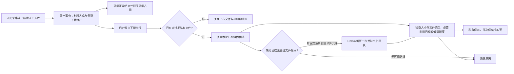

# 按采集订阅自动保存视频：完整实施方案

日期：2026-10-25。调查基线：`codex/site-presentation-video` / `9236700`（PR #6）。

状态：**实现与本地验收已完成；真实上游文件联调未执行。** 免费补证阶段未请求业务接口或视频文件；实施仅使用隔离测试库和本地桩，不读真实凭据或运行库，不提交、推送、合并或部署。逐路线证据见[免费补证记录](reviews/2026-10-25-subscription-video-download-evidence.md)。本文不改变 PR #6 的栏目和公开视频列表，也不启动 AgentKey 第三阶段；原有 5 条暂缓路线继续暂缓。

实施环境：`codex/subscription-video-download`，从当前已确认的 PR #6 基线 `92367007cf4924ad831ebd12a2afdeb71154973b` 建立；日常原分支为 `codex/site-presentation-video`。任务库为本机 `127.0.0.1:55473/aihot_subscription_video_test`，界面验收单独使用 `aihot_subscription_video_ui_test`，均已应用现有 75 个迁移，无本次迁移。Node 24.19.0；修改前执行记录、恢复及私有素材基线测试 28/28 通过。主监督保留设计、集成和最终验收责任，首段订阅归属、预算与恢复实现交由 `gpt-6-astra / medium` 执行器；界面由 `gpt-6.1-sol / high` 执行器完成，主监督集成并逐页验收；独立只读复核使用 `gpt-6-astra / medium`。最终证据见[本地验收报告](reviews/2026-10-25-subscription-video-download-acceptance.md)。

## 1. 已确认的产品边界

| 项目 | 本期决定 |
| --- | --- |
| 配置位置 | 在已有采集订阅上增加“自动保存视频”，默认关闭；信源页展示其主订阅配置和结果，不另设互相冲突的信源开关。 |
| 保存对象 | 该订阅**成功入库且已确认包含视频**的材料，入库后即登记保存，不等待精选或公开。人工核验型平台仍须先完成人工入库。仅查询成功、入库失败、作者未核验不触发。 |
| 取地址 | 先用本轮采集及已开启详情补全中取得的可靠媒体地址；缺地址允许追加付费解析，受次数预算控制。 |
| 解析供应商 | **固定复用现有 Redfox 专用解析接口。** 采集可以来自 AgentKey、SocialData 等；采集供应商与解析供应商分别展示，解析计入 `redfox.media`。没有对应解析器不自动换服务、通用解析器或采集供应商。实现时必须加代码注释解释此边界。 |
| 文件上限 | 沿用现有 `VIDEO_BYTES = 50,000,000`（页面标作 50 MB）。超过上限时尝试同一视频的较低清晰度版本；有符合上限的版本就保存。 |
| 过大提示 | 没有合适版本时，**只在后台下载结果显示空图占位和“原视频过大，未保存”**；前台保留封面和原站观看链接。占位由 UI 渲染，不生成假视频或占位文件。 |
| 保留时间 | 自动保存的文件从首次成功保存起保留 30 天，到期自动删除；复用、重复采集不续期。保留执行结果、溯源及删除记录，不在下一轮自动重新下载同一个已删除文件。 |
| 使用方式 | 私有素材，仅管理员查看和下载；不自动发布视频文件、不替换正文、不改变信源权限。前台继续“视频列表 → 内容详情 → 原站观看”。 |

“保存视频”指保存上游提供的可用视频副本。**当前已接路线没有保证获得作者上传的原始文件**；播放地址、无水印地址和原始上传文件不是同一概念。界面用“保存视频”，不承诺原画、无水印或永久可达；只有对应字段确实说明无水印时才标注。

第一版仅处理完整视频文件。不做 HLS/DASH 分片下载和音画合流、转码降清晰度、直播录制、登录 Cookie 抓取、播放器、对象存储迁移或全站历史补下载。存在其它清晰度时使用接口已给的版本，不自行压缩视频。

## 2. 当前架构能复用什么，必须接通什么

| 当前能力 / 代码 | 本期最小连接点 |
| --- | --- |
| `collection_subscriptions.config`、`execution_version`；`sources/subscriptions.ts`、`platform-subscriptions.ts` | 增加一个可选布尔配置 `autoDownloadVideo`，旧配置缺省 false；覆盖原生主订阅、平台订阅的创建/编辑/读回/切换预检，不复制第二套下载订阅。 |
| `operation_runs`、`operation_results`；`providers/operations/` | 每个订阅、每个已验证作品保存一条独立下载执行记录；多文件用同一 run 的多个结果。增加固定本地操作 `subscription.video.download`，复用 CAS、步骤、等待/停止/恢复与结果分页。 |
| `sources/*execution.ts`、`providers/agentkey/*execution.ts` / `*collection.ts` 与已有导入函数 | 成功材料入库的同一事务中登记下载意图并入队。所有真实入库入口调用同一功能函数；不把副作用塞进全局 `upsertMaterial`。 |
| `redfox/media-tools-contract.ts`、`media-tools.ts`、`client.ts`、`providers/receipts.ts` | 调用已有 `queryMediaTool → redfoxRequest → paidRequest`；使用已接专用操作、媒体预算和回执。新增的是自动流程连接，不重新实现解析 HTTP 客户端。 |
| `operations/assets.ts`、`asset-media.ts`、`lib/http-fetch.ts` | 复用安全网络访问、流式限额、临时文件、文件识别、哈希、不可变发布、私有鉴权、Range 下载、删除墓碑及孤儿清理。补自动保存来源和到期时间。 |
| `operations/result-attachments.ts` | 复用其中文件准备/校验/发布的实际公共步骤（必要时提取一个功能内函数）；**不放宽现有手工附件的 Redfox 回执校验**，不把只支持文本的 `useOperationResult` 冒充视频关联接口。 |
| `jobs/queue.ts`、`providers/operations/jobs.ts` | 继续用 `operations.execute`。已锁定 pg-boss 12.34.0 支持取件优先级过滤，可隔离普通操作与下载槽位，不加队列或任务框架。 |
| `operations/retention.ts`、`result-retention.ts`、`assets.ts` | 自动素材到期调用已有删除流程，保留墓碑；不得套用直接删除 `stored_files` 行的旧通用清理。冻结必要证据，避免下载恢复依赖已过期查询结果。 |
| 订阅表单、执行记录列表/详情、数据工具“私有素材” | 扩展已有控件、结果卡与筛选/跳转；不建“下载中心”、第二套进度页或新的公开页面。 |

**持久化不新增表、列或任务状态。** 配置、冻结输入/进度、结果、文件元数据和期限均使用现有字段。可以新增功能内函数/文件及严格 DTO，不能以“零抽象”为由在多个执行器复制业务判断；也不建设通用解析供应商注册平台。

## 3. 平台覆盖与地址证据

表中“可接”表示有可用于实现的合同，**不是本轮已经实际下载成功**。所有路线都先满足材料身份、入库和视频事实要求；具体字段路径与官方链接以补证记录为准。

| 平台 / 现有采集供应商 | 本轮采集地址证据 | 缺地址时的固定补齐 / 边界 |
| --- | --- | --- |
| 抖音 / Redfox、AgentKey→TikHub | Redfox普通采集只有作品页/封面；TikHub已接路线缺下载字段合同。V4搜索已能确认视频，APP账号/详情/话题的独立视频类型仍不足。 | 对已确认视频复用 Redfox `0W27H3O6`。不为未知类型先购买解析，不把“保存全部已确认视频”扩大成补购所有未知作品。 |
| 小红书 / Redfox、AgentKey→TikHub | 两家当前普通路线都无已闭合文件地址；TikHub统一详情明确视频只返回封面。 | `QPNFJRG1`；只处理 `type=video` 资源。成功响应也可能只有图片，不能假报保存成功。 |
| B站 / Redfox、AgentKey→TikHub | 已验视频身份，但当前详情/列表没有下载字段合同。 | `CWX77QIH`。若实际只给分离流/清单，首版说明格式不支持，不引入合流。 |
| X / Redfox、SocialData、AgentKey→TikHub | Redfox搜索/详情 `medias[].variants[]` 区分 MP4/HLS、给 bitrate；时间线只有视频集合含义。SocialData当前映射中的 `media_url_https` 是封面候选，不能用来下载；TikHub历史有媒体 shape，但类型/下载语义未闭合，当前 parser 未保留。 | 对已经可靠确认的视频复用 `7UW1PT1F`；TikHub独立记录缺视频事实时仍不触发。明确 GIF 不进入；引用/转发只用已验角色和目标身份，不把被引用视频归成当前帖作者原创。 |
| TikTok / Redfox | 五条作品路线文档明确 `playAddress`、带水印 `downloadAddress`、无水印 `downloadNoMarkAddress`。话题/喜欢的类型证据本轮已补齐，需局部连接已有视频判断。 | 优先复用已取下载候选；必要时 `MQMDU19Q`。不为去水印额外购买另一条路线。 |
| Instagram / Redfox | 顶层 `videoUrl` 是播放候选；轮播子项没有已闭合文件地址，不能借顶层字段推断。 | 顶层已验视频可用 `UUSP1G1P`；多资源关系不明时不能自动把图片或不同视频当低清晰度版本。 |
| YouTube / Redfox | `videoUrl` 指 watch 页面，thumbnail是封面，不是媒体流。 | `D52IUEIM`；直播/需登录/只有分片的结果不承诺下载。 |
| 快手、视频号 / Redfox | 部分作品 `videoUrl` 是媒体候选；作者/原文仍有既有人工核验要求。 | 分别 `0ZIWOO8P`、`U2NJ13MW`。只有来自开启选项且仍有效的订阅结果、完成人工入库后才登记；不能绕过逐条确认或把定时快照当已入库。 |
| 微博 / Redfox、AgentKey→TikHub | Redfox详情 `videoUrl` 为媒体候选，搜索无；TikHub当前成功媒体合同不足。 | 本期没有已证对应专用解析器。只用已经取得的可信地址；不默默额外调用普通详情、不换通用解析器。 |
| 今日头条 / Redfox；AgentKey现有部分查询 | Redfox账号列表 `downloadUrl` 声明数组但元素结构未说明；详情能证视频却没有文件字段。AgentKey视频详情仍暂缓。 | 列表需先补元素形状、逐条视频事实和对应关系；无可用地址就说明原因。本期不恢复 AgentKey 暂缓路线。 |
| 公众号 / 大加辣、Redfox、AgentKey→TikHub | Redfox实时详情非空 `videoLink` 是候选；普通列表/广域详情无下载字段。TikHub视频页 `cdn_url` 是封面。大加辣及已取正文只有出现明确视频资源才有候选，不抓 iframe/JS。 | 无已证专用公众号解析器；先只保存已取正文/详情中能闭合的直接视频地址，不加付费递归补查。 |
| 易车 / Redfox | 视频详情 `resources[].downloadUrl` 明示同视频多个清晰度，但没质量标签/排序；账号列表 `videoUrl` 为播放候选。 | 用现有地址，无专用补齐路线。不能宣称第一个就是最高画质。 |
| 汽车之家、百家号 / Redfox | 已取专用视频详情分别 `videoUrl`、`playUrl` 为媒体候选；普通列表无。 | 用已取地址，无专用补齐路线。 |
| 懂车帝、知乎 / Redfox | 当前作品接口没有可下载地址合同。 | 本期缺可用路线，显示原因；不猜ID拼地址、不新增供应商接口。 |
| 西瓜 | 当前没有独立已接采集订阅路线。 | 不计入本期，不把工具通用解析或头条域名当成平台接通。 |

本期覆盖的是现有 `collection_subscriptions` 生命周期：X/公众号主订阅、Redfox平台订阅、AgentKey现有真实导入链及可验证来自订阅的人工入库。RSS、网页、JSON、外部 ingest 仍沿原入口；它们可以出现在公开视频栏目，但**本期不为自动下载而迁移成订阅**。普通手工查询没有订阅授权，不触发自动下载，保留现有手动素材操作。

九个专用解析器只需一个小的静态平台→operation 映射，值引用现有契约；不复制整份供应商目录。映射注释必须写明：这是用户确认的独立下载解析服务，采集供应商不变，固定使用 `redfox.media`，不得按失败情况自动更换。

## 4. 完整执行流程与状态归属

### 4.1 登记与所有权

1. 在已有成功入库事务内调用统一登记函数；冻结父采集 run/result、订阅 ID/执行版本、材料 ID/稳定作品身份、当前作者源、视频证明、必要媒体候选和采集供应商。不是只有 `created/revised=true` 才登记：媒体填空可能不产生正文修订。
2. 重复入库先按稳定意图查原下载 run，已有则复用；同一 command key 不拿本轮新 result、签名URL或发现时间覆盖冻结输入。run 的意图以订阅、执行版本、作品身份组成，媒体选择在其中固定；同一任务的多视频分别记结果。失败/停止不被下一轮自动重建绕过。
3. 下载 run 使用 `provider='local'`、固定 operation key、现有 `subscription_id`；明确 `collector` 与可选 `resolver`。`local` 只是本地保存操作的所有者，不代表 Redfox 费用不存在。
4. **下载不能占用 `collection_subscriptions.active_run_id`。** 当前 `createRun(subscriptionIds)` 会写占用，`eligibleMembers` 也要求占用相等，不能直接套用。增加仅针对该操作的非占用式订阅关联：统一锁订阅/作者源/运行，验证启用、冻结版本和下载开关，但不写采集占用。该校验接入创建、claim、付费 beforeClaim、提交、resume、未知回执释放和恢复，不能靠空 members 绕过。
5. 材料身份/当前源变化、订阅切换或关闭时，旧执行不能继续新付费或业务提交。原始已返回响应仍入回执保存，停止不等于取消上游扣费。平台订阅没有控制信源时，也检查这条材料所属作者源。
6. 登记/入队与材料提交共同成功。下载网络失败不回滚已入库材料、不占用采集游标。登记自身失败不能静默吞掉导致永久漏任务，应让当前材料提交回滚并由既有采集恢复重做。

### 4.2 步骤和结果

用一个下载 run 顺序执行本地选择、必要解析、逐文件保存，复用既有 `step_key/step_version/progress/generation`；不把下载进度写成文章状态或采集订阅状态。付费解析与文件传输分成独立步骤，每个传输步骤最多处理一个候选，便于超时和中断恢复。

`operation_results` 保存原作品/媒体关系、父记录、实际获取方式（本轮地址/Redfox解析/复用文件）、规格与大小、`article_id/source_id/file_key` 和结果原因。直接传输不制造付费回执；采集回执作为溯源引用，只有该下载 run 实际取得的解析回执才写其 `receipt_id`。有现成文件可以不调用供应商。

下载候选从已核接口字段或已取得的正文片段提取，保存在后台执行的冻结输入/进度中；不把 `articles.media[].url` 一律当文件地址，也不将新签名地址或私有 `file_key` 写回公开媒体 DTO。已有视频确认仍由材料媒体事实负责，不因下载失败撤销公开视频资格。

大加辣的具体连接点是 `sources/native-execution.ts` 的 `saveMpMaterial`：从已收 `mpArticle` 正文 `body.content` 在首次 `sanitizeBody` 之前提取明确 `<video src>` / `<video><source src>` 候选，复用已有 `videoMediaFromHtml` 确认事实并交材料合并；之后照旧清洗正文。当前清洗会删除 `<source>`，`articles.media` 的确认项也可能没有 URL，因此不能事后从这些投影恢复地址。保存父结果后在同一事务登记，冻结 `body.receiptId` 的必要证明与候选；恢复优先使用冻结内容，需要重建时仅重放仍保留且对应的已收响应，不为下载再调用大加辣正文接口。其它正文入口同样只处理已取得的正文片段，不读取页面广告/iframe或执行脚本。

多个视频、同视频多个画质、图片、音频必须区分：

- 同视频 variants 是候选版本，只保存一个符合限制的版本；同帖独立视频各保存一个。没有媒体 ID 时，只能使用同一冻结响应内可证明的关系，不能把跨响应的第 N 项当同一视频。
- 专用解析器 `resources[]` 可混入视频/音频/图片。仅取 `type=video`；`videoUrl` 可能与其中资源重复，不重复保存。不把所有 `resources` 都当成画质版本。
- 复用当前 `parseMediaTool` 的资源和元数据结果；若仅有文档明确的顶层 `videoUrl`，只有能证明本作品是单视频且没有冲突时才作为候选。没有可用视频时也持久化解析摘要，不能因返回了标题或封面就当成功文件。
- 帖中引用视频只在已验引用关系和目标身份存在时处理；记录真实媒体来源，父材料仍关联自己的信源，不改作者。无法把返回媒体与目标对应时显示“媒体归属不足”，不能用标题近似匹配。
- 没有稳定媒体 ID、又无法区分多段作品与替代版本时保留研究结果并说明缺口；不得下载一段却称全部保存。

任务状态仍只有既有六种：`active/waiting/needs_review/stopped/completed/failed`。“过大、无地址、格式不支持、已过期”等是**结果原因**，不是新增状态。检查已完成但没有保存文件也可结束 run；摘要必须写清“已保存 0 / 未保存 1”，不能把 completed 显示为“视频下载成功”。

## 5. 50 MB 与较低清晰度处理

1. 先核对真实视频事实和候选类型。作品页、封面、GIF、音频、诊断 cache_url、HLS/DASH 清单不能当完整视频。只接受既有私有素材校验支持的完整视频容器。
2. 优先使用明确下载字段；TikTok已有无水印下载候选可优先。文档未声明水印/清晰度的标作未知，不据文件名、URL路径、宽高猜“原版”。
3. 当前候选有可信大小且超过 50,000,000 字节，直接转下一个同视频版本。没有大小时使用受保护 GET，检查 HTTP 状态/Content-Length 并流式强制限额；头部缺失或错误也不能突破上限。不必为每条再发一个 HEAD。
4. 首选版本实际过大时，尝试同一冻结集合中已证较低码率/分辨率的版本。X `variants[].bitrate` 支持这种排序；易车只证明多个清晰度、没标签，去重后检查其它候选是否在上限内，不能把它们预先称“标清”。无版本证据不能混用其它视频或音频。
5. 缺地址、旧地址不可用或已知版本都过大时，如该平台有固定专用解析器且本作品尚未用过本轮解析机会，可用一次 Redfox 解析获取其提供的资源；已有可用文件不另花钱。不按每个画质分别购买解析，不自动换解析器，不无限刷新签名地址。
6. 本次解析仍没有适合版本就结束并写明原因。没有低清版本的含义是“**当前接口没有提供可用且符合上限的版本**”，不是断言全网不存在。仅 HLS、分离流、不可达或未知大小不伪称已证明文件过大。
7. 明确原候选超过上限且未保存时，后台空图卡显示“原视频过大，未保存”，补充“当前接口无 50 MB 内可用版本”或“其它版本无法验证”；保留原站链接、尝试摘要。前台封面和原站观看不变。

候选清单来自本次有界解析结果，冻结并去重；每个候选至多按本地恢复规则重试，遍历索引持久化，重启不从最大版本开始重下。累计字节超过 50,000,000 时立即中止并删除临时残片；恰好达到上限且正常结束的文件允许继续校验，不下载完整大文件后再判断。不同清晰度失败产生的网络流量单列传输字节，不冒充供应商计费金额。

## 6. 幂等、复用与保留 30 天

### 文件身份与共享

- 文件 key 继续使用现有 `uploads/redfox/<hash>` 格式，保留私有路径兼容；哈希输入增加 `subscription-video` 域及已验证作品/媒体选择。这个历史目录名不表示采集供应商就是 Redfox，代码需注释。
- 具备稳定媒体 ID 或已证明的单视频主槽时，跨订阅可引用同一个文件；执行记录各自独立，关闭某订阅不停止另一订阅，也不删除已经保存的文件。
- 复用文件不把本轮尚未下载的候选记为实际版本；`selectedCandidate` 留空，原保存记录继续保留其真实版本依据，界面沿用现有原保存记录链接。
- 媒体地址签名、标题更新、轮次或 resultId 不作为稳定文件身份。未知多媒体关系只做冻结响应内的确定性去重，不承诺跨供应商全量去重，不为此增加目标表和订阅诉求表。
- 对没有稳定媒体 ID 的冻结资源，保存确切 receipt attempt 与资源清单摘要/hash，再在该清单内使用 index；不能只用 receiptId+index，因为未知/失败重试可能在同一回执ID上替换响应。下载解析不是请求无限更新媒体目录，后续新响应不能覆盖已冻结选择。
- 获取地址前先检查已有成功结果/文件/墓碑；发布时再次锁相同 key，复用已注册文件，不覆盖不同哈希的文件。极端并发首次取址不宣称“绝对只付费一次”；实际请求仍全部受回执和预算控制。
- 发布前冻结 `expectedFileKey` 和选择依据；半文件不能冒充完成。已发布但数据库未登记的文件，经原有类型/大小/hash校验后可恢复本地登记，不必先再解析。

### 到期和删除

`stored_files.metadata.origin='subscription-video'` 标明本功能文件，`expires_at=首次注册created_at+30天`。在现有 publish 入口局部支持此元数据和期限；人工上传、手动保存、生成产物的期限保持原样。

每日清理按每批 50 条续批扫描该 marker 的到期文件，调用 `deleteAsset()`，沿用 `available → deleting → deleted`、备份互斥锁和失败恢复。本轮固定到期截止时间与最大 key，沿持久游标扫描并回绕一次；每个 key 本轮最多尝试一次，失败不阻塞后续，下一轮再重试。本轮截止后到期的文件留待下一轮，不把单批 50 条变成每日删除上限。不能直接删数据库记录，否则会丢失历史关联并导致下轮重新下载。

- 重复发现、跨订阅引用不续期。例如第 29 天另一订阅引用同一文件，只剩 1 天，页面展示实际到期日。
- 到期后文件读取/新任务引用立即按期限拒绝；物理清理由每日任务完成。若既有正在使用文件的人工任务阻止删除，明确显示清理延期，保留既有使用保护，不强杀其任务。
- 本功能已过期的待办/停止下载要先本地收尾，不能因自己的 `expectedFileKey` 永久阻挡清理。清理失败仍保留 `deleting` 并重试。
- `deleted/deleting` 墓碑在新付费/下载前检查，同一已保存媒体不自动复活。自动保留期届满与人工删除均适用；管理员若确需重新取得，沿现有手动工具操作，不新增自动循环续期。
- 对没有稳定媒体ID的结果，还按现有下载意图/作品的已保存结果检查删除事实；不能因新响应的清单hash或订阅执行版本改变而重新构造文件key、绕开“已过期不自动重下”。该检查仍读现有 run/result/file，不新建去重表。
- 记录与文件期限不同：执行结果保留“保存过、何时到期/删除”的事实；不因文件过期删除文章，不因文章公开而延长私有文件期限。

## 7. 预算、出站和恢复

### 付费边界

解析固定 `redfox.media`，沿用现有预算、服务开关、回执、尝试和账单。不给开关设置隐式非零预算，不挪用 `collect/query` 额度；未配凭据/预算时显示“等待 Redfox 媒体预算/配置”，不影响正常采集。订阅表单与执行记录说明可能额外计费，费用估算不是金额硬上限。

每个作品的自动保存意图正常最多提交一次专用解析；恢复复用原回执，不通过换 window 重买。未知结果遵循现有同步只读规则：等待 30 分钟后至多自动重试一次，仍计预算，可能重复计费；预算占用和已有尝试优先于“推荐次数”。确定失败/解析失败不重新当成未知；修本地 parser 后重放已收响应。自动解析完成后地址再次过期，不自动再买新的一代。

解析身份必须包含原站作品、固定 operation/端点、真实参数和稳定意图；不能把动态签名 URL、任务重试次数作为取址身份。文档和 UI 展示正常次数与未知重试的可能次数。文件 HTTP 传输不算 Redfox API 请求，但计本地传输量；存储/带宽不伪称免费。

本操作的解析尝试设为正常一次、至多一次自动重发；429 等可重试响应与未知重试共用这一上限，以既有 receipt attempts 计数，不为不同错误各加一套重试额度。达到上限保留结果/回执供处理，不在下一轮采集中重新申请新的自动意图；手工处理仍受原有预算。

### 出站和槽位

自动任务要求订阅有效且 `COLLECT_ENABLED` 允许；固定 Redfox 解析还要求 `REDFOX_CALLS_ENABLED`。直接下载检查其候选对应的既有供应商出站开关；不会借 `provider='local'` 绕过关闭。模型开关不控制视频文件保存，不能借用“视频生成”的执行语义。

沿用 `operations.execute`：普通操作 priority 0、普通 worker `minPriority:0/localConcurrency:2`；下载操作 priority -1、下载 worker `maxPriority:-1/localConcurrency:1`。初始、下一步和恢复统一由 `queueOperationStep` 决定 priority。已有 pg-boss 的过滤实际作用于取件；单纯降低排序优先级不能代替槽位隔离。该并发是每进程限制，不能宣称全实例仅一个下载；本期不搭建分布式限流平台。

单次文件传输复用 60 秒、50 MB、临时上传空间检查（至少 4 倍单文件额度）、现有每进程上传上限；每步独立，继续适用现有 180 秒队列超时。空间不足/上传槽忙进入等待，不能先解析再发现本地已无保存空间。流式限额之外，既有文件头/容器识别并不证明整段音画可播放，不能把它包装成完整视频质量验证。

### 必补的恢复连接点

| 场景 | 最小处理 |
| --- | --- |
| 解析已收响应、结果尚未写入 | `operation_runs.current_receipt_id` 仍管该回执；恢复只解析原响应，空/重复地址/归属不足结果也写消费摘要并保留回执，再进入现有保存步骤检查共享文件、墓碑与完整孤儿文件；没有可恢复文件才按原原因结束，不重传旧候选或重买。 |
| 预算等待、临时限流、未知结果 | 复用现有 waiting/needs_review 与尝试分类；新本地操作的 Redfox 解析步骤明确进入只读分类，不能落进默认 provider 分支。 |
| 完整文件已经发布、事务未提交 | `expectedFileKey` 加入现有本地恢复和孤儿保护；重新校验后登记。关闭出站时仍允许合规的本地收尾。 |
| 下载到一半进程中断 | 临时残片沿原清理；对相同冻结候选有界重试。不能把半文件记为 available，也不立即重购地址。 |
| 订阅停用、下载关闭、供应商切换、源禁用 | 按订阅关联停止非终态派生下载，增加 generation；付费前与提交前再次校验。采集主 run 占用正常释放，另一订阅不受影响。 |
| 停用后回执才返回 | 回执响应仍保留；禁止写入失效任务的结果/文件关联。未知回执仍被原操作治理，不能被通用恢复器自动释放。 |
| 下载结果来源超过查询结果保留期 | 入库时锁原结果并冻结必要证明，恢复不依赖重新读取原查询大对象。只引用父ID供追踪，不无限延长所有原始结果/回执。 |
| 文件已经删除/到期 | 读取与恢复先查墓碑/期限，写明原因，不重新传输。 |

新操作需要接通 `execute.ts` 本地分发、`recovery.ts` 白名单/出站/只读分类、`read.ts` 详情投影、操作控制和 `assets.hasActiveInput`。这些是现有引擎的必要接点，不新增第二个恢复调度器。

## 8. 后台流程和截图验收

保持当前 UI 风格，复用订阅表单、开关、说明文字、状态标签、现有空图组件和执行结果卡，不新增 tab 或导航入口。

1. **信源 → 主采集订阅 / 新建、编辑平台订阅**：显示“自动保存视频”；附“成功入库后私有保存，单个≤50 MB，30天到期”；展开说明采集供应商、固定 Redfox 解析和媒体预算入口。若本路线无自动入库或缺证，明确显示人工核验/不支持原因，不能用一个“平台支持”标签掩盖路线差异。
2. **订阅列表 / 详情**：显示开关、最近保存数量、待处理/未保存原因摘要；点“查看执行记录”使用已有按订阅筛选。没有已保存文件时不能显示可下载按钮。
3. **采集执行结果**：每条已入库内容链接其下载执行；整体采集完成与视频保存进度分开显示，不能因下载在等预算把已完成采集改回运行中。
4. **下载执行详情**：显示采集供应商、解析供应商/操作、实际费用回执、文件候选/大小/选用版本、已保存/复用/未保存数量；超大时空图占位及明确提示。复用“返回订阅”“查看材料”“原站链接”。
5. **数据工具 → 私有素材**：现有列表增加自动保存来源、关联内容/订阅、保存时间/到期时间；查看/下载/手动删除复用现有鉴权入口。到期或删除后历史结果显示原因，不显示失效下载按钮。

本次截图批注覆盖：订阅配置；采集成功→下载记录跳转；AgentKey采集＋Redfox解析的供应商/费用；低清版本保存；超大占位；到期删除。桌面与窄屏各选受影响代表状态，不拿合成页面当真实上游验收。所有截图以本地桩和隔离测试库生成，避免泄露签名 URL、回执正文或密钥。

## 9. 实施顺序、待补证据与验收

### A. 先接一条纵向闭环

先完成订阅配置/读回、抖音已确认视频导入→本地下载 run→固定 Redfox 解析→私有文件→执行详情。使用隔离测试库、本地供应商及媒体桩；本地验收通过后才把同一登记函数传播到其它入口。加入用户要求的供应商分工、预算与路径兼容注释。

实施检查点：非占用式订阅所有权已接入现有 `createRun/lockRun/requireExecution`，沿用原 claim、付费 beforeClaim、结果提交和 resume。AgentKey 抖音 V4 已确认视频的成功导入 → 同事务登记 → Redfox 媒体解析 → 测试 MP4 私有保存已通过本地桩和隔离数据库验证。最终一次定向运行 41/41（新增下载 8 项、所有权 5 项，既有执行记录/恢复/素材 28 项），backend/tests 类型检查通过。覆盖解析响应重放、完整文件发布后事务回滚、30 分钟未知回执一次重试、两次总尝试上限、到期及墓碑。失效订阅仍可放弃收尾，不能恢复执行。

以上为 A 阶段当时的首条后端代表路径验收；后续接线与 UI 已在 C/D 完成，真实上游联调仍未执行。修改前的 28 项和中间的 14 项属于被本次 41 项覆盖的基线/检查点，不累计成额外测试数量。

主监督另在隔离 UI 库验证实际 pg-boss 12.34.0 取件：同一 `operations.execute` 注册 `maxPriority:-1/localConcurrency:1` 与 `minPriority:0/localConcurrency:2`；合成下载保持占用时，普通优先级任务先完成。此项证明过滤与槽位隔离生效，不代表全实例并发限制或真实视频下载。

### B. 接通已有候选和降清晰度

按合同接 Redfox X、TikTok、易车，再接其余已证媒体字段；复用九个专用解析器。补齐已证 TikTok话题/喜欢的现有视频标记连接，不顺带扩大未知类型。用不同长度/HTTP头/容器的本地文件验证低清回退、超大与格式错误；不猜未证字段。

实施检查点：已形成九个固定解析器映射和精确字段候选提取；同媒体版本与独立媒体分开冻结，X 逐项排除 GIF，易车不推断画质标签，TikTok 水印地址不冒充低清版本。已验证首选超大→较低码率保存、多视频分别保存、精确50MB边界、无头部/压缩头部仍强制流式限额、manifest尝试身份、墓碑和重复发现跳转。最近一次定向运行 58/58（候选9、首条下载8、所有权5、附件18、素材16、恢复2）通过；这不是与前一阶段测试数相加的总数。这是 B 阶段检查点；后续入口和 UI 的完成情况见 C/D 及最终验收报告。

### C. 接完所有实际导入入口及停止恢复

已接通 X/公众号主订阅、平台订阅、AgentKey 现有真实入库和同一采集执行的人工确认入库；完成切换预检、配置冻结、停用收尾、回执治理、队列过滤和跨订阅复用验证。独立查询即使带采集来源链接，也不触发自动保存；研究快照及 RSS/web/json 保持原流程。SocialData 单层已核引用视频按真实作品 ID 保存，不改变父文章作者。视频号定时列表仍缺可靠视频类型，不能仅凭解析工具存在即承诺自动登记。

### D. 30天清理、界面与整体验收

已复用私有素材清理游标完成到期检查、物理删除与墓碑；现有订阅、执行结果和素材界面已接通，17 处代表截图含桌面及 390 px 窄屏批注。整体复审发现的已收解析响应遇共享文件恢复遗漏和完成态统计遗漏，均先复现后最小修复；完成态不展示无法完整累计的传输尝试次数。真实上游联调仍须另获授权，不能用“允许未来自动解析”的产品决定当作现在的调用授权。

### 仍需补证的精确边界

| 缺口 | 阻塞内容 | 最小补齐方式 |
| --- | --- | --- |
| 媒体实际可达、有效期、反盗链、Content-Type/大小、音画情况 | 对应具体文件的真实成功验收；不阻塞本地流程实现 | 优先官方明确说明；仍需真实响应时另行授权最少一次解析和受限文件GET。不能把 TikHub JSON缓存24小时当媒体TTL，不转发API密钥到CDN。 |
| TikHub抖音APP独立类型；X/微博媒体语义 | 对应未确认视频记录的自动登记；不是整个平台均不可用 | 先要具体官方合同或有授权的脱敏正/反例；本期不自动为未知作品买解析。已有V4搜索/小红书/B站等不受影响。 |
| 头条列表downloadUrl数组元素和作品对应；部分公众号转码数组 | 这些字段的自动地址提取 | 官方非空示例；没有时保持具体缺口，不发明子字段。已有确定的其他媒体路径不受影响。 |
| 多视频身份/版本关系未说明 | 多段文件去重、是否能称低清版本 | 使用已核mediaID/同视频variant关系；无证据保留未保存原因，不添加资源映射表掩盖缺合同。 |
| 原始上传文件/原始画质保证 | “原文件归档”的承诺 | 当前不承诺，不影响保存可用副本；不能用无水印、original_info或URL名称替代证明。 |
| 快手/视频号作者和原文核验 | 无人工确认时的自动入库及其下载 | 保留当前人工路径；不能因有videoUrl解除。 |

### 定向验收清单

- [x] 旧订阅缺字段仍关闭；配置保存、读回、调度、入库和下载 run 贯通；预览/研究查询不触发。
- [x] 文章重复 upsert 但补充了可靠视频事实时可登记；同订阅重复不再创建/购买；无可靠事实或入库失败无下载。
- [x] AgentKey/SocialData采集与Redfox解析明确分开，真实解析都走 `redfox.media`；预算不足、凭据缺失不影响采集结束。
- [x] 只取视频，不把封面/GIF/作品页/音频/JSON缓存/HLS当成功；多视频与多清晰度区别明确。
- [x] 50,000,000字节边界、缺/假Content-Length、首选过大而低清合格、全版本过大、其它版本无法访问均有正确结果；无合适版本只在后台空图提示。
- [x] 相同媒体跨订阅复用、一个订阅停用不影响另一个；媒体身份不明不会错误合并，墓碑不被下轮绕过。
- [x] 中断于解析响应落库后、下载中、文件发布后DB提交前均可定向恢复；不重购已收解析，不消耗普通执行槽位。
- [x] 供应商切换/禁用/关闭下载后旧任务不再付费或提交，未知回执保留治理；现有正常采集和手工附件流程回归通过。
- [x] 首次保存起30天、不续期；到期读取拒绝、物理删除/失败恢复正常，人工素材和正在使用保护不误删；文件删除不改变文章与前台权限。
- [x] 现有UI全程可找进度、结果、文件和原因；完成截图批注；公众接口不泄露私有地址、签名参数或供应商凭据。

## 10. 兼容、收尾与方案复审

无数据库回填、历史视频扫描或旧表迁移。新增JSON字段缺省关闭，部署新代码不自动启用订阅或提高预算。订阅参数/供应商/下载策略变化沿现有 execution_version 使旧任务失效；名称/纯展示修改不无故重建下载。切换预检列出视频保存能力差异，不能暗中丢掉已开启配置。

若以后需要回退，先关闭自动保存并本地收尾新操作，保留未知回执治理；旧 Worker 不识别新步骤时不可让其自动重发。使用既有停止、恢复和文件删除机制，不新增“回退专用状态”或另建质量门禁。正式部署和回退均不属于本轮授权。

本方案已经移除的多余设计：下载目标表、订阅诉求表、跨供应商共享执行、多套结果管理、新队列/恢复器、自动替换供应商、流媒体合流和通用媒体识别框架。保留的必要改动是非占用式订阅关联、真实入库登记、Redfox解析连接、文件生命周期以及现有UI结果说明。

已完成主审与独立静态复审，未发现有充分代码或文档依据的剩余 P1/P2/P3 方案问题。核对过程中补齐了大加辣正文清洗前的候选提取、下载候选不进入公开DTO、manifest绑定确切回执尝试以及重试共享上限，未增加表、列、状态或队列。两份文档的本地链接和格式检查通过。

同日追加快速复审：发现并修正 1 项 P3 文案冲突——“达到限额立即停止”与允许 ≤50 MB 的要求不一致，现明确为超过 50,000,000 字节才中止，等于上限且正常结束可继续校验。其余多资源/低清版本、30天墓碑、解析重试上限、复用与范围边界未发现新的问题；没有增加实现范围。

上述两段为实施前的方案审查历史。2026-10-26 完整代码复审另发现两项 P2（解析空/重复响应漏掉本地复用、到期删除未续批）及一项 P3（复用记录标注未尝试版本），现已完成最小修复、定向回归和 UI 对照验收。主监督再次核对架构、回执与预算、文件复用、清理和界面，未发现新的有证据支持的 P1/P2/P3；具体结果与截图见[本地验收报告的追加复验](reviews/2026-10-25-subscription-video-download-acceptance.md#2026-10-26-追加复验)。真实上游可达性、有效期、反盗链及音画情况仍未验证，不承诺所有视频都能保存。未提交、推送、合并、部署或执行真实调用。
