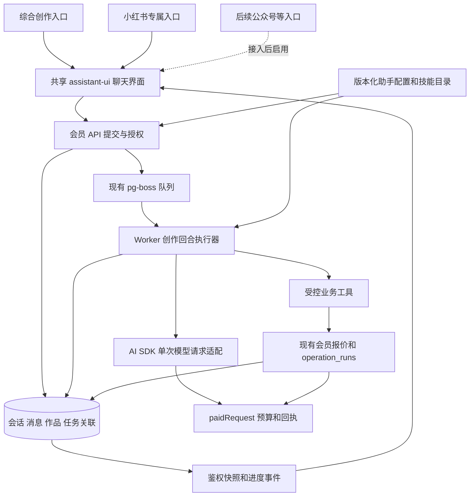

# 创作助手统一底座与小红书首批接入方案

> 2026-10-30 实施更新：阶段 A 的首版已在独立工作树完成本地桩闭环验收，见 [验收记录](reviews/2026-10-30-assistant-v1-acceptance.md)。未部署、未真实付费联调；后续阶段和完整上游能力仍按下文范围推进。

> 2026-10-30 界面规划更新：[助手聊天工作区改版方案](assistant-chat-workspace-plan.md)明确独立一级导航、聊天主界面、左侧助手与历史、右侧稿件及手机适配。该改版已完成核心本地桩验收，见[三栏验收记录](reviews/2026-10-30-assistant-chat-ui-acceptance.md)；后端、技能和计费合同不变，仍未部署。

> 2026-10-31 修订：既有创作/检索/版本/计费流程完成小规模真实联调，见[流程验收](reviews/2026-10-31-assistant-live-acceptance.md)；模型费用逐笔归因限制保留，未部署。本次输入区增量已实现并完成本地验收，见[输入区验收](reviews/2026-10-31-assistant-inputs-acceptance.md)，统一以[工作区方案第12节](assistant-chat-workspace-plan.md#12-输入区增量修订材料技能与费用确认2026-10-31)为范围及交互权威：技能自动/手动选择、TXT/MD与稿件材料、每次确认/会话额度内自动。上方2026-10-30更新为当时记录，不代表当前验证状态。

状态：第三版主方案，2026-10-31增量修订。阶段A与三栏已有实现，后续能力不得视为已完成。面向 AIHOT 产品负责人及实施者，沿用原路径保留首次Skill审计证据。

目标是在现有网站内建设统一的创作执行底座，前台同时保留综合入口和多个专属助手入口。首版提供“创作助手”和“小红书助手”；后续公众号等助手增加受审阅配置、技能及必要工具，复用同一套会话、执行、积分、回执和作品管理。采用 assistant-ui 展示交互、AI SDK 处理模型协议与工具决策、现有 Worker 和 operation_runs 执行持久任务。

完整上游包已核对：14 个文件、166,777 字节，全部 Git blob SHA 与固定提交一致。它有 5 个 Python 脚本，依赖搜索、视觉模型、文件与网页解析；没有自己的大模型服务、会话系统或图片生成 API。推荐保留经过审阅的创作规程，将脚本适配为受控后端工具。不能将“复制 SKILL.md”或“安装两个 npm 包”视为接入完成。

本方案覆盖双入口、技能路由、跨助手资料转交，以及小红书六个用户动作的依赖、交互、计费、持久化、恢复、验收和发布条件。第一阶段先验证双入口与完整纵向链路，后续阶段补全输入与视觉能力；只交付第一阶段时不得宣称完整兼容上游技能。公众号作为后续扩展示例，不属于首版已接入能力。

## 1 证据和适用基线

- 产品入口：[Redfox 小红书创作 Skill](https://redfox.hk/skills/no/gwE5gmpt)。通过“获取 Skill → GitHub”取得源码地址。
- 固定源码：[redfox-community 的技能目录](https://github.com/redfox-data/redfox-community/tree/d2e24f02340a440a73a96aa6ad6a65f681fba89f/skills/xiaohongshu-creator)，提交 `d2e24f02340a440a73a96aa6ad6a65f681fba89f`，上游提交时间 2026-10-28。
- [文件清单与逐文件 Git SHA](reviews/2026-10-30-xiaohongshu-skill-manifest.json)。完整原包作为本次聊天附件留存；仓库仅保存清单和方案，不把上游脚本安装为可执行技能。
- AIHOT 基线：`47d7ec6aea4ec661c26c0da5b452fe1f4c48f5a6` 加本次开始时已有未提交改动，包括会员工具、万相和素材处理。后续实施前重新核对这些文件，不能覆盖其他工作。
- 强制边界以 [开发原则](development-principles.md) 和 [工程手册](engineering-playbook.md) 为准。
- 第二版产品决策来自本次用户确认：“统一底座、多个助手入口、同时保留一个综合入口”，首版创作助手与小红书助手；本轮授权仅更新方案及评审，不实施业务代码。
- 第三版确认综合入口的快捷动作与自由输入并存，细化现有模块复用和[内部技能接入标准 v1](assistant-skill-integration-standard.md)。该标准是待实施的系统内部合同，不是任意外部Skill零改造兼容或生产成熟证明。
- 证据范围：官方源码静态阅读、npm 元数据及发布包类型声明、当前业务代码。未执行上游脚本、未安装项目依赖、未连接业务数据库、未执行真实创作或 Redfox 业务请求。

## 2 完整包和实际执行方式

| 文件 | 职责和真实依赖 |
| --- | --- |
| SKILL.md | 意图路由、复合任务顺序、日期和格式要求；没有模型执行器 |
| README.md、README.en.md | 使用说明 |
| assets/platform-rules.md | M2 改写提示词；至少 5 个不同 emoji、标题正文和标签等 |
| references/xhs_hot_article_format.md | M1 搜索响应及字段解释 |
| references/title_score_guide.md | M3 标题生成、六维评分与参考来源格式 |
| references/core_workflow.md | M4 筛选、20 张封面逐图理解、3 套设计方案 |
| references/xhs_trend_data_format.md | M3/M4 四类聚合数据字段 |
| references/prohibited_word_core_workflow.md | M5 提取、分批检测、标记替换、纯文本文件交付 |
| scripts/fetch_xhs_hot_articles.py | M1 请求 Redfox 搜索；格式化和文件输出，带重试 |
| scripts/fetch_xhs_trends.py | M3 请求四类聚合数据；JSON/Markdown 输出 |
| scripts/fetch_explosive_covers.py | M4 请求同一聚合接口；提供封面 URL 和来源，脚本本身不分析图片、不生图 |
| scripts/check_sensitive_words.py | M5 文件/网页提取、Redfox 检测、响应整理；OCR 和自然语言修改由宿主 Agent 完成 |
| scripts/rewrite_record.py | M2 固定来源标识上报及输出改写规则；实际不发送原文，不携带 API Key |

### 2.1 原包环境

声明 Python ≥3.8、requests ≥2.28.0、python-docx 1.1.0、beautifulsoup4 4.12.3、playwright 1.58.0 和 Chromium。此处是上游声明，未验证所有版本组合可安装。

Python 负责外部查询与提取，宿主 Agent 负责理解、写作、评分、视觉/OCR、引用资源、询问用户和交付文件。原包还直接要求 `web_search` 和 `read_image` 等宿主工具；有 API Key 不等于具备全部能力。

M1 实际只读环境变量；部分其他脚本会扫描 Shell 配置文件，Windows 分支还会读用户环境变量。网站接入统一使用后端凭据机制，不扫描用户目录、不执行配置命令、不让模型读取或回显密钥。

### 2.2 外部调用合同

以下 URL 来自固定提交的代码，代表客户端实际请求方式，不等于已验证上游当前可用性或价格。

| 模块 | 方法与端点 | 重要参数及鉴权 | 系统映射 |
| --- | --- | --- | --- |
| M1 | POST /story/api/xhs/search/search | keyword、pageNum、pageSize、startDate/endDate、source；X-API-Key | 已有 3X8FGEEM，复用解析与回执；保留 articles 与 latestHotArticles 的来源区别 |
| M3/M4 | GET /story/api/cozeSkill/getXhsCozeSkillData | keyword、startDate、source；X-API-Key | 当前未接此精确端点；不能拿每日榜或七日榜冒充 |
| M5 | POST /story/api/cozeSkill/sensitiveWordSearch | content、platform=小红书、source；X-API-Key | 已有 API_1791881343238，但当前输入只有 content，须补明确的小红书模式及响应解析 |
| M2 上报 | POST /story/api/skill/record/save | 实际仅 source=小红书文案改写-xhs，无鉴权头 | 从适配版移除；不影响改写算法 |
| 搜索/OCR/视觉/生图 | 原包没有实现模型服务 | 宿主提供 | 用网站接入的独立工具与模型能力 |

原包 M2 文档与代码矛盾：文档要求以原文作为脚本参数上报记录，并称需要鉴权、免费；实际脚本未使用 content 参数构造 payload，也未加 X-API-Key。不能写成“脚本已泄露原文”，也不能把“免费”的文档说明当作计费验证。

脚本真实运行与规程还有以下区别，适配时按证据处理：

- M1 只查询一页，默认最多 3 次尝试、30 秒超时；扩日期是宿主指令。现有接口合同说明带 keyword 时页码/条数不生效，因此 pageSize=50 不能保证获得 50 条。保留实际数量、原始计数和 articles/latestHotArticles 的区别；不循环翻页补齐假样本。
- M3/M4 默认最多 3 次尝试、60 秒超时，只检查存在 data，未严格验证成功状态或数组类型；格式化展示时每桶按 photoId 去重，原始 JSON 输出保留数组，不能把跨桶重复也删掉后改变桶计数。M4 的 JSON 不受 max-items 限制，网站必须自行控制模型投影的数量与大小。
- M5 默认最多 3 次尝试，原脚本提取 DOCX 只读正文段落、遗漏表格等；若网站扩展表格提取，应明示提取范围并提供预览。M5 某些错误输出后进程仍正常退出，不能用退出码代替有类型的成功结果。
- M1/M3 的文件路径含原关键词，M1 还会写 HTML；网站统一保存结构化结果和私有制品，不复刻这些路径与 HTML 副作用。

四桶精确映射如下。响应单项保留 photoId/userId/userName/publicTime/coverUrl，增量来自 anaAdd；addCollectedCunt、addInteractiveount 等上游拼写在供应商适配层处理，不传播到公共 DTO。

| 上游 data 字段 | 规范化桶 |
| --- | --- |
| lowPowderExplosiveArticle | low_fan_explosive |
| likeTheTop500 | daily_like_top500 |
| singleDayIncrements | daily_increment |
| sevenDaysOfIncrements | weekly_increment |

参考文档示例的 daily_like_top 与脚本不同，以已验证的供应商合同和上述显式映射为准。M1 当前已有 HTTP 200 无 code 的研究对象兼容，不为模仿上游脚本强制 code=2000 而破坏它。

统计同时提供每桶去重成员数和跨桶唯一作品数，桶计数之和不称作独立样本数。M4 按唯一 photoId 选图，保留全部所属桶；总互动与 anaAdd 增量分别展示，不混加。缺失/畸形桶有显式错误或不完整状态，不冒充成功空桶。

### 2.3 必须修正的适配差异

1. 不直接运行上游 Python，不安装通用 Shell、任意读文件或浏览器操作工具。脚本中的网络调用必须进入现有回执、预算、所有权和恢复通道。
2. 去除密钥回显/扫描配置指令和 M2 无关上报。模型只看到工具 schema 和必要结果。
3. 上游网络重试不能照搬：5xx、超时或解码错误可能发生在供应商已扣费之后。未知结果进入待核对，已保存响应只重解析。
4. 四类聚合接口保留原始桶及原始数据类型，不臆造“低粉”“增长”来源。缺数据时说明缺口，不生成假的 50 条样本或 20 张封面。
5. M3 的强制 8–10 匹配指数、标题重复即 S 级、Top10% 等不能作为预测事实。保留六维及权重供编辑参考；权重不凭感觉调整，算术由服务端计算；取消自动高分捷径，重复标题显示重复提示。该差异须在技能版本说明和验收中明示。
6. M4 的“相关性优先”与下一步“按互动重新选前 20”冲突，采用同一个相关性优先候选集，再逐图分析；未成功读取的图片不计入已分析分母。原规程的主观综合分只作选择建议，不扩大为新的质量评分平台。
7. 时间统一用 Asia/Shanghai；上游所述有效窗口为昨天至 30 天前。默认近 7 天为 today−7 至 yesterday，近 30 天为 today−30 至 yesterday；不采用封面参考文档的 today−(N−1) 混合口径。先以 API 文档/桩和获准样例核实日期字段语义，不能声称供应商数据一定新鲜。
8. 原包按 Python 字符数接受 3000，现有接口按 JavaScript UTF-16 长度限制 2999。一期沿已有 2999 合同；≤10000 的长文先展示检测范围/分批费用，按自然句界切块并保留原文偏移；不截断代理对，必要的边界重叠去重后合并。3000 字边界差异须用户可见。
9. DOC 与 DOCX 不等价。原包对 .doc 也调用 python-docx，不能据说明宣称支持旧版二进制 Word。目标版先支持 TXT、DOCX、图片、公开静态网页；DOC、PDF、必须登录/动态渲染网页明确提示转换或粘贴文本。
10. 第三方参考图片只用于有依据的研究展示；不自动成为生图的上传参考，不把下载可行性当作再利用授权。生图优先使用文字方案和用户有权使用的素材。
11. 泛词可推荐 10 个细分方向，先等待选择；推荐数量不等于自动查询 10 次。泛词探索的首次联网搜索也先报价确认。M4 的最多 5 词是该模块的输入规则。M1/M3 按用户确认方向逐个生成工具建议，超过本回合限额则缩小范围或另开回合。数据不足只提出更大的日期窗口，保留关键词；不得叠加隐式重试。默认 7 天失败后只提议 30 天，不重新跑 1/3 天；用户明确从 1 天开始才按 1→3→7→30 递增，每次收费扩展独立授权。已到 30 天则停止扩展并展示真实样本范围。
12. M5 的 2999 和 10000 均按服务端 UTF-16 单元计数并向用户显示，分片不截断代理对。超过 2999 时提供“仅前 2999／分批全部／取消”，总长度超过 10000 时在任何检测外呼前拒绝，请用户缩小范围或拆成独立任务；不静默截断。零命中显示当前检测范围及“未检出”，原文不改且仍可导出 TXT，不承诺平台审核通过。部分分片未完成时展示已检/未检区间，导出说明覆盖范围，不能标为全文已检测。

## 3 用户路径和范围

当前：用户在 /tools 分别查询资料、填写生成表单、查看执行记录。目标：在 /tools 增加“创作助手”“小红书助手”两个入口，复用同一聊天页面骨架与后端，通过助手配置呈现不同定位、快捷动作和作品面板。原数据工具和公开 /agent MCP 说明页继续各自承担现有职责。

### 3.1 首版两个入口

| 入口 / assistantId | 首版能力与默认行为 | 地址 |
| --- | --- | --- |
| 创作助手 / creative | 综合入口。基于用户粘贴的材料起草、提纲、改写；明确小红书需求时选择已启用的小红书模块。平台不明且影响交付时询问，不自动套小红书格式 | /tools/assistant |
| 小红书助手 / xiaohongshu | 专属入口。默认平台和规程为小红书，阶段 A 提供 M1 单关键词写作子集、M2 改写快捷动作；同样的业务动作复用综合入口的技能和工具 | /tools/assistant/xiaohongshu |
| 历史会话 | 按已保存 assistant_id 显示原助手身份；所有入口共用一条会话详情路由 | /tools/assistant/sessions/:sessionId |

入口页 GET 仅展示新建状态，不自动建会话、调模型或收费。新建页草稿按 assistantId 隔离，历史页按 sessionId 隔离；历史列表显示助手标签并支持过滤。会话 URL 不决定助手身份，详情以服务端保存值为准。

首版综合入口的通用写作使用自有 general-writing 规程，限定为根据用户给定材料提纲、起草、改写，保持事实，不附加平台特定 emoji/标签，不承诺联网研究或公众号排版。小红书规程是 xiaohongshu-creator，经审阅适配后按阶段开放模块；不能把它的整份提示词放进所有助手的全局 system。

M3/M4/M5、OCR和生图扩展随阶段 B/C 启用；TXT/MD上传提前纳入阶段A后的输入区增量，Word/PDF、图片及音视频理解仍后延，具体范围以工作区方案第12节为准。两个入口的能力展示都来自后端同一目录；每项返回已实现/已启用及当前可执行状态和原因，缺配置、预算或价格时显示不可执行。首版没有公众号 Skill：用户要求公众号专属能力时明确说明未接入；若用户接受，可由综合入口产出标为“通用文章草稿”的内容，不宣称完成公众号专属流程。

综合入口必须提供“小红书创作”“公众号创作”等任务快捷按钮，并保留可直接描述需求的输入框。首版“小红书创作”可执行已启用模块；“公众号创作”展示“未开放”并禁止提交，接通相应能力后启用。“通用文章草稿”是另一个明确动作，用户主动选择后才走通用规程，不能把未开放按钮静默映射为通用写作。

任务快捷按钮与独立助手入口含义不同：在creative中点击“小红书创作”，只为下一次输入选择任务意图、展示材料引导，仍在creative会话；独立“小红书助手”导航才打开专属入口。点击任务按钮不建任务、不收费、不自动提交。用户不点按钮也能直接描述需求，由模型语义选技能；明确平台或已给出必要信息时不重复问，只有影响交付的意图不清/冲突或材料缺失才追问。

快捷动作使用后端发出的稳定actionId及允许的规范化选项，旧taskHint兼容保留；新skillSelection.actionId由服务端约束候选范围，与下拉共用同一绑定。标签名称不是路由键，前端不能直接指定Skill版本或工具。按钮选择与文字明确冲突时先澄清。已在执行/等问题/等批准时，任务快捷动作禁用或仅准备下一任务草稿，不可充当answer、批准或覆盖当前技能；问答选项卡使用独立命令。

### 3.2 小红书能力及交付

| 用户动作 | 完成交付 | 必需新增能力 |
| --- | --- | --- |
| M1 写笔记 | 3–6 标题、正文、5–10 标签、2–3 条有效参考及互动数据 | 搜索结果适配、联网素材、风格问答、结构化作品保存 |
| M2 改写 | 标题、正文、标签及可继续编辑版本 | 规则加载、事实与语气约束；无需上报 |
| M3-A 起标题 | 10 个候选、参考和推荐理由 | 四类聚合接口、数据数量统计 |
| M3-B 评标题 | 六维表、加权总分、编辑建议与修改版本 | 可追溯评分依据、重复提示、数值计算 |
| M4 做封面方案 | 最多 20 张逐图分析证据、风格总结、3 套 3:4 方案及生图提示词 | 聚合接口、私有参考图读取、视觉模型 |
| M5 检查词语 | 命中标记、替换建议、最小改动版本、可下载 TXT；无命中也明确显示已检测范围 | 指定平台检测、提取/OCR、分批结果合并 |
| 可选生成封面图片 | 选定方案对应的真实图片与素材库记录 | 调用已有会员生图；独立报价，属于原 Skill 之上的扩展 |

复合请求按模块串行推进。M1 的风格询问、泛词细分方向选择、长文范围确认均是持久等待点；用户已在 brief 提供答案时不重复询问。用户可拒绝某一阶段并继续其他已授权阶段。

会话展示加载中的工具卡、有效来源、费用请求、文本作品和图像成果。文件下载按钮必须指向已保存且鉴权的文件；M1 文案直接可读，不能只有“已保存”。作品可继续修改并保留历史版本；不自动发布小红书，不写入新闻采集/公开投影。

首版界面以步骤和已提交消息实时更新，模型完整回复持久化后显示。token 级逐字流不作为首版承诺；后续若加入，必须区分临时文本和已提交结果，不能牺牲回执恢复。

### 3.3 会话和跨助手继续创作

一个会话固定一个 assistant_id。切换导航入口只是查看另一入口或已有会话，不修改原会话、停止原任务或重写系统提示词；正在等待问题/报价的状态仍留在原会话。综合助手在同一会话内按需使用多个已授权技能，不为每次选技能创建隐藏助手、子会话或另一份模型回合收费。

“用这份稿件在其他助手中继续”是显式资料转交：用户选择目标助手、已提交的作品版本及需要带入的要求，预览后创建目标新会话。阶段 A 先支持已提交文本稿件和用户确认的 brief；素材引用随着阶段 C 的输入能力接入。首版目标只能是当前已启用的两个助手。

目标会话保存固定文本快照及来源版本，修改目标不反写源稿，源稿后续变化不自动改变目标输入。只转交选定材料；不搬完整聊天、隐藏提示词、工具回执、待批准建议、quote/charge/run 或 unknown 状态。模型不能发起转交。创建目标会话本身不调模型、不付费；用户在目标会话另行取得报价并提交生成。

同一用户可在两入口间使用自己的稿件，仍需逐项检查当前访问权。文本副本计入目标会话配额；删除源会话不自动删除目标已选副本，删除提示应说明这一点。未来共享的文件引用须绑定目标会话并纳入素材删除保护；不能靠保留一条旧 URL 越过删除/撤权。仅持有 sourceId 不授予源会话的读取权。

## 4 技术选择和版本合同

2026-10-30 已查官方 npm 元数据及发布 tarball：

| 用途 | 固定候选版本 | 已核实的合同 |
| --- | --- | --- |
| 聊天组件 | @assistant-ui/react 0.15.32 | React/React DOM ^18 或 ^19；提供 ExternalStoreRuntime |
| 模型工具协议 | ai 7.0.157 | Node ≥22、Zod ^3.25.76 或 ^4.1.8 |
| 兼容模型适配 | @ai-sdk/openai-compatible 3.0.81 | Node ≥22；可提供自定义模型请求实现 |
| 可选 UIMessage 适配 | @assistant-ui/ai-sdk 0.0.16、@ai-sdk/react 4.0.161 | 前者要求 ai ^7.0.101，后者精确依赖 ai 7.0.157 |

采用前三项为主方案：assistant-ui 的 useExternalStoreRuntime 接本系统消息/状态，AI SDK 在 Worker 中运行。无需首版引入两个可选适配包；旧名 @assistant-ui/react-ai-sdk 不新增。选择相互兼容版本并锁定 lockfile，不在实施时直接写 latest。

现有 React 19.3.0、Node ≥24.11、后端 Zod 4.6.5 满足声明范围。assistant-ui 自身另依赖 Zod ^4.6.7，允许独立解算，不能为了它未经调查升级全仓 Zod。发布包提供 dist JavaScript，不要求给后端新增构建步骤。React Router 8.4.0 / Fastify 5.12.5 的实际集成仍需隔离安装与桩验证。

成熟度分层判断：聊天组件/模型SDK已有可核对的发布包，账号、工具、积分、回执和队列机制已存在于本系统；新增的助手配置、技能加载、语义路由和持久编排仍处于设计阶段。当前可以确认边界和接入标准，不宣称组合后的系统已生产成熟。进入上线前必须用两种不同技能证明底座复用，并完成费用/权限/恢复专项验证及获准的实际生成对照。

参考：[assistant-ui 运行时](https://www.assistant-ui.com/docs/runtimes/custom/external-store)、[AI SDK 版本适配](https://www.assistant-ui.com/docs/runtimes/ai-sdk/overview)、[Fastify 示例](https://ai-sdk.dev/cookbook/api-servers/fastify)、[Skill 指南](https://ai-sdk.dev/cookbook/guides/agent-skills)。

## 5 执行架构和边界

执行器每次只推进一个持久步骤。AI SDK 管理消息格式、工具 schema 和模型响应；业务执行器决定授权、入队、持久化与恢复。不运行一个跨多次付费请求但只记一张回执的内存 Agent 循环。

“多个助手”在首版表示多个受审阅产品配置，共用一个执行器，不是自动多 Agent 协作或多个独立部署。助手之间不调用另一助手执行任务；综合入口直接加载符合范围的技能。共享底座的全局指令只定义权限、事实、工具与交付纪律，具体平台规程按技能加载。

采用单次模型生成返回文本/tool_calls → 保存原始回执 → 保存决策和待执行调用 → Worker 执行已批准工具 → 写入 tool result → 下一次模型生成。首版串行执行工具，即使模型一次提出多个调用也按持久序号执行。每个 tool_call 都必须有匹配结果或明确拒绝结果后才能继续模型消息链。

### 5.1 文件职责

| 位置 | 计划职责 |
| --- | --- |
| packages/backend/src/assistant/ | profiles、技能目录/规则、sessions、turns、execution、model、tools、artifacts、events、资料转交；均为功能内模块，不建通用插件平台 |
| packages/contracts/src/assistant.ts | 助手公开信息、会话身份、消息/事件/工具建议/作品 DTO、输入 schema、协议版本 |
| apps/api/src/routes/user-assistant.ts | 登录、CSRF、参数和错误映射；只入队/读取，不在线调用模型 |
| apps/worker/src/ | 注册创作步骤执行、恢复及父子完成唤醒；复用现有生命周期 |
| apps/web/app/features/assistant/ | 共享 assistant-ui 适配、配置驱动欢迎语/快捷动作、工具卡、报价、作品/来源/版本面板、转交预览 |
| apps/web/app/routes.ts、apps/web/app/routes/ | 注册双入口和唯一会话详情地址；loader 只调用会员 API，不复制每个助手的执行逻辑 |
| providers/redfox/ | 补聚合端点、小红书检测合同；保持供应商协议的唯一权威 |
| users/credits*、providers/operations/* | 增加 assistant-turn、阶段 C 的 assistant-vision 的价格/交付/分发/恢复支持及明确关联，不复制账本；同步 contracts 的工具/积分类别枚举 |
| database/migrations/ | 追加迁移与零预算种子，实施时取最新序号 |

创作 Skill 是后端能力，放在 assistant 功能私有资源中；不会借 industry/ 将执行指令或密钥配置打包到前端。平台特定创作规程不得覆盖新闻筛选提示词。

复用必须落实到现有模块的唯一入口，而不是复制相似实现：

| 责任 | 复用与必要增量 |
| --- | --- |
| 会员身份/HTTP边界 | 复用user-handler/session/CSRF及会员权限；新助手路由仅做适配，不建另一套用户系统 |
| 调度与状态 | 复用operation_runs、queueOperationStep、现有operation队列/Worker注册和recoverOperations；新增assistant provider分支委托功能内执行器，不为每个助手或Skill新建队列/状态机 |
| 业务工具 | 复用users/tools的输入规范化、报价、create命令及详情投影；必要时提供tx组合入口，助手进程不经自HTTP请求自己的/api/tools |
| 供应商付费 | 复用paidRequest、预算、供应商合同/解析与现有恢复分类；AI SDK只增加HTTP边界适配，不另写费用记录系统 |
| 会员积分 | 复用credits的报价、预占、结算与核对；只补assistant-turn/assistant-vision合同及交付判定 |
| 文件和所有权 | 复用operations/assets与users/tool-assets，文件仍由stored_files管理；新作品表只负责类型、文本版本及溯源，不复制上传/下载/删除权限实现 |
| 新闻与发布 | 站内新闻读取沿publication；助手私有作品不自动进入采集/发布链路，已有公众号采集不是账号写入工具 |

需要新增的是助手特有的配置/目录/加载、会话和作品领域数据及编排步骤；已有基础机制按真实边界扩展。若接入一个只使用现有工具的新技能仍需要改通用执行器分支、复制路由/账本，应先调整装配边界，再继续接入。

### 5.2 受控工具

| 工具 | 输入和结果 | 连接方式 |
| --- | --- | --- |
| load_skill / read_skill_reference | load接收skillId/moduleId；read接收activationId/resourceId；版本由服务端冻结映射解析 | 只读该回合允许且属于相应激活包的已审阅资源；记录路由结果，不接受任意路径、URL、latest或模型指定新版本 |
| search_xhs_notes | 关键词、明确日期、数量上限；结构化候选及来源角色 | 3X8FGEEM 复用会员报价和提交领域能力；批准时使用下述事务组合入口 |
| get_xhs_trend_buckets | 最多 5 词且总长≤200、日期；四类候选与计数 | 新增精确聚合端点适配；API 标识与价格核实前不可外发 |
| search_web_context | query、时效要求；回答及可验证来源 | 首选已有 Redfox AI 搜索能力的明确引擎；它是研究回答而非原始 SERP，必须验证引用与日期，不能宣称结果全部在近 7 天 |
| read_owned_text | 用户素材 ID；提取文本、字符数、来源偏移 | 受控 TXT/DOCX 提取，不接受服务器文件路径 |
| read_public_page | http(s) URL；正文、最终 URL、提取状态 | 无凭据的受限静态提取；动态/登录页明确不支持 |
| inspect_cover / extract_image_text | 参考记录 ID 或自有素材 ID；逐图分析/OCR 和证据 | 新增 assistant-vision 会员任务，受控图片获取 + 单图视觉调用；不得由模型传任意 URL 绕过获取器 |
| check_xhs_words | 文字/批次 ID；结构化命中和原文偏移 | 指定平台的小红书检测适配；网页提取不得携带 Redfox 密钥 |
| save_draft / export_text | 本会话作品内容及基准版本；版本/下载记录 | 本地事务和私有素材存储 |
| propose_cover_generation | 选定方案、用户素材 ID、模型/尺寸/数量 | 生成工具建议和报价；服务端确认后调用已有 images 命令 |

所有工具由服务端注入 actor/userId；模型不能提交权限、quoteId、命令幂等键、供应商地址或凭据。资料中的指令作为数据处理，不得触发安装、Shell、外发授权或新闻发布。只向模型传所需业务投影，不传原始回执、请求头及敏感诊断。

已有 AI 搜索是可用候选而非完全等价的 web_search。实施先用它补 M1 最新资料；来源为空或日期未核实时必须明确降级，不编造“最近热点”。若真实用例证明不够，再选择专门网页搜索适配，不把当前 AgentKey 社交查询白名单误当作通用网页搜索已经接通。

### 5.3 助手配置和技能选择

首版在 assistant 功能内维护少量版本化静态配置与自有/适配规则文件；不增加运营配置后台、动态代码安装或任意第三方 Skill 上传入口。

| 配置 | 必须明确的字段与用途 |
| --- | --- |
| AssistantProfile | 稳定id、version/hash、名称/定位、欢迎语、actionId与taskHint映射/可用状态、允许的技能及模块、默认技能/平台、允许工具、模型策略、交付类型、限额/价格策略引用 |
| SkillDescriptor | 遵循[内部接入标准](assistant-skill-integration-standard.md)的可校验manifest；身份/版本/哈希、模块、规则资源、模型能力、已有工具/输入输出合同引用及来源/许可/验收材料 |
| 首版 creative | general-writing + 已启用的 xiaohongshu-creator 模块；无默认平台，按需求及上下文选择 |
| 首版 xiaohongshu | 已启用的 xiaohongshu-creator 模块；默认平台为小红书，预加载对应规程，仍需识别具体任务 |

模型选择技能的过程为：用户确认本回合报价 → Worker提供该回合冻结的候选技能摘要 → 模型依据需求、已确认brief及选定作品提出 load_skill/模块选择 → 服务端校验并记录选择 → 加载该版本规程与所需工具 → 继续执行。模型路由不是关键词硬匹配；平台不明且影响输出时进入 waiting_question。用户手动选择的模块先按可用能力校验，专属入口可直接加载默认技能，不额外发一次分类请求。

冻结候选集具体到skillId/moduleId/version/hash。阶段A只能加载适配后的M1/M2模块和显式共享资源，不能通过一次load_skill把原包M3/M4/M5的执行指令及工具一并放行；原始完整包保留作审计证据，不等同于每次运行的提示词。一个响应中先提出load_skill、再提出未在该响应请求中公开的业务工具，后一个调用也不能因此获得追认；新工具应在下一模型步骤的合法schema中出现。

路由使用同一父 run 的回执和 8 次文本外发额度，不设隐藏的免费分类模型或单独路由 Agent。加载静态规则不付费，后续模型继续仍计数。没有匹配能力时返回明确缺口/可选替代，由用户决定；目录中没有的技能不能靠模型编造 ID 来安装或执行。

模型在候选范围内选技能，不改变本回合模型、供应商、限额或会员价格。首版两个入口采用相同的文本模型/价格策略；后续技能若需要不同模型或突破报价范围，结束/停止当前阶段，再以明确新报价发起新回合，不在 load_skill 后静默升级。视觉/OCR及生图保持独立工具报价。

后端模型配置须记录经适配验证的工具调用、结构化结果解析、上下文/输出上限及输入模态能力。选定模型不满足模块要求时，options显示不可执行；quote前检查候选模块、load_skill时再次校验。一期统一使用已验证工具调用的文本模型，不为不兼容模型自动降级成另一条无回执聊天通道。视觉/OCR的专用模型及价格独立核对，文本模型不因加载M4而自动获得视觉能力；真实能力验证仍是实施门槛。

有效业务工具由服务端计算：回合冻结的助手允许工具 ∩（当前激活模块的必要工具 + 明确通用工具）∩ 当前会员权限 ∩ 已实现且当前启用的能力；付费动作还必须有对应该规范化输入的批准。load_skill仅能激活冻结候选集内的模块，不能扩大上界。工具调用提出、批准及实际外发时均校验其产生步骤的工具schema与模块范围以及当前许可；旧模型结果不能在权限撤销后继续外发。通用工具只包含本范围内的问答/规则读取/自有作品保存等，不能借“通用”给予所有后台工具。

路由结果只保存选中技能/模块、对应输入消息和简短可展示说明，不保存或展示模型私有推理。第三方网页、导入稿件和技能引用中的指令均不能代替用户需求、授权或服务端助手配置。

### 5.4 后续公众号等助手如何接入

后续按同一顺序新增：审阅对应规程及使用许可 → 定义输入/作品类型和模块边界 → 复用已有工具或适配确有需要的新工具 → 补接口、费用、失败恢复与用例 → 增加助手配置及前端展示 → 经验证后启用。仅增加入口名称不构成接入。

例如公众号助手可增加 wechat-writing 规程、公众号文章结构/排版类型与专属页面部件；账号素材上传、草稿箱保存、发布各是额外动作，需分别接入权限、报价和确认，不因“公众号创作”自动获得发布权限。现有公众号新闻采集能力不能直接视为公众号账号写入能力。

技能可被专属入口和综合入口共同使用，但两份 profile 都需显式配置该能力；启用某专属助手不会自动扩大综合助手权限。增加助手不复制队列、operation provider、账本或会话数据库；只在出现真实的独立权限/部署需求时另行设计隔离边界。

标准化接入分两种：只使用已有受控工具的技能，交付manifest、规则资源、输入/交付schema引用、profile/action绑定及fixtures；需要新外部能力的技能，另补对应领域工具适配、价格/权限/恢复和验证，再供manifest引用。工具处理器由代码实现，Skill不能声明Shell命令或任意供应商地址来获得执行能力。标准的字段、加载返回、错误处理和接入完成条件以独立标准文档为准，避免每个技能约定一套协议。

## 6 会话和数据模型

建议增加以下功能内数据，不建立另一套供应商状态或账本。助手/技能定义首先由版本化后端文件保存，数据库保存用户会话及执行所需快照，不为两份配置增加一套管理平台：

| 表 | 关键内容和约束 |
| --- | --- |
| assistant_sessions | owner_user_id、不可变 assistant_id、创建时名称/配置版本、title、brief、revision、active_turn_id、archived_at；brief 更新需 CAS |
| assistant_session_inputs | session_id、选定输入类型、文本/brief快照及hash、可为空的来源会话/作品版本溯源、未来自有素材file_key引用；文件引用纳入删除保护 |
| assistant_handoffs | owner_user_id、command_key、规范化请求hash、source/target标识与deleted状态；(owner_user_id,command_key)唯一。无正文的幂等记录不随源/目标会话删除，保留至账号生命周期结束，账号删除按统一用户数据策略处理 |
| assistant_turns | session_id、parent_operation_run_id 唯一、profile版本/hash、候选技能版本/目录hash、工具权限上界、模型/输入/限额/价格策略快照；已提交的路由/实际技能记录、phase与pending_question；终态以operation_runs为准 |
| assistant_model_steps | turn_id、model_ordinal、operation_step_version、不可变 request_snapshot/request_hash、receipt_id、已提交消息引用；(turn_id,model_ordinal) 唯一，只冻结输入及关联，不另存一套执行状态 |
| assistant_messages | session_id、单调 seq、turn_id、role、白名单 parts、来源引用；已提交消息不可被 UI 重放覆盖 |
| assistant_tool_calls | 服务端call_id、turn_id、产生它的model_step/模块快照与工具集合hash、model_ordinal、ordinal、上游tool_call_id、工具/输入hash、proposal_revision、quote引用、child_run_id、结果摘要；(turn_id,model_ordinal,ordinal)唯一；上游ID仅在该次响应内匹配，允许不同响应重复call_0。换模块不改变旧建议的作用域 |
| assistant_artifact_versions | session_id、artifact_id、version、base_version、kind/schemaVersion、生成turn/skill版本、结构化内容、有限来源快照、file_key；版本追加，当前版本受CAS保护；首版text-draft与xhs-note使用明确schema，后续扩类型不硬塞小红书字段 |
| assistant_events | session_id、seq、type、实体 ID 与必要 DTO；持久进度和重连水位，不保存第二份完整原始模型响应 |

父 operation 表示一次受限模型回合，provider=assistant，operation_key=assistant.turn。外部工具各自保持原 provider、charge 和 run；关联使用 assistant_tool_calls，禁止滥用 memberRecovery 链接。父计费只覆盖模型推理，子任务计费只覆盖各自供应商工具。

会话身份固定，每个新回合按当时已启用配置取得报价并冻结版本；已在执行/等待的回合不会因配置更新自动获得新技能。报价冻结候选集而非尚未产生的模型选择；实际路由结果追加记录且只能从该集合选择，每个模型步骤另冻结当步生效的工具集合。工具/规程版本必须可定位到不可变内容。

同一综合会话中，平台要求、语气和交付目标按当前任务/作品记录；小红书的emoji/标签等不能写入所有任务共享brief。进入下一任务时只组装该任务适用规程，既有稿件作为资料，不把前一技能的系统指令继续叠加。串行多技能产物分为独立作品及类型，不互相覆盖。

作品保存和assistant_delivery校验按激活模块的outputKinds及schemaVersion进行，不接受模型随意声明平台或完成类型；可组合消息卡和作品，无需每个模块新增一张表：

| 模块/阶段 | 交付类型 | 必须具备的内容和证据 |
| --- | --- | --- |
| general-writing / A | text-draft | outline/draft/rewrite意图、正文、所用用户材料引用；无平台专属能力声明 |
| M1/M2 / A起 | xhs-note | 模块对应的标题/正文/标签、事实来源及范围；M1研究数量与真实引用，缺项/缺样本明确partial，不冒充完整模块 |
| M3-A / B | xhs-title-set | 候选标题、实际数量、依据和推荐理由；缺样本/不足请求数量明确说明 |
| M3-B / B | xhs-title-review | 原标题、六维评价、服务端加权总分、依据及修改建议；不把流量预测当事实 |
| M4 / C | xhs-cover-plan | 成功/失败逐图证据及数量、风格结论、3套设计方案与提示词；只有文字方案时不标为已生图 |
| M5 / B起 | xhs-word-check | 请求/实际覆盖范围、批次成功状态与供应商检测证据、命中/建议/最小修改文案和TXT引用；未检部分明确标识 |
| 可选生图 / C | 既有图片任务交付引用 | 真实child结果和鉴权文件引用；图片费用按该child交付结算，不能以文字方案代替 |

结构/schema完整并不等于内容质量已获保证；partial与完整交付分开显示，并遵循负责人确认的部分交付计费规则。普通text-draft不能当作M3评分、M4视觉分析或M5检测完成。

回执保存原始响应及脱敏请求摘要，identity 只参与哈希，不能据此声称原始请求已经保存。精确规范化 messages、工具 schema、非敏感模型参数、Skill/素材哈希冻结到 assistant_model_steps.request_snapshot，按私有会话访问与保留；密钥始终排除。conversation 只存可展示消息、合法 tool call/result；服务端构建上下文并冻结后外发，不信任浏览器提交的历史 role、工具结果或系统提示词。

operation_results 的普通研究结果可能 30 天后清理；已交付文案/版本须保存到创作表，来源冻结必要标题、真实 URL、供应商 ID、时间、统计及查询时间。第三方全文/图片不无限复制。会话暂按用户保留直到删除；会话数、文本总量、事件和原始回执保留期在上线前配置，默认必须有限制。

跨助手转交只复制用户选定的已提交创作文本/确认brief，保留来源标识及hash作为溯源；源删除后可以失去可点击来源，目标已授权的文本副本仍按自身生命周期保留。文件只存经校验的所有权引用，使用前再查当前可用性；引用不是读源会话或永久访问文件的凭据。转交记录不保存完整原会话，也不复制财务记录。

归档只影响列表，不删除作品。删除会话须先阻止新步骤、处理在途任务和素材引用，再按现有文件删除保护清理；财务和回执按各自保留规则处理。删除不是通过级联删除账本完成。转交目标删除时，同事务把assistant_handoffs标记为target_deleted，保留原目标标识及请求hash；来源删除也不清除该幂等事实，旧请求不得复活已删除副本。

## 7 API 和前端协议

全体使用会员认证。下列 /sessions 相对 /api/assistant；助手身份只在创建时由客户端选择，后续从会话记录读取。

- GET /api/assistant/options：允许用户使用的助手公开配置、快捷动作actionId/允许选项/显示名称/可执行状态与原因、已启用模块、模型/输入/运行上限；未开放公众号仅为展示项，不进入可执行候选；不输出完整规程或凭据，不调模型。
- POST /sessions：传 assistantId、可选标题/用户brief及幂等键；服务端解析已启用配置并创建私有会话，不生成内容。
- GET /sessions?assistantId=…：分页列出当前用户历史，assistantId仅是过滤条件；GET /sessions/:id：一致快照，含已保存助手身份/名称、当前回合配置版本与能力、revision、消息、run、作品、水位、问题、建议、报价及可用动作。
- POST /sessions/:id/quote：规范化消息、选定输入/作品版本及可选taskHint（actionId与白名单选项），校验其属于本助手且当前可执行，绑定session/revision/profile/候选集/模型/限额，取得模型回合报价；此处不调用分类模型。
- POST /sessions/:id/turns：提交message、选定输入ID、规范化taskHint、quoteId、expectedRevision，Idempotency-Key必填；再次校验与报价一致，事务写消息、父operation/charge、冻结配置/动作选择、关联和首步队列，返回202。
- GET /sessions/:id/events?after=seq：鉴权SSE或短轮询，只返回该用户该会话事件；游标失效返回重取快照指示，不执行任务。
- POST /sessions/:id/turns/:turnId/answer：回答特定问题，带questionId、expectedRevision；不悄悄替换已执行输入。
- POST /sessions/:id/tool-calls/:callId/approve 或 reject：确认/拒绝规范化输入及服务端报价，带proposalRevision和幂等键；模型不能伪造批准。
- POST /sessions/:id/turns/:turnId/stop、resume：检查generation/状态的业务控制；POST /sessions/:id/archive、delete遵循生命周期。
- POST /sessions/:id/artifacts/:artifactId/versions：人工编辑追加版本；导出走鉴权素材下载。
- POST /sessions/:id/handoffs：传targetAssistantId、用户选择的已提交artifactId/version及brief字段、幂等键；预览只用已授权本地数据。认证后先按owner/key检查规范化提交参数hash：同键不同请求409；同请求目标仍在则返回原targetSessionId，目标已删则410且不重建。首次请求再校验来源所有权、目标可用性、输入类型与配额，在一个事务冻结材料、创建目标session及assistant_handoffs，返回targetSessionId，不创建quote/turn/charge。来源已删不阻止识别原幂等事实，既有结果仍按当前用户可读性返回。

所有入口复用 user-handler/session/CSRF/no-store。SSE 持续连接需周期核对账号有效性及会话归属，注销/停用后停止输出。快照与事件水位在同一一致读中获取；先补水位之后事件再追尾，客户端按 seq 去重。GET、刷新、重连和再次订阅不得创建任务或付费调用。

ExternalStoreRuntime 的 onNew/onCancel/onResume 映射上述命令；isRunning/canResume 从后端状态导出。新消息遇到已有执行中回合时返回 409 并保留输入；支持回答等待问题；自由改需求先停止旧回合再开新回合。首版不接受并发改稿抢写，也不显示尚未接通的分支/重新生成按钮。

| 后端阶段 | 输入和控件路由 |
| --- | --- |
| executing / waiting_child | 可编辑本地草稿，暂不能提交新回合；可停止 |
| waiting_question | 快照恢复 questionId、turnId、问题/选项、revision；普通输入和问答卡都走 answer，继续原 turn，不再报价模型回合 |
| waiting_approval | 恢复全部未决 call、规范化参数、报价有效性及批准状态；仅确认卡调用 approve/reject，文本中的“同意”不自行外发 |
| stopped 且后端可恢复 | 显示继续并调用 resume；具体恢复方式遵循第 9 节，不让组件自行推断可重复付费 |
| completed / failed 等可开新回合状态 | 新输入先取得报价，再提交新 turn；needs_review 先按后端动作处理未知结果 |

message ID、服务端 call_id 与 child runId 映射稳定，事件重放更新同一工具卡。assistant-ui 仅渲染结果与发业务命令，不注册自动执行付费工具的前端 handler。SSR loader 的初始快照与 hydration 共用同一水位，重挂载只建立读取订阅，不重放用户命令。

共享页面实例按sessionId绑定Runtime/查询缓存/事件流；更换会话时清理旧订阅，迟到事件先校验sessionId，不更新新会话。未发送草稿、待答问题、报价和工具卡不跨入口串用。前端菜单只是入口，不能通过篡改URL或assistantId让既有会话换身份；未知助手和未来尚未启用的入口返回明确不可用状态，历史会话不自动改为creative。

## 8 模型请求和费用

### 8.1 每次请求的回执

现 chatJson 只有单轮 JSON 输出，未接收 PaidRequestOptions；不能直接作为完整 Agent 执行器。新增 assistant/model 的局部适配：每次模型 HTTP 请求使用 paidRequest 和父 run 的 receiptOptions。回执边界放在 AI SDK 的自定义 fetch 内部，先保存完整 HTTP status、必要脱敏 headers 和 body，再以保存内容重建 Response 交 SDK 解析；复用回执时只做离线重解析。不能将 provider.doGenerate 整体包进 paidRequest，因为发布包先解析 JSON/schema，再返回结果，畸形响应可能在原文落库前丢失。

请求身份至少包含：sessionId、assistantId、profile版本/hash、候选技能目录hash、当步选择的技能/模块及规程hash、当步工具集合hash、端点/供应商身份、model、非敏感模型配置、完整规范化messages、输入素材/转交快照hash、采样/输出参数、turnId/step/attempt。API Key不进入身份、日志或输出。首次路由没有已选技能时保存候选集，不能用未来的选择结果重写已发送请求身份。

禁用 AI SDK 与 HTTP 适配器的隐式重试，自动工具 execute 不能绕过持久化层。先将 raw response 标为 received，再解析业务成功/拒绝、usage 与工具调用；在一个事务写模型决策/消息、operation result、完成对应回执、推进或等待。解析失败保留 response，只重解析；需再次付费修复时使用新尝试并受原限额约束。只有未取得完整 HTTP 响应的发送后失败进入 unknown；HTTP 200 畸形 JSON、空 choices、4xx/5xx 均须保留原始证据再分类，不能一概当作未知并丢弃 body。

单一 current_receipt_id 可以继续使用：同一父 run 的请求严格串行，每次 saveResult、消费当前回执和 step_version 推进共同提交后，才能开始下一模型步骤。model_ordinal 与 operation step_version 分开，问答及工具等待不消耗模型序号。收到过完整响应的模型步骤不得用新上下文覆盖旧快照后再请求。

首版非 token 流：一个步骤最多一次模型调用；长工具结果等待时不占模型连接。未来 token 流必须先设计分片与最终响应的恢复，不能简单把 streamText 整体塞进一张回执。

### 8.2 平台预算

新增明确的 assistant.llm、assistant.vision 服务，零预算种子、缺行拒绝、MODEL_CALLS_ENABLED 和独立助手外发阀。供应商密钥复用后端安全配置。网页提取虽可不付费，仍有请求数、流量和超时限制。

现 checkBudget 仅特定供应商前缀缺行拒绝，新服务不能沿用“无行放行”。在回执占位事务中验证服务预算存在且允许，不以入口处一次检查代替。

初始运行上限建议（运行保护值，非内容质量阈值）：每会话 1 个活动回合、每会员最多 2 个助手父回合；父子仍计入现有最多 5 个活动工具。一个回合分开限制为文本模型≤8次、单图视觉/OCR≤20次、查询/检测/生图等其他付费请求合计≤20次；三类各自计数并在外发前原子扣占额度，不因重试或恢复重置。这样 1 次聚合 + 20 次单图分析在上限内；复合任务超过上限需拆回合。普通 URL/图片下载另限总计 40 次且首版不自动重试。单次文本输出≤4096 token、输入≤24k token；候选≤50 条，封面≤20 张。令牌上限须按选定模型 tokenizer 校验，无法计量时不以字符数冒充精确 token。

所有助手入口共用同一 user:{id} actor、admission、钱包和服务预算。2个助手父回合、既有5个活动任务/每分钟10个新任务及报价限流按会员跨入口累计，不能通过切换creative/xiaohongshu或转交新会话重置。模型路由、澄清后的继续和内容生成合计≤8次，不为每个Skill重新发放8次；总入口没有额外隐形额度。

这些值冻结在报价和任务输入里。达到上限返回已有成果及停止原因；扩大范围需新授权，不自动延长。等待用户不占 Worker；建议仅 waiting_question/approval 且无在途子任务的回合，在 24 小时未响应后转 stopped；有 pending/unknown 证据时进入待核对，不能用超时释放事实未明的费用。

限额按底层实际外发 attempt 计数，不按步骤数或成功结果数计数：组合 receiptOptions.onReceipt，在 info.kind=call 时同一占位事务中检查/递增回合对应计数；reuse/busy/unknown 不增加外发次数，预算失败回滚该占位。子任务也通过持久父关联参与对应限额，不能只在创建 child 时数一次而漏掉供应商重试。第 9 次文本或超限子请求须在网络发送前被拒绝。

### 8.3 会员积分和交互

一期增加 assistant-turn 固定报价类型，覆盖有上限的模型回合；真实积分单价与所选模型由负责人配置，缺价格拒绝执行。为助手单独增加规范化 intent、价格与交付判定，不能借用 query 的任意结果即交付规则。

报价hash绑定用户及sessionId/revision、assistantId/profile版本、已启用候选技能和模块版本、工具权限上界、所选输入版本、模型/限额及价格策略。实际模型选技能发生在消费报价之后，只能缩小到冻结候选范围。报价后配置/输入改变则409并重新展示报价；提交成功后的在途回合继续使用原快照。首版同一模型/限额的小红书任务在两入口使用同一价格策略，不重复收一笔“选助手费”；同一quote仍不能跨助手、跨会话使用。

taskHint也属于报价输入：更换/清除快捷选择、改变其规范化选项都使未消费报价失效，提交时返回409并重新报价。无按钮时存显式空选择，允许模型在冻结候选中判断。消费后选择写入turn快照，恢复不看浏览器当前按钮。按钮与自然语言有冲突时在原候选/报价范围内澄清；需要超出范围时另开明确的新报价，不绕过已批准限制。

阶段 C 增加 assistant-vision 类别及 assistant.vision operation，现有工具枚举没有此能力。每图一个任务/报价，绑定用途（视觉分析或 OCR）、图片内容哈希、模型和输入/输出限额；多图面板可一次明确确认这些已知报价。交付证据为可解析、对应该图和用途的分析/OCR结果；不是“下载成功”也不是生图 images 结果。复用积分账本和价格机制，补专用 intent、分发及交付判定，不假装已有生图报价能覆盖视觉理解。

用户确认回合报价后，模型可在上限内做多轮理解与写作。后续新增资料查询、逐图分析、生图等付费工具，在聊天中展示真实参数、处理范围和独立报价，确认后才提交。多个已知建议可在同一面板确认，但每个 quote/run 单独持久化，清楚展示已批准/未执行/已完成；不承诺整批外部调用能回滚。

以上是已实现的逐次确认路径。2026-10-31输入区增量已增加可选“额度内自动”，具体授权范围、计价、累计/单任务限额、撤销与并发验收统一见[工作区方案第12节](assistant-chat-workspace-plan.md#12-输入区增量修订材料技能与费用确认2026-10-31)。后端已增加持久授权证据和原子限额检查；每项动作仍走既有quote、charge和receipt，不把现有恢复机制冒充自动授权。不增加任意动态支出或第二套账本。

等待报价期间不产生额外模型请求。工具建议输入或价格版本变化、quote 过期时重新报价；未知或已完成子任务不能因为报价过期重新创建。幂等命令键由服务端根据 turn/callId 固定生成。

批准与创建 child 必须是一个调用方事务：验证父 generation/仍允许执行 → 保存批准事实 → createRun/积分预占/入队 → 写 call 的 child_run_id。现 submitUserTool 的部分命令内部自行开事务且立即入队，不能先调用它、事后补关联；需局部提取可接收 tx 的领域组合入口，保留原独立工具包装器，复用供应商逻辑。事务先取会员 admission，再按统一顺序锁父/call/child，与 stop 共享规则；停止事务必须看见全部已创建 child，避免停止后孤儿子任务继续外呼。

parent charge 完成证据为有效的assistant_delivery（作品或完整答复，含目标动作结果）；内部规划、技能路由、工具建议、追问、能力缺口说明或转交建议本身均不算完成交付。遇到用户拒绝后提供已明确标注范围的有用结果，可按已确认报价规则结算；未交付/停止/部分响应先按事实保留占用，不能见到任何operation result就全额扣费。child charge仍按各自真实交付结算；父失败不自动退回已成功生图的子费用。

## 9 恢复与并发

| 中断或冲突 | 必须恢复到的行为 |
| --- | --- |
| 重复提交同一消息/批准 | 返回原 turn/run，不新增 charge 或外呼 |
| 模型发出前 Worker 退出 | 原命令和占位可识别；按回执事实恢复，不能凭队列失败重发 |
| 模型响应 received，业务事务未提交 | 复用响应重新解析和提交，不调用模型 |
| 模型/工具超时且结果未知 | needs_review，保留关联及占用；不自动再生成 |
| child 创建与关联阶段中断 | 批准/创建/预占/入队/关联同事务全部回滚或提交；历史异常未关联时按固定 actor/key 补关联，不再创建 |
| child 完成，父唤醒丢失 | 完成事件/入队尽量同事务；另有有界扫描从 child 终态补唤醒，唯一 continuation 防重复 |
| 等待用户或子任务 | parent waiting，next_attempt_at=null；助手等待原因不可被通用到期恢复当作外部失败 |
| SSE 断线/页面关闭 | Worker 按原授权继续；重连只读同一结果 |
| 用户停止 | 递增 generation，停止后续模型和新工具；对活跃 child 发明确停止请求；在途供应商结果仍落回执供核对 |
| 停止后旧响应迟到 | 不覆盖新稿/不推进下一步，保留供应商证据和已有文件，按所有权可恢复交付 |
| 并发改稿/人工保存 | base_version 不匹配返回409；旧模型产物保留为旧版本候选，不覆盖人工新版 |
| 技能/模型配置升级 | 在途任务使用冻结版本；旧版本无法解析则待核对，不静默使用新模板重新付费 |
| 导航切换/跨助手转交 | 原run独立执行或等待；目标只获选定材料的新会话，不继承已付费授权、未决批准或回执；原unknown仍在原会话核对 |
| 助手配置/技能目录升级 | 旧turn路由只读旧候选集；新turn按当前有效配置报价；旧会话assistant_id不变 |
| 账号停用/工具撤权/外发关闭 | 内容版本冻结不冻结权限；每次新外发实时拒绝，已有响应本地保存与费用核对仍可完成 |

需要同时补 operation 分发、外发阀判断、waiting/unknown 分类、恢复扫描、管理员详情及错误映射；不能只在 execute.ts 加一个 provider 分支。沿既有 admission→run→receipt 锁序，跨父子操作按稳定顺序获取锁。运行中会话和 child 都使用会员 actor，禁止用管理员身份绕过并发限额。

恢复还有两项明确限制：

- 新助手父任务及其关联子任务的 unknown 不走现有“只读步骤 30 分钟后自动放行”分支；恢复器须检查助手关联，以本方案“不自动重买未知请求”为准。有 received/completed 原始响应时允许本地消费，外发开关关闭也不妨碍本地收尾。wait_reason 区分等待问题/批准/child/预算/解析，不能只靠 next_attempt_at=null 判断。
- resume 仅在后端核对 charge 仍可执行、generation 和剩余额度后恢复同一 run，复用所有已完成 child；恢复原 phase，仍有问题/未批准调用时只恢复等待卡，不绕过 answer/approve。已 settled/released 的 charge 不可重开；新付费工作需新报价和新 turn。unknown 先核对，不能通过 resume 或换 quote 掩盖重复购买；新增尝试须单独明确授权并保留旧证据。

## 10 资料、图片和文档边界

第三方输入不能授予信源等级、材料入选或公开权限。创作助手默认私有，读取站内新闻时通过 publication；平台研究结果不自动导入文章或向 RSS/MCP 发布。

图片 URL、用户网页 URL、重定向和 DNS 必须经过已有安全获取能力及必要补充：仅 http(s)、禁止凭据/内网/回环/云元数据地址、逐跳重校验、限制跳数/大小/时间/类型；浏览器子资源同样需要限制，因此首版采用静态网页读取。不给文档提取器网络或 Shell 权限；DOCX 需要 ZIP 展开大小/数量限制、禁止外部关系和宏执行。

用户 URL 的原脚本请求没有携带 Redfox Key，不能写成直接泄露密钥。另一个真实条件性风险是固定 API 的 urllib 默认重定向可能将 X-API-KEY 带往其他 origin；适配层对带凭据供应商请求禁跨源重定向，不能仅限制首次 URL。

输入图片沿用现有格式/像素/字节限制；第三方封面下载及模型可见版本需绑定取得它的私有研究记录。显示用地址只经本系统鉴权路由，不能将任意第三方 URL 原样放进可执行 HTML。供应商 HTML 解析为词/位置，不直接 dangerouslySetInnerHTML。

现有会员素材上传主要支持媒体，TXT/DOCX 输入不是现成能力：新增受限文档类别、校验、配额和提取结果所有权；生成 TXT 可复用已有 operation-output 格式。OCR 要展示可纠正的文字，错误不得当成用户确认过的事实。

未来DOCX接入时，初版解析范围为正文段落和表格（不属于本次TXT/MD增量），预览中列出页眉页脚、文本框、批注等未纳入区域；检测对象是用户确认的提取文本，不称为整个文件全文。支持范围由含这些区域的 fixture 验证。TXT 先限制为 UTF-8，无法可靠解码时要求转换，不能用乱码继续检测。

M5 只传用户确认范围的文本到检测供应商；在首次检测的操作卡说明接收方和处理目的。M2 的计数上报不接入。普通助手日志仅留 run/step/receipt ID、耗时、调用量和错误分类，不记录文案全文或凭据。

## 11 分阶段实施与验收

### 阶段 A 最小完整创作链路

先接共享执行器与版本化profile/技能目录，同时交付creative和xiaohongshu两个入口、唯一历史会话地址。综合入口支持自有general-writing的用户给定材料提纲/起草/改写，以及按需求选择小红书M1单关键词写作子集/M2；专属入口默认该平台并调用同一技能。公众号专属能力不启用。阶段A复用既有 search_xhs_notes 接通M1单关键词检索，作为独立报价、显式批准的子工具，验证父子任务与积分完整链路；泛词探索、多批次研究及额外联网补充待阶段B，不以阶段A子集冒充上游完整M1。

接通私有会话、父模型回合报价、持久消息/分类型作品、实际工具确认、断线读取、停止、未知结果与费用处理；支持把已提交文本稿件显式转交另一已启用入口的新会话。首版不增加独立助手进程、后台Skill上传或自动多Agent调度。模型步骤使用本地桩验证；仅两个按钮或两份提示词不算完成。

### 阶段 A 后的输入区增量（已实现、本地验收通过）

按[工作区方案第12节](assistant-chat-workspace-plan.md#12-输入区增量修订材料技能与费用确认2026-10-31)实施三个入口：技能下拉与服务端绑定、TXT/MD及稿件选择、可选会话额度内自动费用确认；先以独立库和本地桩验证。不扩展小红书M3–M5或其他媒体理解，不改变现有正式价目和会员套餐。

### 阶段 B 完整文本创作能力

补精确四类聚合接口、M3 标题生成/评分、联网引用适配、M5 纯文本及分批、TXT 导出；保留原 Skill 问答点与明示的评分差异。API 当前合同/价格和授权范围在该阶段接入前落实。

启用模块时同步更新两个profile的明确允许列表与公开能力目录，综合路由与专属快捷动作使用同一实现；在途A版任务不因此自动扩权。

### 阶段 C 视觉和输入扩展

补最多20图的M4真实视觉分析、3套方案、可选生图；Word/文字PDF解析、图片OCR、音视频理解和静态网页读取按实际优先级另行接入（TXT/MD已列入前述输入区增量，不在此重复建设）。旧DOC、扫描PDF、动态登录页面在接通相应转换/识别能力前保持不可用；不得将这一后续清单作为当前上传accept范围。

### 阶段 D 对照与发布准备

同一主题、风格材料、固定 Skill 版本，在获准的模型/成本范围内对照客户端与网站交付。比较输出完整性、来源准确性、连续修改、用户等待点和失败恢复；不要求文字逐字一致，不使用“爆款概率”做验收。

公众号等下一批助手沿5.4扩展，不作为阶段A–D默认交付；为验证扩展边界，首版测试可用无外呼的第二技能/版本fixture，不能把测试fixture显示为线上已接入能力。

| 验收组 | 必须覆盖的证据 |
| --- | --- |
| Skill 事实 | 14文件哈希、无未经审查资源、版本冻结；上报移除与日期/评分差异可追溯 |
| 双入口与技能路由 | 通用改写不带小红书格式；两入口相同小红书动作复用技能/工具/价格；含糊需求澄清；专属越界/未知skill/未启用公众号明确拒绝或由用户选择通用草稿；M1不能加载M3资源/工具；加载同响应未公开工具不追认；路由计入8次 |
| 快捷动作 | 按钮和自由描述指向同一技能能力；按钮不改变assistant_id/不外发；未开放公众号不可提交；taskHint篡改/更换/清除使旧报价无效；等待状态按钮不旁路answer/approve |
| 标准化扩展 | manifest/资源/工具/交付引用校验；目录/加载标准错误；general-writing和小红书使用同一执行器；无真实外呼的新增技能fixture只增包/绑定，不改通用执行分支；新工具单独验证 |
| 助手身份与配置 | URL不能改session助手；历史名称/身份和配置版本可追溯；旧turn无法加载新加入的技能；配置变更使未消费quote失效；撤权后新外发拒绝 |
| 跨助手资料转交 | 只转交选定已提交版本；重复请求同目标、内容变更同键409；目标删除后重放410不复活，来源删除后幂等事实保留；越权/无效版本拒绝；不带聊天/待批/费用；不调模型；源后改/删除不改目标副本；未来文件引用删除保护 |
| 模块与交付合同 | 候选/加载时模型能力不匹配拒绝；普通草稿不能结算为评分/检测；M4方案不能结算为真实生图；换模块不重解释旧建议；partial和缺少供应商证据不冒充完整交付 |
| 模型协议 | 真实 tool_calls 解析、合法 tool result 续聊、重复上游 call_0、无工具/非法工具、2xx畸形JSON/空choices/arguments错误均保留HTTP响应且重解析外呼仍为1；上下文超限、视觉能力缺失 |
| M1/M2 | 泛词等待、风格样本可跳过、带词不自动翻页、扩日期需新报价、缺样本不编造；改稿保持产品事实，出处字段缺失不猜 |
| M3 | 四桶独立计数和跨桶唯一数、缺失/畸形桶、空结果、少样本、评分算术、重复标题不自动满分 |
| M4 | 一张张确实读取，失败图片有记录；1次查询加20张图不触发矛盾限额；统计分母为成功数；方案和真正图片区分；第三方图不自动上传生图 |
| M5 | UTF-16的2999/3000/10000/10001边界、emoji、跨段命中、分批未全完成、零命中不改写、TXT与最终文本及覆盖范围一致；DOCX正文/表格和遗漏区域提示；DOC/PDF/动态页拒绝明确 |
| 权限 | 跨用户session/turn/call/asset/quote越权；目录→加载→批准→外发持续限制；输入材料诱导选skill不扩权；账号停用、伪造历史/批准、失效SSE |
| 成本 | 缺预算/缺价格拒绝、SDK重试关闭、每次调用一回执、父子费用区分、unknown不重发、暂停/部分交付结算；跨入口第3父/第6总活动任务拒绝、同quote跨session/profile拒绝、路由/转交不绕费用 |
| 并发恢复 | 重复提交、批准和stop竞态、child事务中断无孤儿任务、响应已收未提交、child完成丢唤醒、停止迟到、多Worker竞争、人工改稿冲突 |
| 生命周期 | 等待问题/报价时切换入口/刷新/返回可续；草稿/订阅/迟到事件不串会话；answer不创建第二份charge；过期报价/重复事件不重建call；SSR重挂载/断线/再次打开不付费；30天结果清理不丢作品；删除引用保护及配额 |
| 工程 | 定向测试、web typecheck/build、隔离 _test/_ci 库迁移和恢复；首次安装锁文件审核；受影响UI主路径 |

真实调用只在用户另行批准的模型、数据和费用上限内执行。本轮不把桩测试计划写成已验证的质量或供应商可用性。

## 12 上线条件和回退

实施先追加 schema/预算/价格结构，保持旧工具接口兼容。新功能默认关闭，管理员配置模型、价格、预算后分批开启；关闭入口只阻止新任务，在途任务按原版执行/恢复。保留旧 Skill 资源哈希对应版本直到在途任务清空。

明确区分助手“停止接受新任务”和“撤销外发许可”：前者隐藏/禁用新建入口、报价和新turn，保留旧会话可读及存量恢复；后者在外发前立即拦截，不能被旧profile快照绕过。停用一个专属入口不自动停用其他入口，但底层供应商/技能能力撤销应影响所有使用它的助手。版本化渲染器保留旧作品的安全只读展示，不把已下架助手历史自动改成creative。

回退前暂停新建，核对/排空助手父子任务，旧 Worker 不应误领 assistant provider。若旧版本不能识别新任务，保留匹配版本 Worker 处理存量，或有记录地停止并核对；不能直接回滚程序后承诺自动恢复。新增数据采用 forward-fix，不删表回退，不重置现有队列、密钥或生产数据。

上线前需要负责人落实：模型与视觉模型、会员价格及交付/退费口径、数据保留与限额、上游内容使用权限。上游公开目录未见 LICENSE，GitHub 元数据 license=null；本方案不将公开可下载等同于已确认二次分发许可。商业集成/提示词复用边界需供应商明确，期间可做自有实现设计与桩验证。

M3/M4 精确聚合端点的正式 API 标识、响应、请求价格及 source 参数接受情况，本轮未获得独立当前接口文档或真实回执验证；禁止猜 API ID 或用相近榜单替代。M5 platform 参数也需核对当前官方合同。接口关闭时对应能力显示不可用，不能静默换供应商。

## 13 评审交付

见 [完整评审记录](reviews/2026-10-30-xiaohongshu-agent-plan-review.md)，第6节记录统一底座与多入口复审，第7节记录快捷动作、模块复用与[技能接入标准](assistant-skill-integration-standard.md)复核。首轮费用/回执/恢复不变量继续保留。评审针对设计和源码依赖，不代替实施验收；外部合同、模型能力、许可和价格条件有明确责任与完成点。

主要官方来源：[上游 SKILL.md](https://github.com/redfox-data/redfox-community/blob/d2e24f02340a440a73a96aa6ad6a65f681fba89f/skills/xiaohongshu-creator/SKILL.md)、[assistant-ui](https://www.assistant-ui.com/docs)、[AI SDK Agent](https://ai-sdk.dev/docs/agents/overview)、[AI SDK 流恢复](https://ai-sdk.dev/docs/ai-sdk-ui/chatbot-resume-streams)、[npm ai](https://registry.npmjs.org/ai/7.0.157)、[npm assistant-ui](https://registry.npmjs.org/@assistant-ui%2freact/0.15.32)。
